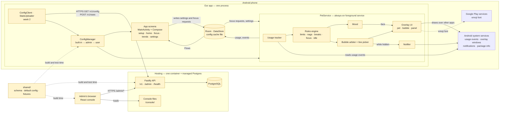
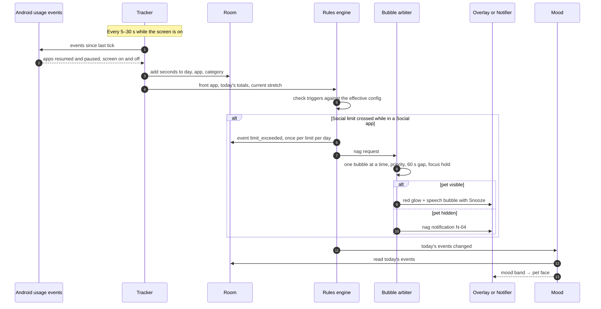
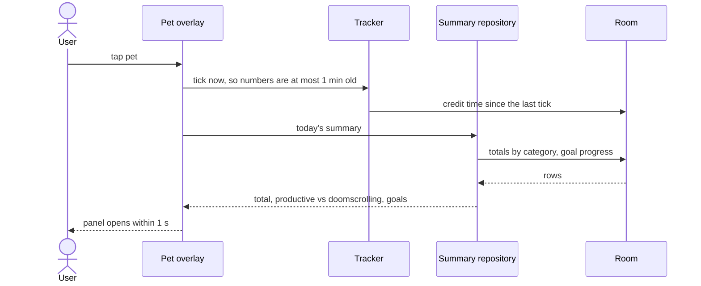
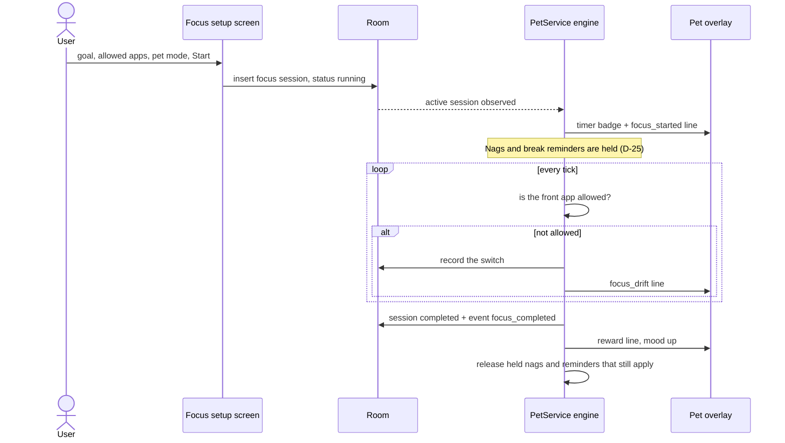
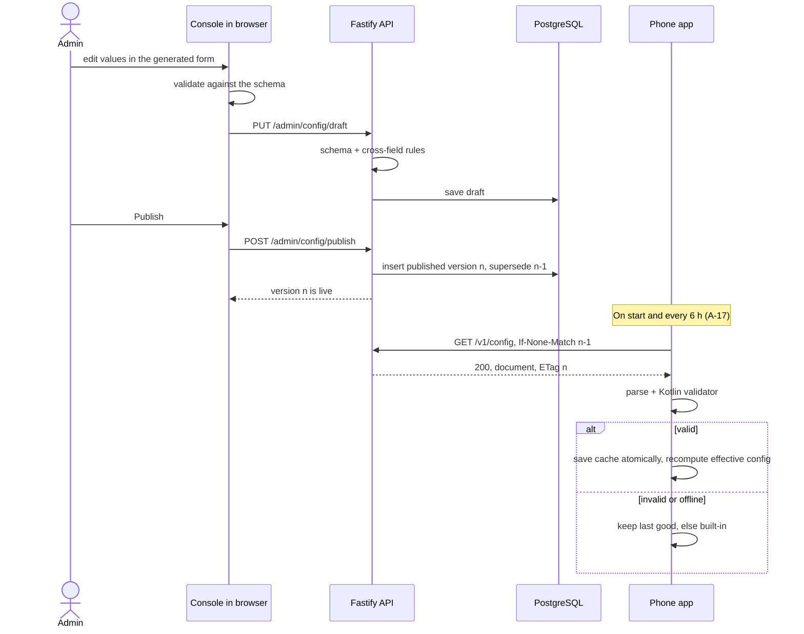
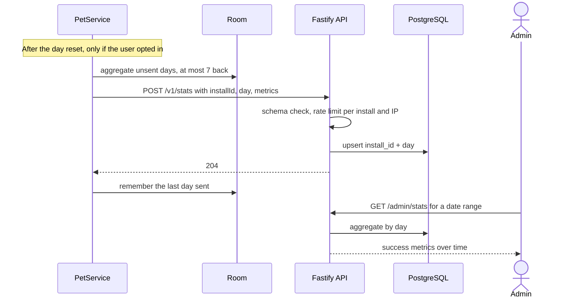
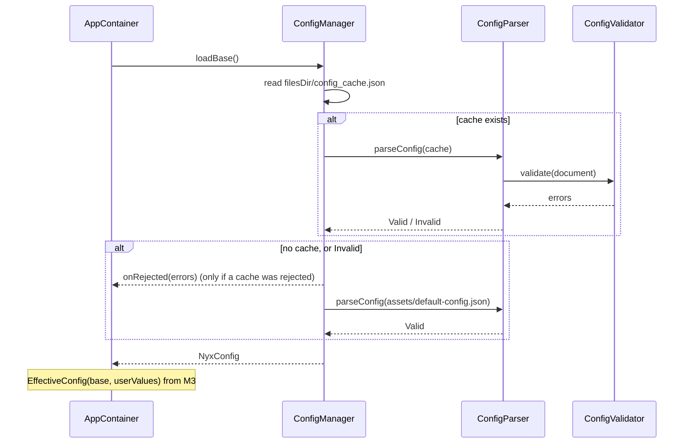

# Architecture — Nyx · v1.0 HLD (approved 2026-10-18)

> Phase 4 output. Read this first if you're new to the repo: after ~10 minutes you should know how data moves through the system and where every piece lives.
> Low-level design (LLD) for each module is added to §14 at the **start** of its milestone, before any code.
> Rule: code and diagrams must agree. A task that changes a component, a flow or a folder updates this file in the same task.
> Last updated: 2026-10-19

---

## 1. System overview

- **What it does:** an emoji pet floats over every app on an Android phone. It watches which apps are used, warns when the user's limits are crossed, nudges breaks, keeps the user company during focus sessions, and its mood reflects the user's habits.
- **Three deployable parts:**
  - **The Android app.** Does all the tracking and reacting, on the phone, offline.
  - **The backend container.** Serves one config document to every phone, receives opt-in anonymous stats, and serves the admin console. Week 2.
  - **A managed PostgreSQL database.** Config versions and stats. Week 2.

| Who / what | Uses the system to… | Talks to |
|---|---|---|
| User (adult, 18+) | See their usage, set limits and goals, run focus sessions | The app only |
| Admin (the developer) | Tune every number, line, pet and switch; read aggregated stats | The web console |
| Android system services | Usage events, overlay windows, notifications, installed-app info | The app |
| Google Play services | Downloadable emoji font (D-40) | The app |
| Hosting platform | Runs the container, HTTPS, managed Postgres, backups | Backend |

---

## 2. Component diagram

Nodes turn green (`:::done`) as each component lands.



---

## 3. The phone app — how it's organised

**Two entry points, one shared container**
- `MainActivity` hosts the app screens (setup, home, focus setup, trends, settings).
- `PetService` is the always-on foreground service. It runs the engine and draws the pet.
- Both get their repositories from one `AppContainer`, created in `PetApp` (the `Application` class). Dependency injection is manual (TECH_STACK §5).

**Screens never call the service** (D-44)
- Screens write what the user wants into storage: settings, "start a focus session", "show the pet again".
- The service observes storage and reacts.
- So the app works the same whether the service is running, restarting or freshly booted. There's no binding or IPC to get wrong.
- Buttons on the overlay (snooze, hide, dismiss) live inside the service and go straight to the engine.

**Nothing important lives only in memory**
- Usage totals, the event log, focus sessions and settings are stored (Room, DataStore).
- After the service restarts, the engine rebuilds today's state from today's totals and events. Mood is always recomputed from the event log (H-03).

**One engine coroutine owns engine state**
- Ticks, overlay button presses and storage changes are all processed one at a time on a single coroutine.
- So there are no race conditions between, say, a snooze tap and a tick.

**Packages** (inside `android/app/src/main/java/com/companionstudio/nyx/`)

| Package | Owns |
|---|---|
| (root) | `PetApp`, `AppContainer`, `MainActivity`, `AppNavigation` |
| `ui/` | Theme, shared composables |
| `data/` | Room database class, DataStore, `DayClock` (day keys, reset hour) |
| `config/` | Config models, validator, built-in loader, layering, cache; `ConfigClient` (week 2) |
| `setup/` | S-01 to S-07 |
| `home/` | S-08 Home, S-10 Trends |
| `settings/` | S-11 Settings |
| `focus/` | S-09 Focus setup, focus sessions (SM-04) |
| `service/` | `PetService`, boot and screen-on/off receivers, notifications (N-01 to N-04) |
| `tracking/` | Usage events → foreground app → per-app/category totals, stretches, app categories |
| `rules/` | Triggers, nags (SM-02), breaks (SM-03), idle lines, bubble arbiter, line picker |
| `mood/` | Mood calculation (SM-01), bands → pet face |
| `pet/` | Overlay windows: pet, speech bubble, summary panel |
| `stats/` | Daily aggregates + uploader (week 2) |

Each feature package holds its own Room entities and DAOs, repository, ViewModels and screens.

---

## 4. The engine (core loop)

**Tick**
- Runs only while the screen is on. A screen-on/off receiver starts and stops it.
- Interval is adaptive (H-01):
  - ~5 s when a limit is close, a nag is active or a focus session is running.
  - ~30 s otherwise.
  - Both numbers are config.
- Each tick:
  1. Read usage events since the last tick (activity resumed/paused, screen on/off).
  2. Work out the foreground app and credit the elapsed seconds to `(day, package, category at that moment)`.
  3. Update the current stretch.
  4. Evaluate triggers in a fixed order against the effective config.
  5. Advance the state machines from `DISCUSSION.md`: SM-01 mood, SM-02 nags, SM-03 breaks, SM-04 focus.
  6. The bubble arbiter picks at most one bubble.
  7. Append events, recompute mood, update the pet face.
- **Not counted** (A-20): the launcher, system UI, and this app.

**Screen off and breaks**
- No timers run while the screen is off.
- On screen-on, the engine compares the off and on timestamps:
  - ≥ 5 min off = a break (D-27): resets stretches and completes a pending break reminder.
- Day reset is detected the same lazy way: the day key is recomputed every tick.

**Meeting the 60-second promise**
- A 30 s slow tick keeps every reaction within 60 s (US-08 NFR).
- Opening the summary panel forces an immediate tick, so its numbers are ≤ 1 min old (US-07).

**Trigger catalog** — the contract between code and the line pools in config (H-02)

| Trigger | Fires when | Bubble | Mood |
|---|---|---|---|
| `limit_reached` | A daily limit (category or total) is crossed while in a covered app | Nag line, red glow | −10, once per limit per day |
| `limit_repeat` | N min later, still in a covered app | Next escalation line | — |
| `stretch_reached` | A continuous stretch limit is crossed | Nag line, red glow | −10, once per stretch limit per day |
| `snoozed` | User taps Snooze on a nag | — | −5 |
| `break_due` | X min of continuous screen-on | Line + notification N-02 | — |
| `break_taken` | Screen off ≥ 5 min after a reminder | Line on return | +5 |
| `doomscroll_10min` | Every 10 min of Social & scrolling | — | −3 |
| `goal_met` | A positive goal is met. Limit goals are judged at the day reset and only shown in trends (CR-05) | Reward line | +10, once per goal per day |
| `focus_started` | Session starts | Line | — |
| `focus_drift` | An app that isn't allowed is in front | Line | — |
| `focus_checkin` | Every X min in check-in mode | Line | — |
| `focus_completed` | Timer done or Done tapped | Reward line | +15 |
| `focus_broken` | A "no switching" goal is broken | Line | — |
| `idle` | ~30 min of screen time with no other bubble (D-26) | Line | — |
| `pet_returned` | Mood rises above 0 after running away | Line | — |

- **During focus:** only `focus_*` bubbles show. Nags, break reminders and rewards are held and fire at the end if they still apply (D-25).
- **While hidden:** nags and break reminders become notifications (N-04, N-02). Other bubbles are skipped (D-24).
- **Lines:** a line is picked at random from the pool for (personality, trigger, mood band), never repeating the last 3. Placeholders such as `{app}`, `{minutes}` and `{limit}` are filled in.

---

## 5. The config document

**One JSON document holds everything the admin can tune** (H-04)
- **Its shape** is defined once in `shared/config.schema.json` (JSON Schema draft-07).
- **The built-in defaults** live in `shared/default-config.json` (D-43). That one file is:
  - copied into the app's assets at build time (the built-in layer), and
  - seeded as the first published config on the server.

**Layering on the phone** (F-09, US-21, US-22, D-45)
1. **Base document:** the last valid admin config if there is one, otherwise the built-in defaults. The admin document replaces the built-in one *as a whole*; there's no deep merge of the two.
2. **User values:** applied per setting, only where the setting is `userEditable`, and clamped into the admin's `min`–`max`.
3. **Narrowed ranges:** if the admin later narrows a range, stored user values are clamped on the next read. The user's stored value isn't overwritten, so widening the range again restores it.

**Every tunable setting has the same shape**

```json
{ "default": 60, "min": 15, "max": 240, "userEditable": true }
```

- A "locked" setting is simply `"userEditable": false`.
- A limit of `0` means "off". By default there's no total daily limit (A-14).

**Outline** (illustrative excerpt; the full schema is designed in M2's LLD)

```json
{
  "schemaVersion": 1,
  "configVersion": 7,
  "features": { "focus": true, "breaks": true, "idleLines": true, "trends": true, "stats": true },
  "day": { "resetHour": { "default": 0, "min": 0, "max": 6, "userEditable": true } },
  "tracking": { "fastTickSeconds": 5, "slowTickSeconds": 30, "doomscrollCategories": ["social"] },
  "limits": {
    "categories": { "social": { "dailyMinutes": { "default": 60, "min": 15, "max": 240, "userEditable": true } } },
    "totalDailyMinutes": { "default": 0, "min": 0, "max": 960, "userEditable": true },
    "stretch": { "minutes": { "default": 30, "min": 10, "max": 120, "userEditable": true }, "categories": ["social", "games"] }
  },
  "nags": { "repeatMinutes": { "default": 10, "min": 5, "max": 30, "userEditable": true },
            "snoozeMinutes": { "default": 10, "min": 5, "max": 30, "userEditable": true },
            "maxSnoozesPerDay": 3 },
  "breaks": { "afterMinutes": { "default": 45, "min": 20, "max": 120, "userEditable": true }, "breakMinutes": 5 },
  "bubbles": { "minGapSeconds": 60, "showSeconds": 8 },
  "idle": { "everyMinutes": 30 },
  "hide": { "minutes": 30 },
  "mood": {
    "start": 70,
    "weights": { "focus_completed": 15, "goal_met": 10, "break_taken": 5,
                 "doomscroll_10min": -3, "limit_exceeded": -10, "snoozed": -5 },
    "bands": [ { "id": "great", "from": 85, "to": 100 }, { "id": "ran_away", "from": 0, "to": 0 } ]
  },
  "pets": [ { "id": "cat", "name": "Cat", "faces": { "great": "😻", "happy": "😸", "ran_away": "🐾" } } ],
  "personalities": [ { "id": "cheerful", "name": "Cheerful coach", "previewLine": "Let's make today a good one!" } ],
  "lines": { "cheerful": { "limit_reached": { "any": ["That's {limit} of {category} today. Stretch break?"] } } },
  "categoryDefaults": { "com.instagram.android": "social" },
  "androidCategoryMap": { "game": "games", "social": "social", "video": "entertainment", "productivity": "productive" }
}
```

**Validation** — the same rules on all three sides (D-39)

| Rule | Example |
|---|---|
| Types and required fields | `default` is a number |
| Ranges | `min ≤ default ≤ max` |
| References exist | every personality in `lines` exists; every pet has a face for every mood band |
| Coverage | mood bands cover 0–100 with no gaps; every personality has at least an `any` line for every trigger in §4 |

Where each side checks:
- **Console:** schema in the browser.
- **Backend:** schema + cross-field rules on save.
- **Phone:** Kotlin validator.

Files in `shared/fixtures/valid/` and `shared/fixtures/invalid/` must be accepted or rejected the same way by the backend and the phone tests.

**Versions**
- `configVersion` is the published version number. It's also the HTTP ETag.
- `schemaVersion` is the shape. It only changes for breaking changes.
  - The app sends the schema version it was built with, and the server returns the latest published document for that schema version.
  - Additive changes don't bump it: the app ignores unknown keys, and new fields have defaults.

---

## 6. Data model (overview)

Full fields, indexes and ERDs are written in each milestone's LLD.

**Phone — Room** (kept ≥ 31 days, older rows deleted at day reset, A-13)

| Table | Holds | Key |
|---|---|---|
| `daily_app_usage` | Seconds per app per day, with the category at the time (US-04) | `(day, package, category)` |
| `events` | Engine event log: limit_exceeded, nag_shown, snoozed, break_due, break_taken, doomscroll_10min, goal_met, focus_*, idle_shown, ran_away… | `id`, index on `day` |
| `focus_sessions` | Goal, allowed apps, pet mode, start/end, outcome, switch count | `id` |
| `app_categories` | Category per package, and whether the user chose it | `package` |

**Phone — DataStore**
- Setup progress and age confirmation.
- Chosen pet and personality.
- User values for user-editable settings, keyed by setting path.
- Idle lines on/off.
- Pet position; `hiddenUntil`.
- Stats: opt-in flag, install ID, last day sent.
  - The install ID is a random UUID created on opt-in and deleted on opt-out.

**Phone — files**
- `config_cache.json`: the last good admin config + its ETag, written atomically.

**Server — PostgreSQL** (week 2)

| Table | Holds | Key |
|---|---|---|
| `config_versions` | Every config document with status `draft`, `published` or `superseded`, and its schema version | `id` = `configVersion`. At most one draft and one published row per schema version |
| `daily_stats` | One row per install per day: app version, Android version, metrics (JSON) | `(install_id, day)`, index on `day`. Rows older than 12 months deleted daily |

- **Admin accounts:** there's no admin table. One admin, credentials in environment variables (A-16, D-38).

---

## 7. API overview (week 2)

**Standard shapes**
- **Success:** the resource itself as JSON (no envelope), or `204 No Content`.
- **Errors:** always

```json
{ "error": { "code": "VALIDATION_FAILED", "message": "Config is invalid", "details": [ { "path": "/limits/stretch/minutes/default", "message": "must be ≤ max" } ] } }
```

- Codes: `VALIDATION_FAILED` (400) · `UNAUTHENTICATED` (401) · `NOT_FOUND` (404) · `CONFLICT` (409) · `RATE_LIMITED` (429) · `INTERNAL` (500).

**Endpoints** (request and response bodies are defined in the M10, M11 and M14 LLDs)

| Method | Path | Who | Purpose |
|---|---|---|---|
| GET | `/health` | Hosting platform | Process up + database reachable |
| GET | `/v1/config?schema=<n>` | Any app, no auth | Latest published config for that schema version. ETag → `304` when unchanged |
| POST | `/v1/stats` | Opted-in apps | One day's aggregates → `204`. Upsert by `(installId, day)`. Rate-limited |
| POST | `/admin/login` | Anyone | → `204` + session cookie. 5 attempts/min/IP |
| POST | `/admin/logout` | Admin | Clears the cookie |
| GET | `/admin/config/published` | Admin | Current live document (to compare with the draft, W-02) |
| GET, PUT | `/admin/config/draft` | Admin | Read / save the draft. Schema + cross-field validation on save |
| POST | `/admin/config/publish` | Admin | Draft becomes the new published version |
| GET | `/admin/stats?from=&to=` | Admin | Aggregated metrics for the success metrics |
| GET | `/console/*` | Admin's browser | Built console files |

Version history + rollback (F-16, Could) reuses `config_versions`; it isn't in v1's milestones.

---

## 8. Data flows

### DF-1 Usage tick → nag (the core loop)



### DF-2 Tap the pet → summary panel



### DF-3 Focus session



### DF-4 Admin publishes → phones apply the new config



### DF-5 Opt-in daily stats



---

## 9. Cross-cutting concerns

**Time and days**
- All day logic goes through one `DayClock`. It uses `java.time` with the device time zone and an injectable clock for tests.
- The **day key** is the local date shifted by the reset hour. With reset 04:00, 03:30 belongs to the previous day.
- Seconds are credited to the day key at the moment they happen. A time-zone change never double-counts (NFR).
- **Day reset:** new totals, mood back to start, nags back to `Under`, snooze count 0, stretches reset.
  - A running focus session continues and belongs to the day it started (A-25).

**Config:** see §5. A bad config never crashes the app (US-21). Invalid documents are ignored and logged.

**Errors**
- **App:** no silent catches. Failures in the engine are logged and the tick continues. Network failures retry at the next 6-hour check.
- **Backend:** one central error handler maps errors to the standard shape (§7). Unknown errors return `INTERNAL` without internal details.

**Logging**
- **App:**
  - Release builds never log which apps the user opens.
  - Debug builds log engine decisions for testing.
  - Crash data comes from Play Console's Android vitals (no crash SDK).
- **Backend:**
  - Fastify's logger writes JSON to stdout with request IDs.
  - Request bodies, passwords, cookies and install IDs are never logged.

**Security** (backend)
- **Admin session:** a signed, `httpOnly`, `Secure`, `SameSite=Strict` cookie, valid 12 h. Rotating `SESSION_SECRET` logs out everywhere.
- **CSRF:**
  - The `SameSite=Strict` cookie.
  - Admin routes accept only `application/json`.
  - No CORS is enabled: the console is served from the same address.
- **Headers:** security headers including a Content Security Policy for the console (helmet).
- **Rate limits** (all behind the host's proxy, with `TRUST_PROXY` on so limits see real client IPs):
  - Login: 5/min/IP.
  - Stats: per install ID and per IP.
- **Database:** queries are always parameterised; the app's DB user has access to its own tables only.
- **HTTPS:** provided by the hosting platform. The release app refuses plain HTTP.

**Security** (app)
- No secrets in the app (A-10).
- Debug builds may talk to the dev backend over plain HTTP on the emulator's host address only.

**Privacy — what ever leaves the phone**
- `GET /v1/config`: no identifiers.
- `POST /v1/stats`: only if opted in; daily aggregates only (A-09).
- Nothing else. The privacy policy and Play's Data safety form must say exactly this (M15).

**Battery** (R-07, A-19)
- No ticks while the screen is off.
- No wake locks, no exact alarms.
- Adaptive tick interval.
- Measured on a real phone in M9.

**UI rules** (target SDK 36)
- Edge-to-edge is always on, so screens handle system bar insets.
- The predictive back gesture is handled by Navigation 3.
- Alerts never rely on colour alone (glow + bubble + optional notification).
- Pet touch target ≥ 48 dp.
- TalkBack and large text work on setup, settings, home and trends.

---

## 10. Android permissions and Play policy

| Permission / declaration | How it's granted | Why | Without it |
|---|---|---|---|
| `PACKAGE_USAGE_STATS` | User, in Settings → Usage access | Know which app is in front and for how long | No tracking; the pet can't react |
| `SYSTEM_ALERT_WINDOW` | User, in Settings → Display over other apps | Draw the pet | The pet can't appear |
| `POST_NOTIFICATIONS` | Runtime prompt (Android 13+) | Persistent notification, break reminders, nags while hidden, permission lost | No reminders outside the overlay |
| `FOREGROUND_SERVICE` + `FOREGROUND_SERVICE_SPECIAL_USE` | Automatic | The always-on service | — |
| `RECEIVE_BOOT_COMPLETED` | Automatic | Bring the pet back after a reboot | Pet returns only when the app is opened |
| `INTERNET` | Automatic | Config fetch, opt-in stats (week 2) | Built-in config only |
| Battery optimisation exemption | User, on the battery settings screen we open | Lower the chance the system stops the service (R-04) | Some brands kill the pet |
| `<queries>` for launcher apps | Manifest declaration, no permission | List the user's apps for categorisation | — |

**Play policy notes**
- **Special-use foreground service:**
  - The manifest describes the use case.
  - The Play Console declaration needs a text justification and a demo video (R-03, M15).
- **Battery exemption:** we open the battery settings list (`ACTION_IGNORE_BATTERY_OPTIMIZATION_SETTINGS`, no permission needed). The one-tap request dialog is reserved for Google's acceptable use cases, which don't clearly include this app.
- **Package visibility:** we declare a `<queries>` entry for apps with a launcher icon instead of the restricted `QUERY_ALL_PACKAGES` permission. The exact behaviour is verified in M3 (R-10).
- **Restart after reboot:** confirmed allowed. Android 15 blocks `BOOT_COMPLETED` from starting only `dataSync`, `camera`, `mediaPlayback`, `phoneCall`, `mediaProjection` and `microphone` services, not `specialUse`.
- **Other restart paths are verified in M4 (R-09):** restart after an app update, and restart after the system kills the process.
  - The fallback is a notification that brings the pet back on tap.
  - Background: since Android 15, holding the overlay permission alone no longer lets an app start a foreground service from the background; a visible overlay window is also needed.
- **Health apps declaration:** "no health features" (D-02).
- **Target audience:** 18+.

---

## 11. Permission matrix (role × action)

| Action | Phone user | Admin (logged in) | Anyone on the internet |
|---|---|---|---|
| Use the app, change user-editable settings within range | ✅ | — | — |
| Change a locked setting or a range | ❌ | ✅ via published config | ❌ |
| `GET /v1/config` | ✅ (the app) | ✅ | ✅ (public, no secrets) |
| `POST /v1/stats` | ✅ only if opted in | — | ✅ but schema-checked, rate-limited, anonymous |
| `POST /admin/login` | — | ✅ | ✅ rate-limited |
| Read / edit the draft, publish | ❌ | ✅ | ❌ (`401`) |
| Read aggregated stats | ❌ | ✅ | ❌ (`401`) |
| See any one person's usage | ❌ — it never leaves their phone | ❌ | ❌ |

Tests: every admin route is checked for `401` without a session (M11).

---

## 12. Config and environments

**Backend environment variables** (mirrored in `backend/.env.example`)

| Variable | Purpose | Example (dev) |
|---|---|---|
| `NODE_ENV` | `development` or `production` | `development` |
| `PORT` | HTTP port | `3000` |
| `DATABASE_URL` | Postgres connection string | `postgres://pet:pet@db:5432/pet` |
| `ADMIN_USERNAME` | Admin login name | `admin` |
| `ADMIN_PASSWORD_HASH` | scrypt hash, generated by `npm run hash-password` | — |
| `SESSION_SECRET` | ≥ 32 random bytes; signs the admin cookie | — |
| `TRUST_PROXY` | `true` behind the host's proxy, so rate limits see real client IPs | `false` |
| `LOG_LEVEL` | Logger level | `info` |

**Android build settings**
- `CONFIG_BASE_URL` per build type:
  - debug → the dev backend (`http://10.0.2.2:3000` from the emulator).
  - release → the production HTTPS address (set in M15).
- `applicationId`: `com.companionstudio.nyx`; app name: Nyx (D-49).

**Environments** (A-27)
- **dev:** laptop running Docker Compose (API + Postgres), the console dev server, and the emulator or a USB-connected phone.
- **prod:** the hosting platform.
- **No staging environment in v1.**
  - Config changes are protected by draft → publish and validation on all three sides.
  - Code is tested locally with the same Docker image that ships.

**Docker topology**
- **Local — `docker-compose.yml`:**
  - `db`: `postgres:18-alpine`, port 5432, volume `pgdata`.
  - `api`: built from `backend/Dockerfile`, port 3000, env from `backend/.env`, starts after `db` is healthy.
  - The console runs separately with `npm run dev` (Vite, port 5173) and proxies `/admin` and `/v1` to port 3000.
- **Production image — `backend/Dockerfile`, multi-stage, build context = repo root** (D-42):
  1. Build the console (`admin/`) into static files.
  2. Copy the backend and the console files into one Node image; the backend serves them at `/console/`.
  - `admin/` therefore has no Dockerfile of its own: it's static files, not a server. This is a deliberate exception to AGENTS.md §4's "own Dockerfile" rule.

---

## 13. Repo map — where to go to change something

| I want to… | Go to |
|---|---|
| Change a number, line, pet, personality or switch for everyone | The admin console → Publish. No code. |
| Add a new setting | `shared/config.schema.json` + `shared/default-config.json` + `android/…/config/` (model, validator) + a fixture in `shared/fixtures/` + the feature package that uses it |
| Change the defaults the app ships with | `shared/default-config.json` |
| Change how usage is counted, categories, stretches | `android/…/tracking/` |
| Change when the pet nags, reminds or talks | `android/…/rules/` |
| Change mood math | `android/…/mood/` (weights and bands are config) |
| Change the pet, bubble or panel | `android/…/pet/` |
| Change focus sessions | `android/…/focus/` |
| Add or change an app screen | `android/…/<feature>/` + `AppNavigation` |
| Change notifications, boot or restart behaviour | `android/…/service/` |
| Change day boundaries or time-zone handling | `android/…/data/DayClock` |
| Add an API endpoint | `backend/src/features/<feature>/<feature>.routes.js` |
| Change admin login or session | `backend/src/features/auth/` + `backend/src/middleware/` |
| Change the database schema | a new `backend/migrations/NNN_<name>.sql` |
| Change a console screen | `admin/src/features/<feature>/` |
| Change seed or test data | `shared/fixtures/` · `backend/seeds/` · Android debug scenarios in `android/app/src/debug/` |
| Change what CI runs | `.github/workflows/android.yml` (Node workflow from M10) |

`android/…` = `android/app/src/main/java/com/companionstudio/nyx/`. The depth is Android's convention; everything below it is one level of feature packages.

**Backend layout**

```text
backend/
├── src/
│   ├── features/
│   │   ├── auth/      ← auth.routes.js, auth.service.js, auth.test.js
│   │   ├── config/    ← config.routes.js, config.service.js, config.model.js, config.validation.js, config.test.js
│   │   ├── stats/     ← stats.routes.js, stats.service.js, stats.model.js, stats.test.js
│   │   └── health/
│   ├── middleware/    ← requireAdmin.js, errorHandler.js
│   ├── lib/           ← db.js, password.js (scrypt), schema.js (loads shared schema)
│   ├── app.js         ← builds the Fastify app (used by tests)
│   └── server.js      ← starts it
├── migrations/        ← 001_init.sql …
├── scripts/           ← migrate.js, hash-password.js
├── seeds/
├── Dockerfile
├── .env.example
└── README.md
```

**Console layout**

```text
admin/
├── src/
│   ├── features/
│   │   ├── login/
│   │   ├── config/    ← W-02 config editor, W-03 pets & lines
│   │   └── stats/     ← W-04
│   ├── api.js
│   ├── App.jsx
│   └── main.jsx
├── index.html
├── vite.config.js
└── README.md
```

---

## 14. Low-level design (per milestone)

Written at the start of each milestone, before code.

| Module | Milestone | LLD status |
|---|---|---|
| Project setup | M0 | not needed |
| App shell, storage, DayClock | M1 | done 2026-10-19 (§14.1) |
| Config: schema, defaults, validator, layering | M2 | written 2026-10-19, awaiting approval (§14.2) |
| Setup flow + app categories | M3 | pending |
| PetService + usage tracking | M4 | pending |
| Overlay: pet, bubble, panel, hide | M5 | pending |
| Lines, bubble arbiter, mood | M6 | pending |
| Limits, nags, breaks, idle lines | M7 | pending |
| Focus sessions | M8 | pending |
| Backend foundation + config API | M10 | pending |
| Admin auth + console | M11 | pending |
| App remote config | M12 | pending |
| Trends + positive goals | M13 | pending |
| Opt-in stats | M14 | pending |

### 14.1 M1 — App shell, storage, DayClock

**Purpose:** the skeleton every later milestone plugs into: the `Application` class, the manual DI container, navigation with predictive back, the theme, the day-key clock, and Home (S-08) fed from a fake repository. Story: US-28 (screen shell only).

**Storage scope (D-50, approved 2026-10-19)**
- Room refuses a database with no tables: a probe on 2026-10-19 failed with `@Database annotation must specify list of entities`. So the roadmap's "empty schema" can't be built.
- **Decision:**
  - `AppDatabase` is created in M3 together with its first real table (`app_categories`, filled by S-05). M4 adds `daily_app_usage` and `events`.
  - DataStore is created in M3 together with its first keys (setup progress, age check).
  - M1 records the policies below so M3 just follows them.
- **Alternatives:**
  - A placeholder entity now. Rejected: a table that exists only to make Room compile, and has to be removed later.
  - Pull `app_categories` forward into M1. Rejected: it designs M3's data before M3's LLD.

**Room policy** (applied when M3 creates `AppDatabase`)
- One `AppDatabase` in `data/`. Entities and DAOs live in their feature packages (§3).
- `exportSchema = true`. The schema JSON goes in `android/app/schemas/` (KSP argument `room.schemaLocation`) and is committed, so every schema change shows up in review.
- **Until the first Play release (M15):**
  - Every schema change bumps `version`.
  - **Debug** builds call `fallbackToDestructiveMigration(dropAllTables = true)`, so a changed schema wipes local data instead of crashing.
  - **Release** builds never use the destructive fallback.
- **From `v1.0.0` on:** every schema change ships a `Migration` (or `AutoMigration`) plus a migration test. `room-testing` goes through dependency approval at that point.
- Day keys are stored as ISO dates (`"2026-10-19"`): readable in the database inspector and they sort correctly. Confirmed in M4's LLD, where the first day-keyed table arrives.

**DataStore policy** (applied when M3 creates it)
- One Preferences DataStore named `settings`, created once in `AppContainer` (a second instance on the same file throws).
- Each feature owns its keys in a small `…Settings` class in its package. No global keys file.

**Files** (`android/app/src/main/java/com/companionstudio/nyx/`)

| File | Responsibility |
|---|---|
| `PetApp.kt` | `Application` class; creates `AppContainer` once in `onCreate`. Set in the manifest |
| `AppContainer.kt` | Manual DI: holds `DayClock` and `SummaryRepository` (the fake one until M4) |
| `MainActivity.kt` | `enableEdgeToEdge()`, `NyxTheme`, `AppNavigation()`. Nothing else |
| `AppNavigation.kt` | Navigation 3: `@Serializable` `NavKey` objects, back stack, `NavDisplay` |
| `ui/theme/` | Theme from the wizard, kept as is (Material 3, dynamic colour on Android 12+). Unused imports and commented-out boilerplate removed |
| `ui/PlaceholderScreen.kt` | "Not built yet" screen for destinations whose milestone hasn't happened yet |
| `data/DayClock.kt` | Day keys (below) |
| `home/TodaySummary.kt` | Data shown on Home: `TodaySummary`, `GoalProgress` |
| `home/SummaryRepository.kt` | `interface SummaryRepository { fun observeToday(): Flow<TodaySummary> }` |
| `home/FakeSummaryRepository.kt` | Fixed fake numbers. Replaced by the real repository in M4, which is the only change Home needs |
| `home/HomeViewModel.kt` | Turns the repository flow into `StateFlow<TodaySummary?>` (`null` = loading) |
| `home/HomeScreen.kt` | Stateless `HomeScreen(summary, onFocus, onTrends, onSettings)` + a route composable that wires in the ViewModel |
| `home/DurationFormat.kt` | Seconds → "1 h 25 min" / "12 min" / "0 min". Also used by the summary panel in M5 |

**Navigation**
- Keys: `Home`, `FocusSetup`, `Trends`, `Settings` (`data object`s implementing `NavKey`, `@Serializable`).
- The back stack is `rememberNavBackStack(Home)`, so it survives rotation and process death. This needs the Kotlin serialization plugin, which is already in the register; M1 applies it.
- `FocusSetup` (M8), `Trends` (M13) and `Settings` (M7) show `PlaceholderScreen` until their milestones replace them. That gives the back gesture something to go back from in M1.
- Back: `NavDisplay(onBack = { backStack.removeLastOrNull() })`. Predictive-back animation comes from `navigation3-ui`. Back on Home leaves the app (system default).
- Setup gating (Home vs S-01) isn't in M1 (→ M3). The app always opens on Home for now.
- **Heads-up, not needed in M1:** a ViewModel created inside a Navigation 3 entry is scoped to the Activity unless `androidx.lifecycle:lifecycle-viewmodel-navigation3` is added. That's fine for Home, the root screen. M3 (setup screens with their own ViewModels) will ask to add it, or explain why it isn't needed.

**DayClock**

```kotlin
class DayClock(
    private val clock: Clock = Clock.systemUTC(),            // where "now" comes from; fixed in tests
    private val zone: () -> ZoneId = ZoneId::systemDefault,  // read on every call
) {
    fun dayKeyAt(instant: Instant, resetHour: Int): LocalDate
    fun today(resetHour: Int): LocalDate = dayKeyAt(clock.instant(), resetHour)
}
```

- **Rule:** `dayKey = LocalDateTime.ofInstant(instant, zone()).minusHours(resetHour).toLocalDate()`. Wall-clock based: with reset 04:00, 03:30 belongs to the previous day; 04:00:00 starts the new one.
- **Why the zone is a function and not the `Clock`'s zone:** `Clock.systemDefaultZone()` fixes the zone when it's created. Android updates the process default time zone when the user changes it, so reading `ZoneId.systemDefault()` on every call follows the change.
- **Why `resetHour` is a parameter:** the reset hour comes from config (M2) and user settings (M3). Passing it in keeps `DayClock` free of dependencies and trivial to test.
- `require(resetHour in 0..23)`. Config limits it to 0–6 (§5). This check only catches programming errors.
- `nextResetAt()` and anything else the day reset needs arrive in M4 together with the code that uses them.

**Home (S-08) data**

```kotlin
data class TodaySummary(
    val totalSeconds: Long,
    val productiveSeconds: Long,
    val doomscrollSeconds: Long,
    val goals: List<GoalProgress>,
    val petFace: String,     // emoji for the current mood band; comes from config + mood in M6
)
data class GoalProgress(val label: String, val usedSeconds: Long, val targetSeconds: Long)
```

- **Fake values:** 3 h 12 min total, 1 h 05 min productive, 47 min doomscrolling. Goals: "Social ≤ 60 min" at 47 of 60 and "Games ≤ 30 min" at 35 of 30 (over). Face 😸.
- **Screen:**
  - Face, total, productive vs doomscrolling, and one row per goal (text + progress bar).
  - An over-limit goal says "over" in words, not just in colour (§9).
  - Buttons: Start focus, Trends, Settings.
  - Content scrolls, and handles insets through `Scaffold`, so large text works.
  - Strings live in `strings.xml`.
- **States:** loading (`null`) shows a progress indicator. There's no error state: the fake can't fail, and the real repository (M4) reads local Room, so an empty day is all zeros.

**Tests**

| Test | Where | Checks |
|---|---|---|
| `DayClockTest` | `src/test/` | Reset 0: 23:59:59 vs 00:00:00 · reset 4: 03:59 → previous day, 04:00 → same day · time-zone change: the same instant gives the new zone's day once the zone provider switches (Asia/Kolkata → America/New_York) · DST-free zones (Asia/Kolkata, UTC) across a reset · one DST zone (Europe/London, spring-forward day) to show wall-clock behaviour · resetHour outside 0–23 is rejected |
| `DurationFormatTest` | `src/test/` | 0, 59 s, 60 s, 3599 s, 3600 s, 11 520 s |
| `HomeViewModelTest` | `src/test/` | Emits `null`, then the repository's summary (coroutines-test, `Dispatchers.setMain`) |
| `US28_HomeScreenTest` | `src/androidTest/` | Fake summary → face, total, goals and the "over" label are shown; buttons call their callbacks |
| `US28_NavigationTest` | `src/androidTest/` | Launch `MainActivity` → Home · tap Settings → placeholder · back (through `onBackPressedDispatcher`) → Home |

- The wizard's `ExampleUnitTest` and `ExampleInstrumentedTest` are deleted.
- Coverage: `DayClock` ≥ 90% (ROADMAP §2).

**Not in M1:** Room and DataStore instances (→ M3, D-50), setup gating (→ M3), real data (→ M4), config-driven faces and reset hour (→ M2, M6).

### 14.2 M2 — Config: schema, defaults, validator, layering

**Purpose:** the app can always produce a valid config: the last good admin document if there is one, otherwise the built-in defaults, with the user's own values layered on top. Nothing here fetches from a server (→ M12) or stores user values (→ M3). Stories: US-21, US-22, US-05 (data side).

**The document** (`shared/config.schema.json`, `schemaVersion` 1)
- The Kotlin models below *are* the full shape. The schema says the same thing in JSON Schema draft-07, plus the number bounds in the table further down.
- Every field is required. A missing field is a validation error, not a silent default.
- Unknown keys are allowed on every side (D-52). The schema doesn't set `additionalProperties: false`; the phone parses with `ignoreUnknownKeys = true`. This is what lets an additive change leave `schemaVersion` alone.

```kotlin
@Serializable data class NyxConfig(
    val schemaVersion: Int,                    // must equal SCHEMA_VERSION (1) for this build
    val configVersion: Int,                    // ≥ 1; the built-in document is 1
    val features: Features,
    val day: DayConfig,
    val tracking: TrackingConfig,
    val limits: LimitsConfig,
    val nags: NagsConfig,
    val breaks: BreaksConfig,
    val focus: FocusConfig,
    val bubbles: BubblesConfig,
    val idle: IdleConfig,
    val hide: HideConfig,
    val mood: MoodConfig,
    val pets: List<Pet>,
    val personalities: List<Personality>,
    val lines: Map<String, Map<String, Map<String, List<String>>>>, // personality → trigger → band id or "any" → lines
    val categoryDefaults: Map<String, Category>,   // package name → category (US-04)
    val androidCategoryMap: Map<String, Category>, // Android's app category name → ours; mapping rules in M3's LLD
)

@Serializable data class Setting(val default: Int, val min: Int, val max: Int, val userEditable: Boolean)

@Serializable data class Features(val focus: Boolean, val breaks: Boolean, val idleLines: Boolean, val trends: Boolean, val stats: Boolean)
@Serializable data class DayConfig(val resetHour: Setting)
@Serializable data class TrackingConfig(val fastTickSeconds: Int, val slowTickSeconds: Int, val doomscrollCategories: List<Category>)
@Serializable data class LimitsConfig(val categories: Map<Category, CategoryLimit>, val totalDailyMinutes: Setting, val stretch: StretchLimit)
@Serializable data class CategoryLimit(val dailyMinutes: Setting)
@Serializable data class StretchLimit(val minutes: Setting, val categories: List<Category>)
@Serializable data class NagsConfig(val repeatMinutes: Setting, val snoozeMinutes: Setting, val maxSnoozesPerDay: Int)
@Serializable data class BreaksConfig(val afterMinutes: Setting, val breakMinutes: Int, val repeatMinutes: Int)
@Serializable data class FocusConfig(val durationMinutes: Setting, val checkinMinutes: Setting)
@Serializable data class BubblesConfig(val minGapSeconds: Int, val showSeconds: Int)
@Serializable data class IdleConfig(val everyMinutes: Int)
@Serializable data class HideConfig(val minutes: Int)
@Serializable data class MoodConfig(val start: Int, val weights: MoodWeights, val bands: List<MoodBand>)
@Serializable data class MoodWeights(
    @SerialName("focus_completed") val focusCompleted: Int,
    @SerialName("goal_met") val goalMet: Int,
    @SerialName("break_taken") val breakTaken: Int,
    @SerialName("doomscroll_10min") val doomscroll10Min: Int,
    @SerialName("limit_exceeded") val limitExceeded: Int,
    @SerialName("snoozed") val snoozed: Int,
)
@Serializable data class MoodBand(val id: String, val from: Int, val to: Int)
@Serializable data class Pet(val id: String, val name: String, val enabled: Boolean, val faces: Map<String, String>) // band id → emoji
@Serializable data class Personality(val id: String, val name: String, val enabled: Boolean, val previewLine: String)

@Serializable enum class Category {
    @SerialName("social") SOCIAL, @SerialName("games") GAMES, @SerialName("entertainment") ENTERTAINMENT,
    @SerialName("productive") PRODUCTIVE, @SerialName("neutral") NEUTRAL,
}
```

- **What each block is for** (and which milestone first reads it):

| Block | Used for | Read from |
|---|---|---|
| `day.resetHour` | `DayClock` reset hour | M3 settings, M4 |
| `tracking` | Tick intervals (H-01); which categories count as doomscrolling | M4 |
| `limits` | Daily limits per category and in total (0 = off); stretch limit and the categories it covers. A category with no entry has no limit and can't get one (A-14) | M7 |
| `nags` | SM-02 repeat interval, snooze length, max snoozes per day | M7 |
| `breaks` | SM-03: remind after X min on screen; screen off ≥ `breakMinutes` = a break (D-27, also resets stretches); remind again every `repeatMinutes` | M4, M7 |
| `focus` | S-09 duration and check-in sliders (default + range) | M8 |
| `bubbles` | Gap between bubbles; how long one stays up | M6 |
| `idle`, `hide` | Idle line interval (D-26); hide duration (D-24) | M7, M5 |
| `mood` | Start value, weights and bands (SM-01). The bands are pure data: "ran away" is mood 0 in code (SM-01), not a special band id | M6 |
| `pets`, `personalities`, `lines` | S-04 choices and the line pools. `enabled = false` hides an item from new picks (US-20) | M3, M6 |
| `categoryDefaults`, `androidCategoryMap` | Suggested categories (US-04) | M3 |

- **Categories are fixed** (D-51): `social` (Social & scrolling), `games`, `entertainment`, `productive`, `neutral`. They're an enum in the schema and in Kotlin; Home's "productive vs doomscrolling" depends on what they mean. Adding a category is a breaking change and bumps `schemaVersion`. Display names live in `strings.xml`.
- **Positive goals** (US-17, M13) aren't in v1 of the document. They arrive as an additive block with a Kotlin default, so `schemaVersion` stays 1.

**Bubble triggers** — the trigger catalog (§4) entries that show a bubble, as `BubbleTrigger` in `config/`:
`limit_reached`, `limit_repeat`, `stretch_reached`, `break_due`, `break_taken`, `goal_met`, `focus_started`, `focus_drift`, `focus_checkin`, `focus_completed`, `focus_broken`, `idle`, `pet_returned`.
- `snoozed` and `doomscroll_10min` only move mood, so they have no line pool.
- `goal_met` is required now even though positive goals come in week 2. It keeps the coverage rule simple, and costs a few lines of text.
- **Pool lookup** (implemented in M6): the band pool if it exists and isn't empty, otherwise `any`. Which placeholders (`{app}`, `{minutes}`, `{limit}`, `{category}`) each trigger may use is designed in M6's LLD, together with a validator rule for it.

**Validation rules**
- Every error carries a rule ID, a JSON path and a message: `ConfigError(rule = "setting-range", path = "nags.snoozeMinutes", message = "default 40 is above max 30")`.
- The validator returns every error it finds, not just the first. The console shows them all (US-19).
- Rule `schema` is everything JSON Schema can express. The other rules are cross-field and live in code on both the phone and the backend (§5).

| Rule ID | Rejects |
|---|---|
| `schema` | Not JSON · a required field missing · wrong type (`"sixty"`, `60.5`, `null`) · an unknown category · `schemaVersion` ≠ 1 · a number outside its bounds (table below) · an id not matching `^[a-z0-9_]+$` · an empty name, face, preview line or line |
| `setting-range` | A setting where `min ≤ default ≤ max` doesn't hold |
| `tick-order` | `fastTickSeconds` > `slowTickSeconds` |
| `duplicate-id` | Two pets, two personalities or two mood bands with the same id |
| `mood-bands-coverage` | Mood bands that leave a gap or overlap in 0–100, or a band with `from` > `to` |
| `pet-faces` | A pet with no face for some mood band |
| `line-references` | Lines for a personality that doesn't exist; a pool key that's neither `any` nor a band id |
| `line-coverage` | A personality without a non-empty `any` pool for every bubble trigger |
| `nothing-enabled` | No enabled pet, or no enabled personality |

- **Ignored on purpose:** unknown keys anywhere, including unknown trigger names in `lines` and unknown band ids in `faces` (D-52). A newer config may carry pools for triggers an older app doesn't know yet.

**Number bounds** (the `schema` rule; for a `Setting`, `default`, `min` and `max` all have to be inside them)

| Field | Bounds |
|---|---|
| `configVersion` | ≥ 1 |
| `day.resetHour` | 0–23 (`DayClock`'s own limit; the default document allows 0–6) |
| `tracking.fastTickSeconds`, `tracking.slowTickSeconds` | 1–60 (the 60-second promise, §4) |
| `limits.categories.*.dailyMinutes`, `limits.totalDailyMinutes` | 0–1440 (0 = off) |
| `limits.stretch.minutes`, `breaks.afterMinutes`, `focus.durationMinutes`, `idle.everyMinutes`, `hide.minutes` | 1–1440 |
| `nags.repeatMinutes`, `nags.snoozeMinutes`, `breaks.repeatMinutes`, `focus.checkinMinutes` | 1–240 |
| `nags.maxSnoozesPerDay` | 0–100 |
| `breaks.breakMinutes` | 1–60 |
| `bubbles.minGapSeconds` · `bubbles.showSeconds` | 0–3600 · 1–60 |
| `mood.start`, `mood.bands[].from`, `mood.bands[].to` | 0–100 |
| `mood.weights.*` | −100 to 100 |

**Fixtures** (`shared/fixtures/`, D-53)
- Each invalid file is a full document with exactly one thing broken. It's named `<rule-id>--<what>.json`, e.g. `setting-range--default-above-max.json`, `schema--not-json.json`.
- The phone test checks each invalid file is rejected **with that rule ID**, not just rejected. The backend test (M10) does the same, so both sides agree on *why* as well as *whether*.
- The invalid set: one file per rule, and for `schema` one per bullet above (not JSON, missing field, wrong type, unknown category, wrong schema version, out of bounds, bad id, blank line). `mood-bands-coverage` has a `--gap` and an `--overlap` file.
- **Valid:** `minimal.json` (one pet, one personality, two bands `0–0` and `1–100`, `any` pools only), `band-pools.json` (band-specific pools next to `any`), `unknown-keys.json` (extra keys at several levels, including an unknown trigger in `lines`).
- `shared/default-config.json` is tested directly, not copied into `fixtures/valid/`.
- The fixtures are written by hand from `minimal.json`; no generator script is committed.

**Default document** (`shared/default-config.json`, configVersion 1) — placeholder numbers, tuned later from the console
- Limits (A-14): Social & scrolling 60 min (range 0–240), Games 120 (0–480), Entertainment 120 (0–480); no entry for Productive or Neutral. Total daily 0 = off (0–960). Stretch 30 min (10–120) on Social and Games. All user-editable.
- Nags: repeat 10 (5–30) and snooze 10 (5–30), user-editable; max 3 snoozes a day, admin only (D-16).
- Breaks: remind after 45 min (20–120), user-editable; a break is ≥ 5 min off (D-27); remind again every 10 min.
- Focus: duration 25 min (5–180), check-in every 10 min (5–30).
- Day reset hour 0 (0–6). Ticks 5 s / 30 s. Doomscrolling = Social. Bubbles: 60 s gap, 8 s on screen. Idle every 30 min. Hide 30 min. All features on.
- Mood (A-24): start 70; weights +15 / +10 / +5 / −3 / −10 / −5; the 8 bands and the Cat and Blob faces of SM-01 (`great`, `happy`, `ok`, `meh`, `grumpy`, `sad`, `sick`, `ran_away`).
- Personalities (A-28): `cheerful` "Cheerful coach" and `calm` "Calm friend". At least 4 `any` lines per bubble trigger (so "never repeat the last 3" has room), plus a few band pools for `idle` to show the mechanism. All text English.
- `categoryDefaults`: about 20 well-known packages (Instagram, TikTok, YouTube, Netflix, WhatsApp…). `androidCategoryMap`: Android's game, social, video, audio, image, news, maps and productivity categories.

**Layering** — base document → user values (§5, D-45)
- **Base:** `ConfigManager.loadBase()`:
  1. `filesDir/config_cache.json` exists, parses, validates and has `schemaVersion` 1 → use it.
  2. Otherwise → the built-in document from assets. A rejected cache is reported through `onRejected(errors)`, which `AppContainer` sends to `Log.w` with rule IDs and paths only.
  - Nothing writes the cache until M12. The cache file is the raw document; its ETag is `configVersion`, so no wrapper is needed (M12 confirms).
  - The built-in document can't be invalid at runtime: `DefaultConfigTest` fails the build first. If it ever is, `loadBase()` throws with the errors. That's a broken build, not a broken server, so US-21's "never crash" isn't what applies.
- **User values:** a plain `Map<String, Int>` from setting path to stored value. M3 stores them in DataStore, one `intPreferencesKey` per path, named `config.<path>` (e.g. `config.nags.snoozeMinutes`), in a `ConfigUserValues` class in `config/`.
- **Effective value** of a setting:

```kotlin
fun Setting.resolve(userValue: Int?): Int =
    if (!userEditable || userValue == null) default else userValue.coerceIn(min, max)
```

  - Locked → always the admin default; the stored value is ignored but kept.
  - Range narrowed → clamped on every read; the stored value isn't rewritten, so widening the range brings it back (§5).
- **`EffectiveConfig(document, userValues)`** is what the rest of the app reads:
  - `settings: Map<String, Setting>` — every tunable setting by path, in display order. S-06 and S-11 build their sliders and read-only rows from it.
  - `valueOf(path): Int?` — the effective value; `null` when the document has no such setting (e.g. a Productive limit).
  - Paths: `day.resetHour`, `limits.categories.<category>.dailyMinutes`, `limits.totalDailyMinutes`, `limits.stretch.minutes`, `nags.repeatMinutes`, `nags.snoozeMinutes`, `breaks.afterMinutes`, `focus.durationMinutes`, `focus.checkinMinutes`. Kept as constants in `SettingPaths`, so call sites never spell them by hand.
- Turning `EffectiveConfig` into a `StateFlow` that follows DataStore arrives in M3 with the first user value. In M2, `AppContainer` exposes `configManager` only.



**Files**

| File | Responsibility |
|---|---|
| `shared/config.schema.json` | JSON Schema draft-07 for the document above, with the bounds table |
| `shared/default-config.json` | The built-in defaults |
| `shared/fixtures/valid/`, `invalid/` | As above |
| `config/NyxConfig.kt` | The `@Serializable` models, `Setting`, `Category`, `SCHEMA_VERSION` |
| `config/BubbleTrigger.kt` | The bubble triggers and their JSON names |
| `config/ConfigParser.kt` | `parseConfig(json): ConfigResult` (`Valid(config)` / `Invalid(errors)`) and `ConfigError`. A kotlinx `SerializationException` becomes a `schema` error; it's never swallowed |
| `config/ConfigValidator.kt` | `validate(config): List<ConfigError>`: bounds, then the cross-field rules |
| `config/EffectiveConfig.kt` | `Setting.resolve`, `EffectiveConfig`, `SettingPaths` |
| `config/ConfigManager.kt` | `loadBase()`: cache or built-in. Takes `readBuiltIn: () -> String`, `cacheFile: File`, `onRejected` |
| `AppContainer.kt`, `PetApp.kt` | `AppContainer(context)` builds `ConfigManager` from assets and `filesDir` |
| `android/app/build.gradle.kts` | Copy task + unit-test system property (below) |

- If `NyxConfig.kt` or `ConfigValidator.kt` passes ~250 lines, it's split by block (AGENTS §4).

**Build**
- A small `CopyDefaultConfig` task (`@InputFile` → `@OutputDirectory`) copies `shared/default-config.json` into a generated assets folder. It's wired with `androidComponents.onVariants { it.sources.assets?.addGeneratedSourceDirectory(task, CopyDefaultConfig::outputDir) }` (checked against `gradle-api` 9.4.1: `Sources.getAssets(): SourceDirectories.Layered`, `addGeneratedSourceDirectory(TaskProvider, (Task) -> DirectoryProperty)`).
  - So only that one file reaches the APK. The schema and fixtures stay out.
  - A changed `default-config.json` triggers a rebuild; nothing is committed under `android/`.
- Unit tests get the path to `shared/` as the system property `nyx.sharedDir`, set in `testOptions.unitTests.all`. Tests never guess relative paths.

**Tests**

| Test | Where | Checks |
|---|---|---|
| `US21_ConfigFixturesTest` | `src/test/` | Every `valid/` file is accepted · every `invalid/` file is rejected with the rule ID from its file name · the fixture folders aren't empty (a wrong path can't make the test pass) |
| `US21_DefaultConfigTest` | `src/test/` | `shared/default-config.json` is valid · ≥ 2 enabled personalities · Cat and Blob both present and enabled |
| `ConfigValidatorTest` | `src/test/` | What fixtures don't show well: several errors reported at once, with the right paths · `nothing-enabled` for personalities as well as pets · bounds at exactly the edges pass |
| `US22_EffectiveConfigTest` | `src/test/` | No user value → default · user value inside range → used · outside range → clamped · range narrowed → clamped, and the stored value is unchanged · widened again → restored · locked → default · `valueOf` for a missing setting → `null` · `settings` lists every path in `SettingPaths` |
| `US21_ConfigManagerTest` | `src/test/` | No cache → built-in · valid cache → cache · invalid cache → built-in and `onRejected` called with the rule IDs · not-JSON cache → built-in · cache with `schemaVersion` 2 → built-in · invalid built-in → throws (uses `TemporaryFolder`) |
| `US21_BuiltInConfigTest` | `src/androidTest/` | On a device, `AppContainer`'s `ConfigManager` loads the asset and gets `configVersion` 1, which proves the Gradle copy works |

- Coverage: ≥ 90% on `config/` (ROADMAP §2).
- **Check during the build:** kotlinx.serialization may accept a quoted number (`"60"`) for an `Int`, while JSON Schema rejects it. That would break D-39 parity. The `schema--wrong-type` fixture uses `"sixty"`; a quoted-number case is tried as a unit test. If kotlinx accepts it, the build stops for a decision (AGENTS §1); no pre-parse gets added quietly.

**Not in M2:** fetching and writing the cache (→ M12), storing user values and the config `StateFlow` (→ M3), reading any of these values in features (→ M3 onwards), line placeholders and pool lookup (→ M6), positive goals (→ M13).
