# Architecture — Nyx · v1.0 HLD (approved 2026-10-18)

> Phase 4 output. Read this first if you're new to the repo: after ~10 minutes you should know how data moves through the system and where every piece lives.
> Low-level design (LLD) for each module is added to §14 at the **start** of its milestone, before any code.
> Rule: code and diagrams must agree. A task that changes a component, a flow or a folder updates this file in the same task.
> Last updated: 2026-10-22 (M8 LLD §14.8)

---

## 1. System overview

- **What it does:** an emoji pet floats over every app on an Android phone. It watches which apps are used, warns when the user's limits are crossed, nudges breaks, keeps the user company during focus sessions, and its mood reflects the user's habits.
- **Three deployable parts:**
  - **The Android app.** Does all the tracking and reacting, on the phone, offline.
  - **The backend container.** Serves one config document to every phone, receives opt-in anonymous stats, and serves the admin console. Week 2.
  - **A managed PostgreSQL database.** Config versions and stats. Week 2.

| Who / what | Uses the system to… | Talks to |
|---|---|---|
| User (adult, 18+) | See their usage, set limits and goals, run focus sessions | The app only |
| Admin (the developer) | Tune every number, line, pet and switch; read aggregated stats | The web console |
| Android system services | Usage events, overlay windows, notifications, installed-app info | The app |
| Google Play services | Downloadable emoji font (D-40) | The app |
| Hosting platform | Runs the container, HTTPS, managed Postgres, backups | Backend |

---

## 2. Component diagram

Nodes turn green (`:::done`) as each component lands.

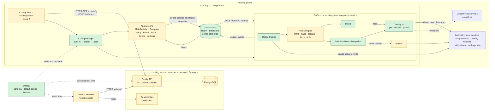

---

## 3. The phone app — how it's organised

**Two entry points, one shared container**
- `MainActivity` hosts the app screens (setup, home, focus setup, trends, settings).
- `PetService` is the always-on foreground service. It runs the engine and draws the pet.
- Both get their repositories from one `AppContainer`, created in `PetApp` (the `Application` class). Dependency injection is manual (TECH_STACK §5).

**Screens never call the service** (D-44)
- Screens write what the user wants into storage: settings, "start a focus session", "show the pet again".
- The service observes storage and reacts.
- So the app works the same whether the service is running, restarting or freshly booted. There's no binding or IPC to get wrong.
- Buttons on the overlay (snooze, hide, dismiss) live inside the service and go straight to the engine.

**Nothing important lives only in memory**
- Usage totals, the event log, focus sessions and settings are stored (Room, DataStore).
- After the service restarts, the engine rebuilds today's state from today's totals and events. Mood is always recomputed from the event log (H-03).

**One engine coroutine owns engine state**
- Ticks, overlay button presses and storage changes are all processed one at a time on a single coroutine.
- So there are no race conditions between, say, a snooze tap and a tick.

**Packages** (inside `android/app/src/main/java/com/companionstudio/nyx/`)

| Package | Owns |
|---|---|
| (root) | `PetApp`, `AppContainer`, `MainActivity`, `AppNavigation` |
| `ui/` | Theme, shared composables |
| `data/` | Room database class, DataStore, `DayClock` (day keys, reset hour) |
| `config/` | Config models, validator, built-in loader, layering, cache; `ConfigClient` (week 2) |
| `setup/` | S-01 to S-07 |
| `home/` | S-08 Home, S-10 Trends |
| `settings/` | S-11 Settings |
| `focus/` | S-09 Focus setup, focus sessions (SM-04) |
| `service/` | `PetService`, boot and screen-on/off receivers, notifications (N-01 to N-04) |
| `tracking/` | Usage events → foreground app → per-app/category totals, stretches, app categories |
| `rules/` | Triggers, nags (SM-02), breaks (SM-03), idle lines, bubble arbiter, line picker |
| `mood/` | Mood calculation (SM-01), bands → pet face |
| `pet/` | Overlay windows: pet, speech bubble, summary panel |
| `stats/` | Daily aggregates + uploader (week 2) |

Each feature package holds its own Room entities and DAOs, repository, ViewModels and screens.

---

## 4. The engine (core loop)

**Tick**
- Runs only while the screen is on. A screen-on/off receiver starts and stops it.
- Interval is adaptive (H-01):
  - ~5 s when a limit is close, a nag is active or a focus session is running.
  - ~30 s otherwise.
  - Both numbers are config.
- Each tick:
  1. Read usage events since the last tick (activity resumed/paused, screen on/off).
  2. Work out the foreground app and credit the elapsed seconds to `(day, package, category at that moment)`.
  3. Update the current stretch.
  4. Evaluate triggers in a fixed order against the effective config.
  5. Advance the state machines from `DISCUSSION.md`: SM-01 mood, SM-02 nags, SM-03 breaks, SM-04 focus.
  6. The bubble arbiter picks at most one bubble.
  7. Append events, recompute mood, update the pet face.
- **Not counted** (A-20): the launcher, system UI, and this app.

**Screen off and breaks**
- No timers run while the screen is off.
- On screen-on, the engine compares the off and on timestamps:
  - ≥ 5 min off = a break (D-27): resets stretches and completes a pending break reminder.
- Day reset is detected the same lazy way: the day key is recomputed every tick.

**Meeting the 60-second promise**
- A 30 s slow tick keeps every reaction within 60 s (US-08 NFR).
- Opening the summary panel forces an immediate tick, so its numbers are ≤ 1 min old (US-07).

**Trigger catalog** — the contract between code and the line pools in config (H-02)

| Trigger | Fires when | Bubble | Mood |
|---|---|---|---|
| `limit_reached` | A daily limit (category or total) is crossed while in a covered app | Nag line, red glow | −10, once per limit per day |
| `limit_repeat` | N min later, still in a covered app | Next escalation line | — |
| `stretch_reached` | A continuous stretch limit is crossed | Nag line, red glow | −10, once per stretch limit per day |
| `snoozed` | User taps Snooze on a nag | — | −5 |
| `break_due` | X min of continuous screen-on | Line + notification N-02 | — |
| `break_taken` | Screen off ≥ 5 min after a reminder | Line on return | +5 |
| `doomscroll_10min` | Every 10 min of Social & scrolling | — | −3 |
| `goal_met` | A positive goal is met. Limit goals are judged at the day reset and only shown in trends (CR-05) | Reward line | +10, once per goal per day |
| `focus_started` | Session starts | Line | — |
| `focus_drift` | An app that isn't allowed is in front | Line | — |
| `focus_checkin` | Every X min in check-in mode | Line | — |
| `focus_completed` | Timer done or Done tapped | Reward line | +15 |
| `focus_broken` | A "no switching" goal is broken | Line | — |
| `idle` | ~30 min of screen time with no other bubble (D-26) | Line | — |
| `pet_returned` | Mood rises above 0 after running away | Line | — |

- **During focus:** only `focus_*` bubbles show. Nags, break reminders and rewards are held and fire at the end if they still apply (D-25).
- **While hidden:** nags and break reminders become notifications (N-04, N-02). Other bubbles are skipped (D-24).
- **Lines:** a line is picked at random from the pool for (personality, trigger, mood band), never repeating the last 3. Placeholders such as `{app}`, `{minutes}` and `{limit}` are filled in.

---

## 5. The config document

**One JSON document holds everything the admin can tune** (H-04)
- **Its shape** is defined once in `shared/config.schema.json` (JSON Schema draft-07).
- **The built-in defaults** live in `shared/default-config.json` (D-43). That one file is:
  - copied into the app's assets at build time (the built-in layer), and
  - seeded as the first published config on the server.

**Layering on the phone** (F-09, US-21, US-22, D-45)
1. **Base document:** the last valid admin config if there is one, otherwise the built-in defaults. The admin document replaces the built-in one *as a whole*; there's no deep merge of the two.
2. **User values:** applied per setting, only where the setting is `userEditable`, and clamped into the admin's `min`–`max`.
3. **Narrowed ranges:** if the admin later narrows a range, stored user values are clamped on the next read. The user's stored value isn't overwritten, so widening the range again restores it.

**Every tunable setting has the same shape**

```json
{ "default": 60, "min": 15, "max": 240, "userEditable": true }
```

- A "locked" setting is simply `"userEditable": false`.
- A limit of `0` means "off". By default there's no total daily limit (A-14).

**Outline** (illustrative excerpt; the full schema is designed in M2's LLD)

```json
{
  "schemaVersion": 1,
  "configVersion": 7,
  "features": { "focus": true, "breaks": true, "idleLines": true, "trends": true, "stats": true },
  "day": { "resetHour": { "default": 0, "min": 0, "max": 6, "userEditable": true } },
  "tracking": { "fastTickSeconds": 5, "slowTickSeconds": 30, "doomscrollCategories": ["social"] },
  "limits": {
    "categories": { "social": { "dailyMinutes": { "default": 60, "min": 15, "max": 240, "userEditable": true } } },
    "totalDailyMinutes": { "default": 0, "min": 0, "max": 960, "userEditable": true },
    "stretch": { "minutes": { "default": 30, "min": 10, "max": 120, "userEditable": true }, "categories": ["social", "games"] }
  },
  "nags": { "repeatMinutes": { "default": 10, "min": 5, "max": 30, "userEditable": true },
            "snoozeMinutes": { "default": 10, "min": 5, "max": 30, "userEditable": true },
            "maxSnoozesPerDay": 3 },
  "breaks": { "afterMinutes": { "default": 45, "min": 20, "max": 120, "userEditable": true }, "breakMinutes": 5 },
  "bubbles": { "minGapSeconds": 60, "showSeconds": 8 },
  "idle": { "everyMinutes": 30 },
  "hide": { "minutes": 30 },
  "mood": {
    "start": 70,
    "weights": { "focus_completed": 15, "goal_met": 10, "break_taken": 5,
                 "doomscroll_10min": -3, "limit_exceeded": -10, "snoozed": -5 },
    "bands": [ { "id": "great", "from": 85, "to": 100 }, { "id": "ran_away", "from": 0, "to": 0 } ]
  },
  "pets": [ { "id": "cat", "name": "Cat", "faces": { "great": "😻", "happy": "😸", "ran_away": "🐾" } } ],
  "personalities": [ { "id": "cheerful", "name": "Cheerful coach", "previewLine": "Let's make today a good one!" } ],
  "lines": { "cheerful": { "limit_reached": { "any": ["That's {limit} of {category} today. Stretch break?"] } } },
  "categoryDefaults": { "com.instagram.android": "social" },
  "androidCategoryMap": { "game": "games", "social": "social", "video": "entertainment", "productivity": "productive" }
}
```

**Validation** — the same rules on all three sides (D-39)

| Rule | Example |
|---|---|
| Types and required fields | `default` is a number |
| Ranges | `min ≤ default ≤ max` |
| References exist | every personality in `lines` exists; every pet has a face for every mood band |
| Coverage | mood bands cover 0–100 with no gaps; every personality has at least an `any` line for every trigger in §4 |

Where each side checks:
- **Console:** schema in the browser.
- **Backend:** schema + cross-field rules on save.
- **Phone:** Kotlin validator.

Files in `shared/fixtures/valid/` and `shared/fixtures/invalid/` must be accepted or rejected the same way by the backend and the phone tests.

**Versions**
- `configVersion` is the published version number. It's also the HTTP ETag.
- `schemaVersion` is the shape. It only changes for breaking changes.
  - The app sends the schema version it was built with, and the server returns the latest published document for that schema version.
  - Additive changes don't bump it: the app ignores unknown keys, and new fields have defaults.

---

## 6. Data model (overview)

Full fields, indexes and ERDs are written in each milestone's LLD.

**Phone — Room** (kept ≥ 31 days, older rows deleted at day reset, A-13)

| Table | Holds | Key |
|---|---|---|
| `daily_app_usage` | Time per app per day (stored in milliseconds, D-63), with the category at the time (US-04) | `(day, package, category)` |
| `tracking_cursor` | One row: the moment usage has been credited up to (D-62) | `id` = 0 |
| `events` (M6, §14.6, D-64) | Engine event log in log order: doomscroll_10min, ran_away, pet_returned (M6); limit_exceeded, snoozed, break_taken… (M7 on). Mood is recomputed from it | `id`, index on `day` |
| `focus_sessions` | Goal, allowed apps, pet mode, start/end, outcome, switch count | `id` |
| `app_categories` | Category per package, only where the user chose one; suggestions are computed when needed (D-58) | `package_name` |

**Phone — DataStore**
- Setup progress and age confirmation.
- Chosen pet and personality.
- User values for user-editable settings, keyed by setting path.
- Idle lines on/off.
- Pet position; `hiddenUntil`.
- Stats: opt-in flag, install ID, last day sent.
  - The install ID is a random UUID created on opt-in and deleted on opt-out.

**Phone — files**
- `config_cache.json`: the last good admin config + its ETag, written atomically.

**Server — PostgreSQL** (week 2)

| Table | Holds | Key |
|---|---|---|
| `config_versions` | Every config document with status `draft`, `published` or `superseded`, and its schema version | `id` = `configVersion`. At most one draft and one published row per schema version |
| `daily_stats` | One row per install per day: app version, Android version, metrics (JSON) | `(install_id, day)`, index on `day`. Rows older than 12 months deleted daily |

- **Admin accounts:** there's no admin table. One admin, credentials in environment variables (A-16, D-38).

---

## 7. API overview (week 2)

**Standard shapes**
- **Success:** the resource itself as JSON (no envelope), or `204 No Content`.
- **Errors:** always

```json
{ "error": { "code": "VALIDATION_FAILED", "message": "Config is invalid", "details": [ { "path": "/limits/stretch/minutes/default", "message": "must be ≤ max" } ] } }
```

- Codes: `VALIDATION_FAILED` (400) · `UNAUTHENTICATED` (401) · `NOT_FOUND` (404) · `CONFLICT` (409) · `RATE_LIMITED` (429) · `INTERNAL` (500).

**Endpoints** (request and response bodies are defined in the M10, M11 and M14 LLDs)

| Method | Path | Who | Purpose |
|---|---|---|---|
| GET | `/health` | Hosting platform | Process up + database reachable |
| GET | `/v1/config?schema=<n>` | Any app, no auth | Latest published config for that schema version. ETag → `304` when unchanged |
| POST | `/v1/stats` | Opted-in apps | One day's aggregates → `204`. Upsert by `(installId, day)`. Rate-limited |
| POST | `/admin/login` | Anyone | → `204` + session cookie. 5 attempts/min/IP |
| POST | `/admin/logout` | Admin | Clears the cookie |
| GET | `/admin/config/published` | Admin | Current live document (to compare with the draft, W-02) |
| GET, PUT | `/admin/config/draft` | Admin | Read / save the draft. Schema + cross-field validation on save |
| POST | `/admin/config/publish` | Admin | Draft becomes the new published version |
| GET | `/admin/stats?from=&to=` | Admin | Aggregated metrics for the success metrics |
| GET | `/console/*` | Admin's browser | Built console files |

Version history + rollback (F-16, Could) reuses `config_versions`; it isn't in v1's milestones.

---

## 8. Data flows

### DF-1 Usage tick → nag (the core loop)

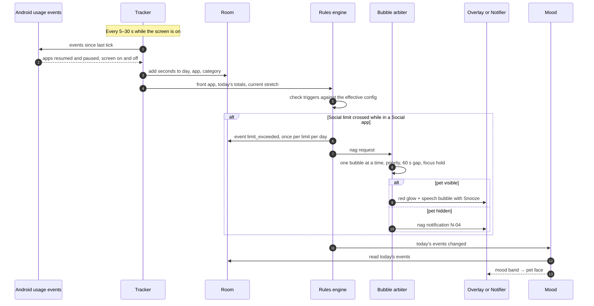

### DF-2 Tap the pet → summary panel

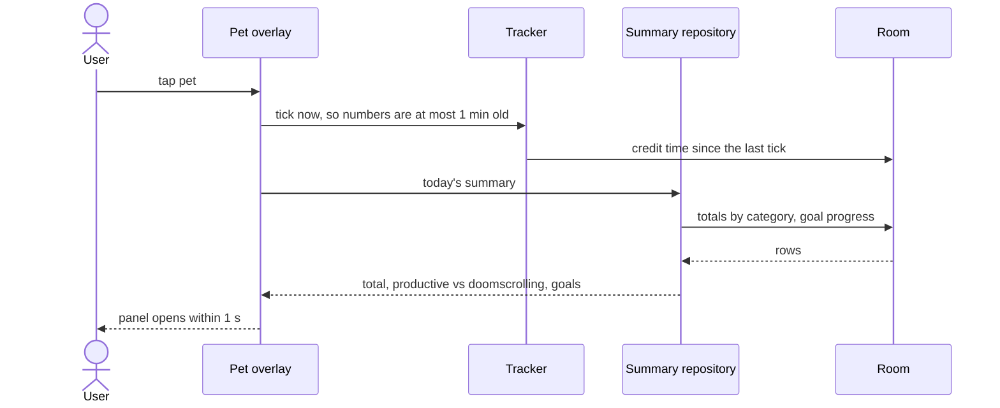

### DF-3 Focus session

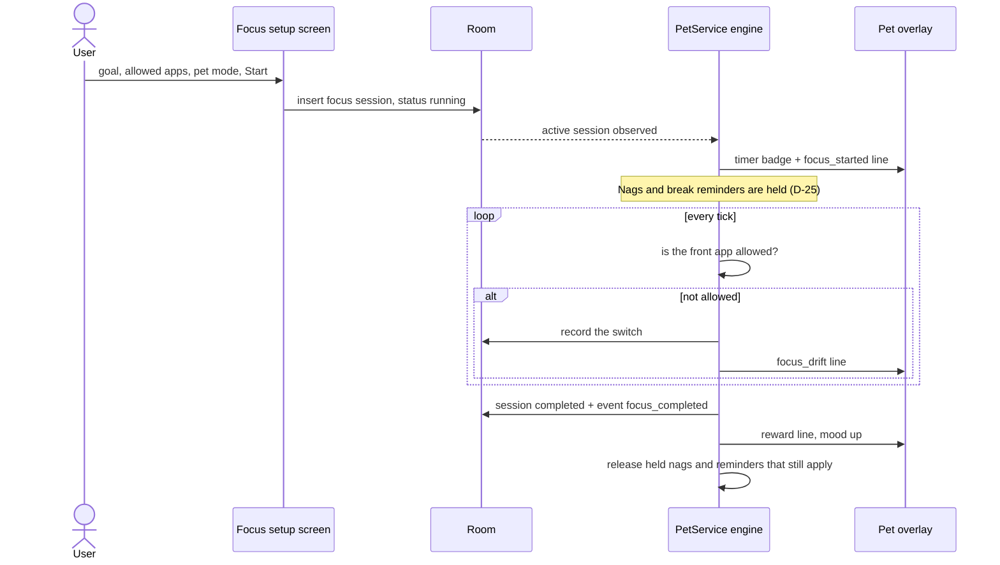

### DF-4 Admin publishes → phones apply the new config

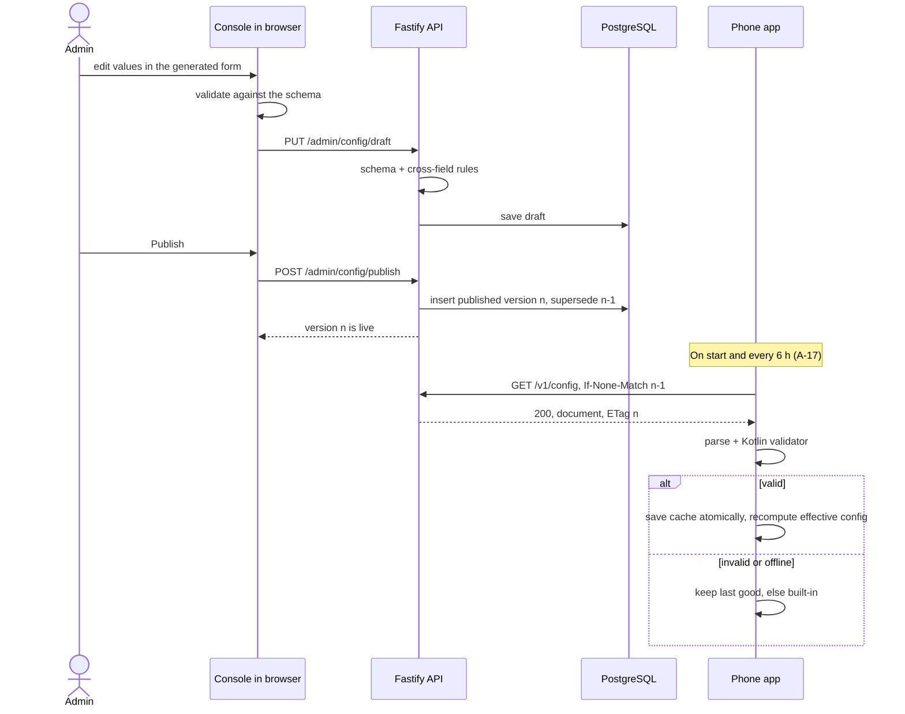

### DF-5 Opt-in daily stats

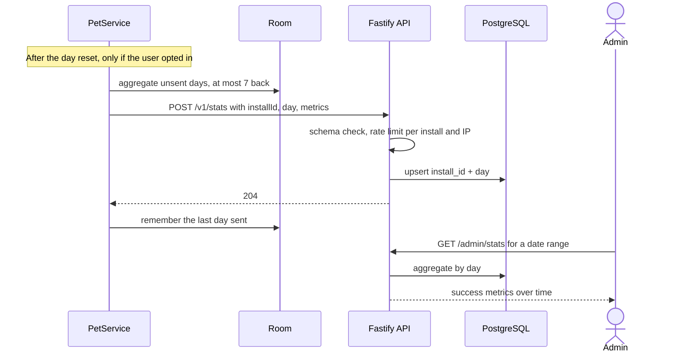

---

## 9. Cross-cutting concerns

**Time and days**
- All day logic goes through one `DayClock`. It uses `java.time` with the device time zone and an injectable clock for tests.
- The **day key** is the local date shifted by the reset hour. With reset 04:00, 03:30 belongs to the previous day.
- Seconds are credited to the day key at the moment they happen. A time-zone change never double-counts (NFR).
- **Day reset:** new totals, mood back to start, nags back to `Under`, snooze count 0, stretches reset.
  - A running focus session continues and belongs to the day it started (A-25).

**Config:** see §5. A bad config never crashes the app (US-21). Invalid documents are ignored and logged.

**Errors**
- **App:** no silent catches. Failures in the engine are logged and the tick continues. Network failures retry at the next 6-hour check.
- **Backend:** one central error handler maps errors to the standard shape (§7). Unknown errors return `INTERNAL` without internal details.

**Logging**
- **App:**
  - Release builds never log which apps the user opens.
  - Debug builds log engine decisions for testing.
  - Crash data comes from Play Console's Android vitals (no crash SDK).
- **Backend:**
  - Fastify's logger writes JSON to stdout with request IDs.
  - Request bodies, passwords, cookies and install IDs are never logged.

**Security** (backend)
- **Admin session:** a signed, `httpOnly`, `Secure`, `SameSite=Strict` cookie, valid 12 h. Rotating `SESSION_SECRET` logs out everywhere.
- **CSRF:**
  - The `SameSite=Strict` cookie.
  - Admin routes accept only `application/json`.
  - No CORS is enabled: the console is served from the same address.
- **Headers:** security headers including a Content Security Policy for the console (helmet).
- **Rate limits** (all behind the host's proxy, with `TRUST_PROXY` on so limits see real client IPs):
  - Login: 5/min/IP.
  - Stats: per install ID and per IP.
- **Database:** queries are always parameterised; the app's DB user has access to its own tables only.
- **HTTPS:** provided by the hosting platform. The release app refuses plain HTTP.

**Security** (app)
- No secrets in the app (A-10).
- Debug builds may talk to the dev backend over plain HTTP on the emulator's host address only.

**Privacy — what ever leaves the phone**
- `GET /v1/config`: no identifiers.
- `POST /v1/stats`: only if opted in; daily aggregates only (A-09).
- Nothing else. The privacy policy and Play's Data safety form must say exactly this (M15).

**Battery** (R-07, A-19)
- No ticks while the screen is off.
- No wake locks, no exact alarms.
- Adaptive tick interval.
- Measured on a real phone in M9.

**UI rules** (target SDK 36)
- Edge-to-edge is always on, so screens handle system bar insets.
- The predictive back gesture is handled by Navigation 3.
- Alerts never rely on colour alone (glow + bubble + optional notification).
- Pet touch target ≥ 48 dp.
- TalkBack and large text work on setup, settings, home and trends.

---

## 10. Android permissions and Play policy

| Permission / declaration | How it's granted | Why | Without it |
|---|---|---|---|
| `PACKAGE_USAGE_STATS` | User, in Settings → Usage access | Know which app is in front and for how long | No tracking; the pet can't react |
| `SYSTEM_ALERT_WINDOW` | User, in Settings → Display over other apps | Draw the pet | The pet can't appear |
| `POST_NOTIFICATIONS` | Runtime prompt (Android 13+) | Persistent notification, break reminders, nags while hidden, permission lost | No reminders outside the overlay |
| `FOREGROUND_SERVICE` + `FOREGROUND_SERVICE_SPECIAL_USE` | Automatic | The always-on service | — |
| `RECEIVE_BOOT_COMPLETED` | Automatic | Bring the pet back after a reboot | Pet returns only when the app is opened |
| `INTERNET` | Automatic | Config fetch, opt-in stats (week 2) | Built-in config only |
| Battery optimisation exemption | User, on the battery settings screen we open | Lower the chance the system stops the service (R-04) | Some brands kill the pet |
| `<queries>` for launcher apps | Manifest declaration, no permission | List the user's apps for categorisation | — |

**Play policy notes**
- **Special-use foreground service:**
  - The manifest describes the use case.
  - The Play Console declaration needs a text justification and a demo video (R-03, M15).
- **Battery exemption:** we open the battery settings list (`ACTION_IGNORE_BATTERY_OPTIMIZATION_SETTINGS`, no permission needed). The one-tap request dialog is reserved for Google's acceptable use cases, which don't clearly include this app.
- **Package visibility:** we declare a `<queries>` entry for apps with a launcher icon instead of the restricted `QUERY_ALL_PACKAGES` permission. The exact behaviour is verified in M3 (R-10).
- **Restart after reboot:** confirmed allowed. Android 15 blocks `BOOT_COMPLETED` from starting only `dataSync`, `camera`, `mediaPlayback`, `phoneCall`, `mediaProjection` and `microphone` services, not `specialUse`.
- **Other restart paths are verified in M4 (R-09):** restart after an app update, and restart after the system kills the process.
  - The fallback is a notification that brings the pet back on tap.
  - Background: since Android 15, holding the overlay permission alone no longer lets an app start a foreground service from the background; a visible overlay window is also needed.
- **Health apps declaration:** "no health features" (D-02).
- **Target audience:** 18+.

---

## 11. Permission matrix (role × action)

| Action | Phone user | Admin (logged in) | Anyone on the internet |
|---|---|---|---|
| Use the app, change user-editable settings within range | ✅ | — | — |
| Change a locked setting or a range | ❌ | ✅ via published config | ❌ |
| `GET /v1/config` | ✅ (the app) | ✅ | ✅ (public, no secrets) |
| `POST /v1/stats` | ✅ only if opted in | — | ✅ but schema-checked, rate-limited, anonymous |
| `POST /admin/login` | — | ✅ | ✅ rate-limited |
| Read / edit the draft, publish | ❌ | ✅ | ❌ (`401`) |
| Read aggregated stats | ❌ | ✅ | ❌ (`401`) |
| See any one person's usage | ❌ — it never leaves their phone | ❌ | ❌ |

Tests: every admin route is checked for `401` without a session (M11).

---

## 12. Config and environments

**Backend environment variables** (mirrored in `backend/.env.example`)

| Variable | Purpose | Example (dev) |
|---|---|---|
| `NODE_ENV` | `development` or `production` | `development` |
| `PORT` | HTTP port | `3000` |
| `DATABASE_URL` | Postgres connection string | `postgres://pet:pet@db:5432/pet` |
| `ADMIN_USERNAME` | Admin login name | `admin` |
| `ADMIN_PASSWORD_HASH` | scrypt hash, generated by `npm run hash-password` | — |
| `SESSION_SECRET` | ≥ 32 random bytes; signs the admin cookie | — |
| `TRUST_PROXY` | `true` behind the host's proxy, so rate limits see real client IPs | `false` |
| `LOG_LEVEL` | Logger level | `info` |

**Android build settings**
- `CONFIG_BASE_URL` per build type:
  - debug → the dev backend (`http://10.0.2.2:3000` from the emulator).
  - release → the production HTTPS address (set in M15).
- `applicationId`: `com.companionstudio.nyx`; app name: Nyx (D-49).

**Environments** (A-27)
- **dev:** laptop running Docker Compose (API + Postgres), the console dev server, and the emulator or a USB-connected phone.
- **prod:** the hosting platform.
- **No staging environment in v1.**
  - Config changes are protected by draft → publish and validation on all three sides.
  - Code is tested locally with the same Docker image that ships.

**Docker topology**
- **Local — `docker-compose.yml`:**
  - `db`: `postgres:18-alpine`, port 5432, volume `pgdata`.
  - `api`: built from `backend/Dockerfile`, port 3000, env from `backend/.env`, starts after `db` is healthy.
  - The console runs separately with `npm run dev` (Vite, port 5173) and proxies `/admin` and `/v1` to port 3000.
- **Production image — `backend/Dockerfile`, multi-stage, build context = repo root** (D-42):
  1. Build the console (`admin/`) into static files.
  2. Copy the backend and the console files into one Node image; the backend serves them at `/console/`.
  - `admin/` therefore has no Dockerfile of its own: it's static files, not a server. This is a deliberate exception to AGENTS.md §4's "own Dockerfile" rule.

---

## 13. Repo map — where to go to change something

| I want to… | Go to |
|---|---|
| Change a number, line, pet, personality or switch for everyone | The admin console → Publish. No code. |
| Add a new setting | `shared/config.schema.json` + `shared/default-config.json` + `android/…/config/` (model, validator) + a fixture in `shared/fixtures/` + the feature package that uses it |
| Change the defaults the app ships with | `shared/default-config.json` |
| Change a config validation rule | `android/…/config/ConfigValidator.kt` + a fixture in `shared/fixtures/invalid/` + the backend's `config.validation.js` (M10) |
| Change how usage is counted, categories, stretches | `android/…/tracking/` |
| Change when the pet nags, reminds or talks | `android/…/rules/` |
| Change mood math | `android/…/mood/` (weights and bands are config) |
| Change the pet, bubble or panel | `android/…/pet/` |
| Change focus sessions | `android/…/focus/` |
| Add or change an app screen | `android/…/<feature>/` + `AppNavigation` |
| Change notifications, boot or restart behaviour | `android/…/service/` |
| Change day boundaries or time-zone handling | `android/…/data/DayClock` |
| Add an API endpoint | `backend/src/features/<feature>/<feature>.routes.js` |
| Change admin login or session | `backend/src/features/auth/` + `backend/src/middleware/` |
| Change the database schema | a new `backend/migrations/NNN_<name>.sql` |
| Change a console screen | `admin/src/features/<feature>/` |
| Change seed or test data | `shared/fixtures/` · `backend/seeds/` · Android debug scenarios in `android/app/src/debug/` |
| Change what CI runs | `.github/workflows/android.yml` (Node workflow from M10) |

`android/…` = `android/app/src/main/java/com/companionstudio/nyx/`. The depth is Android's convention; everything below it is one level of feature packages.

**Backend layout**

```text
backend/
├── src/
│   ├── features/
│   │   ├── auth/      ← auth.routes.js, auth.service.js, auth.test.js
│   │   ├── config/    ← config.routes.js, config.service.js, config.model.js, config.validation.js, config.test.js
│   │   ├── stats/     ← stats.routes.js, stats.service.js, stats.model.js, stats.test.js
│   │   └── health/
│   ├── middleware/    ← requireAdmin.js, errorHandler.js
│   ├── lib/           ← db.js, password.js (scrypt), schema.js (loads shared schema)
│   ├── app.js         ← builds the Fastify app (used by tests)
│   └── server.js      ← starts it
├── migrations/        ← 001_init.sql …
├── scripts/           ← migrate.js, hash-password.js
├── seeds/
├── Dockerfile
├── .env.example
└── README.md
```

**Console layout**

```text
admin/
├── src/
│   ├── features/
│   │   ├── login/
│   │   ├── config/    ← W-02 config editor, W-03 pets & lines
│   │   └── stats/     ← W-04
│   ├── api.js
│   ├── App.jsx
│   └── main.jsx
├── index.html
├── vite.config.js
└── README.md
```

---

## 14. Low-level design (per milestone)

Written at the start of each milestone, before code.

| Module | Milestone | LLD status |
|---|---|---|
| Project setup | M0 | not needed |
| App shell, storage, DayClock | M1 | done 2026-10-19 (§14.1) |
| Config: schema, defaults, validator, layering | M2 | done 2026-10-19 (§14.2) |
| Setup flow + app categories | M3 | done 2026-10-19 (§14.3) |
| PetService + usage tracking | M4 | done 2026-10-20 (§14.4) |
| Overlay: pet, bubble, panel, hide | M5 | done 2026-10-21 (§14.5) |
| Lines, bubble arbiter, mood | M6 | done 2026-10-21 (§14.6) |
| Limits, nags, breaks, idle lines, actions ring, break screen | M7 | done 2026-10-21 (§14.7) |
| Focus sessions | M8 | done 2026-10-22 (§14.8) |
| Backend foundation + config API | M10 | pending |
| Admin auth + console | M11 | pending |
| App remote config | M12 | pending |
| Trends + positive goals | M13 | pending |
| Opt-in stats | M14 | pending |

### 14.1 M1 — App shell, storage, DayClock

**Purpose:** the skeleton every later milestone plugs into: the `Application` class, the manual DI container, navigation with predictive back, the theme, the day-key clock, and Home (S-08) fed from a fake repository. Story: US-28 (screen shell only).

**Storage scope (D-50, approved 2026-10-19)**
- Room refuses a database with no tables: a probe on 2026-10-19 failed with `@Database annotation must specify list of entities`. So the roadmap's "empty schema" can't be built.
- **Decision:**
  - `AppDatabase` is created in M3 together with its first real table (`app_categories`, filled by S-05). M4 adds `daily_app_usage` and `events`.
  - DataStore is created in M3 together with its first keys (setup progress, age check).
  - M1 records the policies below so M3 just follows them.
- **Alternatives:**
  - A placeholder entity now. Rejected: a table that exists only to make Room compile, and has to be removed later.
  - Pull `app_categories` forward into M1. Rejected: it designs M3's data before M3's LLD.

**Room policy** (applied when M3 creates `AppDatabase`)
- One `AppDatabase` in `data/`. Entities and DAOs live in their feature packages (§3).
- `exportSchema = true`. The schema JSON goes in `android/app/schemas/` (KSP argument `room.schemaLocation`) and is committed, so every schema change shows up in review.
- **Until the first Play release (M15):**
  - Every schema change bumps `version`.
  - **Debug** builds call `fallbackToDestructiveMigration(dropAllTables = true)`, so a changed schema wipes local data instead of crashing.
  - **Release** builds never use the destructive fallback.
- **From `v1.0.0` on:** every schema change ships a `Migration` (or `AutoMigration`) plus a migration test. `room-testing` goes through dependency approval at that point.
- Day keys are stored as ISO dates (`"2026-10-19"`): readable in the database inspector and they sort correctly. Confirmed in M4's LLD, where the first day-keyed table arrives.

**DataStore policy** (applied when M3 creates it)
- One Preferences DataStore named `settings`, created once in `AppContainer` (a second instance on the same file throws).
- Each feature owns its keys in a small `…Settings` class in its package. No global keys file.

**Files** (`android/app/src/main/java/com/companionstudio/nyx/`)

| File | Responsibility |
|---|---|
| `PetApp.kt` | `Application` class; creates `AppContainer` once in `onCreate`. Set in the manifest |
| `AppContainer.kt` | Manual DI: holds `DayClock` and `SummaryRepository` (the fake one until M4) |
| `MainActivity.kt` | `enableEdgeToEdge()`, `NyxTheme`, `AppNavigation()`. Nothing else |
| `AppNavigation.kt` | Navigation 3: `@Serializable` `NavKey` objects, back stack, `NavDisplay` |
| `ui/theme/` | Theme from the wizard, kept as is (Material 3, dynamic colour on Android 12+). Unused imports and commented-out boilerplate removed |
| `ui/PlaceholderScreen.kt` | "Not built yet" screen for destinations whose milestone hasn't happened yet |
| `data/DayClock.kt` | Day keys (below) |
| `home/TodaySummary.kt` | Data shown on Home: `TodaySummary`, `GoalProgress` |
| `home/SummaryRepository.kt` | `interface SummaryRepository { fun observeToday(): Flow<TodaySummary> }` |
| `home/FakeSummaryRepository.kt` | Fixed fake numbers. Replaced by the real repository in M4, which is the only change Home needs |
| `home/HomeViewModel.kt` | Turns the repository flow into `StateFlow<TodaySummary?>` (`null` = loading) |
| `home/HomeScreen.kt` | Stateless `HomeScreen(summary, onFocus, onTrends, onSettings)` + a route composable that wires in the ViewModel |
| `home/DurationFormat.kt` | Seconds → "1 h 25 min" / "12 min" / "0 min". Also used by the summary panel in M5 |

**Navigation**
- Keys: `Home`, `FocusSetup`, `Trends`, `Settings` (`data object`s implementing `NavKey`, `@Serializable`).
- The back stack is `rememberNavBackStack(Home)`, so it survives rotation and process death. This needs the Kotlin serialization plugin, which is already in the register; M1 applies it.
- `FocusSetup` (M8), `Trends` (M13) and `Settings` (M7) show `PlaceholderScreen` until their milestones replace them. That gives the back gesture something to go back from in M1.
- Back: `NavDisplay(onBack = { backStack.removeLastOrNull() })`. Predictive-back animation comes from `navigation3-ui`. Back on Home leaves the app (system default).
- Setup gating (Home vs S-01) isn't in M1 (→ M3). The app always opens on Home for now.
- **Heads-up, not needed in M1:** a ViewModel created inside a Navigation 3 entry is scoped to the Activity unless `androidx.lifecycle:lifecycle-viewmodel-navigation3` is added. That's fine for Home, the root screen. M3 (setup screens with their own ViewModels) will ask to add it, or explain why it isn't needed.

**DayClock**

```kotlin
class DayClock(
    private val clock: Clock = Clock.systemUTC(),            // where "now" comes from; fixed in tests
    private val zone: () -> ZoneId = ZoneId::systemDefault,  // read on every call
) {
    fun dayKeyAt(instant: Instant, resetHour: Int): LocalDate
    fun today(resetHour: Int): LocalDate = dayKeyAt(clock.instant(), resetHour)
}
```

- **Rule:** `dayKey = LocalDateTime.ofInstant(instant, zone()).minusHours(resetHour).toLocalDate()`. Wall-clock based: with reset 04:00, 03:30 belongs to the previous day; 04:00:00 starts the new one.
- **Why the zone is a function and not the `Clock`'s zone:** `Clock.systemDefaultZone()` fixes the zone when it's created. Android updates the process default time zone when the user changes it, so reading `ZoneId.systemDefault()` on every call follows the change.
- **Why `resetHour` is a parameter:** the reset hour comes from config (M2) and user settings (M3). Passing it in keeps `DayClock` free of dependencies and trivial to test.
- `require(resetHour in 0..23)`. Config limits it to 0–6 (§5). This check only catches programming errors.
- `nextResetAt()` and anything else the day reset needs arrive in M4 together with the code that uses them.

**Home (S-08) data**

```kotlin
data class TodaySummary(
    val totalSeconds: Long,
    val productiveSeconds: Long,
    val doomscrollSeconds: Long,
    val goals: List<GoalProgress>,
    val petFace: String,     // emoji for the current mood band; comes from config + mood in M6
)
data class GoalProgress(val label: String, val usedSeconds: Long, val targetSeconds: Long)
```

- **Fake values:** 3 h 12 min total, 1 h 05 min productive, 47 min doomscrolling. Goals: "Social ≤ 60 min" at 47 of 60 and "Games ≤ 30 min" at 35 of 30 (over). Face 😸.
- **Screen:**
  - Face, total, productive vs doomscrolling, and one row per goal (text + progress bar).
  - An over-limit goal says "over" in words, not just in colour (§9).
  - Buttons: Start focus, Trends, Settings.
  - Content scrolls, and handles insets through `Scaffold`, so large text works.
  - Strings live in `strings.xml`.
- **States:** loading (`null`) shows a progress indicator. There's no error state: the fake can't fail, and the real repository (M4) reads local Room, so an empty day is all zeros.

**Tests**

| Test | Where | Checks |
|---|---|---|
| `DayClockTest` | `src/test/` | Reset 0: 23:59:59 vs 00:00:00 · reset 4: 03:59 → previous day, 04:00 → same day · time-zone change: the same instant gives the new zone's day once the zone provider switches (Asia/Kolkata → America/New_York) · DST-free zones (Asia/Kolkata, UTC) across a reset · one DST zone (Europe/London, spring-forward day) to show wall-clock behaviour · resetHour outside 0–23 is rejected |
| `DurationFormatTest` | `src/test/` | 0, 59 s, 60 s, 3599 s, 3600 s, 11 520 s |
| `HomeViewModelTest` | `src/test/` | Emits `null`, then the repository's summary (coroutines-test, `Dispatchers.setMain`) |
| `US28_HomeScreenTest` | `src/androidTest/` | Fake summary → face, total, goals and the "over" label are shown; buttons call their callbacks |
| `US28_NavigationTest` | `src/androidTest/` | Launch `MainActivity` → Home · tap Settings → placeholder · back (through `onBackPressedDispatcher`) → Home |

- The wizard's `ExampleUnitTest` and `ExampleInstrumentedTest` are deleted.
- Coverage: `DayClock` ≥ 90% (ROADMAP §2).

**Not in M1:** Room and DataStore instances (→ M3, D-50), setup gating (→ M3), real data (→ M4), config-driven faces and reset hour (→ M2, M6).

### 14.2 M2 — Config: schema, defaults, validator, layering

Approved 2026-10-19, with D-51 to D-53 and A-28.

**Purpose:** the app can always produce a valid config: the last good admin document if there is one, otherwise the built-in defaults, with the user's own values layered on top. Nothing here fetches from a server (→ M12) or stores user values (→ M3). Stories: US-21, US-22, US-05 (data side).

**The document** (`shared/config.schema.json`, `schemaVersion` 1)
- The Kotlin models below *are* the full shape. The schema says the same thing in JSON Schema draft-07, plus the number bounds in the table further down.
- Every field is required. A missing field is a validation error, not a silent default.
- Unknown keys are allowed on every side (D-52). The schema doesn't set `additionalProperties: false`; the phone parses with `ignoreUnknownKeys = true`. This is what lets an additive change leave `schemaVersion` alone.

```kotlin
@Serializable data class NyxConfig(
    val schemaVersion: Int,                    // must equal SCHEMA_VERSION (1) for this build
    val configVersion: Int,                    // ≥ 1; the built-in document is 1
    val features: Features,
    val day: DayConfig,
    val tracking: TrackingConfig,
    val limits: LimitsConfig,
    val nags: NagsConfig,
    val breaks: BreaksConfig,
    val focus: FocusConfig,
    val bubbles: BubblesConfig,
    val idle: IdleConfig,
    val hide: HideConfig,
    val mood: MoodConfig,
    val pets: List<Pet>,
    val personalities: List<Personality>,
    val lines: Map<String, Map<String, Map<String, List<String>>>>, // personality → trigger → band id or "any" → lines
    val categoryDefaults: Map<String, Category>,   // package name → category (US-04)
    val androidCategoryMap: Map<String, Category>, // Android's app category name → ours; mapping rules in M3's LLD
)

@Serializable data class Setting(val default: Int, val min: Int, val max: Int, val userEditable: Boolean)

@Serializable data class Features(val focus: Boolean, val breaks: Boolean, val idleLines: Boolean, val trends: Boolean, val stats: Boolean)
@Serializable data class DayConfig(val resetHour: Setting)
@Serializable data class TrackingConfig(val fastTickSeconds: Int, val slowTickSeconds: Int, val doomscrollCategories: List<Category>)
@Serializable data class LimitsConfig(val categories: Map<Category, CategoryLimit>, val totalDailyMinutes: Setting, val stretch: StretchLimit)
@Serializable data class CategoryLimit(val dailyMinutes: Setting)
@Serializable data class StretchLimit(val minutes: Setting, val categories: List<Category>)
@Serializable data class NagsConfig(val repeatMinutes: Setting, val snoozeMinutes: Setting, val maxSnoozesPerDay: Int)
@Serializable data class BreaksConfig(val afterMinutes: Setting, val breakMinutes: Int, val repeatMinutes: Int)
@Serializable data class FocusConfig(val durationMinutes: Setting, val checkinMinutes: Setting)
@Serializable data class BubblesConfig(val minGapSeconds: Int, val showSeconds: Int)
@Serializable data class IdleConfig(val everyMinutes: Int)
@Serializable data class HideConfig(val minutes: Int)
@Serializable data class MoodConfig(val start: Int, val weights: MoodWeights, val bands: List<MoodBand>)
@Serializable data class MoodWeights(
    @SerialName("focus_completed") val focusCompleted: Int,
    @SerialName("goal_met") val goalMet: Int,
    @SerialName("break_taken") val breakTaken: Int,
    @SerialName("doomscroll_10min") val doomscroll10Min: Int,
    @SerialName("limit_exceeded") val limitExceeded: Int,
    @SerialName("snoozed") val snoozed: Int,
)
@Serializable data class MoodBand(val id: String, val from: Int, val to: Int)
@Serializable data class Pet(val id: String, val name: String, val enabled: Boolean, val faces: Map<String, String>) // band id → emoji
@Serializable data class Personality(val id: String, val name: String, val enabled: Boolean, val previewLine: String)

@Serializable enum class Category {
    @SerialName("social") SOCIAL, @SerialName("games") GAMES, @SerialName("entertainment") ENTERTAINMENT,
    @SerialName("productive") PRODUCTIVE, @SerialName("neutral") NEUTRAL,
}
```

- **What each block is for** (and which milestone first reads it):

| Block | Used for | Read from |
|---|---|---|
| `day.resetHour` | `DayClock` reset hour | M3 settings, M4 |
| `tracking` | Tick intervals (H-01); which categories count as doomscrolling | M4 |
| `limits` | Daily limits per category and in total (0 = off); stretch limit and the categories it covers. A category with no entry has no limit and can't get one (A-14) | M7 |
| `nags` | SM-02 repeat interval, snooze length, max snoozes per day | M7 |
| `breaks` | SM-03: remind after X min on screen; screen off ≥ `breakMinutes` = a break (D-27, also resets stretches); remind again every `repeatMinutes` | M4, M7 |
| `focus` | S-09 duration and check-in sliders (default + range) | M8 |
| `bubbles` | Gap between bubbles; how long one stays up | M6 |
| `idle`, `hide` | Idle line interval (D-26); hide duration (D-24) | M7, M5 |
| `mood` | Start value, weights and bands (SM-01). The bands are pure data: "ran away" is mood 0 in code (SM-01), not a special band id | M6 |
| `pets`, `personalities`, `lines` | S-04 choices and the line pools. `enabled = false` hides an item from new picks (US-20) | M3, M6 |
| `categoryDefaults`, `androidCategoryMap` | Suggested categories (US-04) | M3 |

- **Categories are fixed** (D-51): `social` (Social & scrolling), `games`, `entertainment`, `productive`, `neutral`. They're an enum in the schema and in Kotlin; Home's "productive vs doomscrolling" depends on what they mean. Adding a category is a breaking change and bumps `schemaVersion`. Display names live in `strings.xml`.
- **Positive goals** (US-17, M13) aren't in v1 of the document. They arrive as an additive block with a Kotlin default, so `schemaVersion` stays 1.

**Bubble triggers** — the trigger catalog (§4) entries that show a bubble, as `BubbleTrigger` in `config/`:
`limit_reached`, `limit_repeat`, `stretch_reached`, `break_due`, `break_taken`, `goal_met`, `focus_started`, `focus_drift`, `focus_checkin`, `focus_completed`, `focus_broken`, `idle`, `pet_returned`.
- `snoozed` and `doomscroll_10min` only move mood, so they have no line pool.
- `goal_met` is required now even though positive goals come in week 2. It keeps the coverage rule simple, and costs a few lines of text.
- **Pool lookup** (implemented in M6): the band pool if it exists and isn't empty, otherwise `any`. Which placeholders (`{app}`, `{minutes}`, `{limit}`, `{category}`) each trigger may use is designed in M6's LLD, together with a validator rule for it.

**Validation rules**
- Every error carries a rule ID, a JSON path and a message: `ConfigError(rule = "setting-range", path = "nags.snoozeMinutes", message = "default 40 is not within min 5..max 30")`. Rule IDs are constants in `ConfigRule` (named so it doesn't clash with JUnit's `@Rule`).
- The validator returns every error it finds, not just the first. The console shows them all (US-19).
- Rule `schema` is everything JSON Schema can express. The other rules are cross-field and live in code on both the phone and the backend (§5).

| Rule ID | Rejects |
|---|---|
| `schema` | Not JSON · a required field missing · wrong type (`"sixty"`, `60.5`, `null`) · an unknown category · `schemaVersion` ≠ 1 · a number outside its bounds (table below) · an id not matching `^[a-z0-9_]+$` · an empty name, face, preview line or line |
| `setting-range` | A setting where `min ≤ default ≤ max` doesn't hold |
| `tick-order` | `fastTickSeconds` > `slowTickSeconds` |
| `duplicate-id` | Two pets, two personalities or two mood bands with the same id |
| `mood-bands-coverage` | Mood bands that leave a gap or overlap in 0–100, or a band with `from` > `to` |
| `pet-faces` | A pet with no face for some mood band |
| `line-references` | Lines for a personality that doesn't exist; a pool key that's neither `any` nor a band id |
| `line-coverage` | A personality without a non-empty `any` pool for every bubble trigger |
| `nothing-enabled` | No enabled pet, or no enabled personality |

- **Ignored on purpose:** unknown keys anywhere, including unknown trigger names in `lines` and unknown band ids in `faces` (D-52). A newer config may carry pools for triggers an older app doesn't know yet.

**Number bounds** (the `schema` rule; for a `Setting`, `default`, `min` and `max` all have to be inside them)

| Field | Bounds |
|---|---|
| `configVersion` | ≥ 1 |
| `day.resetHour` | 0–23 (`DayClock`'s own limit; the default document allows 0–6) |
| `tracking.fastTickSeconds`, `tracking.slowTickSeconds` | 1–60 (the 60-second promise, §4) |
| `limits.categories.*.dailyMinutes`, `limits.totalDailyMinutes` | 0–1440 (0 = off) |
| `limits.stretch.minutes`, `breaks.afterMinutes`, `focus.durationMinutes`, `idle.everyMinutes`, `hide.minutes` | 1–1440 |
| `nags.repeatMinutes`, `nags.snoozeMinutes`, `breaks.repeatMinutes`, `focus.checkinMinutes` | 1–240 |
| `nags.maxSnoozesPerDay` | 0–100 |
| `breaks.breakMinutes` | 1–60 |
| `bubbles.minGapSeconds` · `bubbles.showSeconds` | 0–3600 · 1–60 |
| `mood.start`, `mood.bands[].from`, `mood.bands[].to` | 0–100 |
| `mood.weights.*` | −100 to 100 |

**Fixtures** (`shared/fixtures/`, D-53)
- Each invalid file is a full document with exactly one thing broken. It's named `<rule-id>--<what>.json`, e.g. `setting-range--default-above-max.json`, `schema--not-json.json`.
- The phone test checks each invalid file is rejected **with that rule ID**, not just rejected. The backend test (M10) does the same, so both sides agree on *why* as well as *whether*.
- The invalid set: one file per rule, and for `schema` one per bullet above (not JSON, missing field, wrong type, unknown category, wrong schema version, out of bounds, bad id, blank line). `mood-bands-coverage` has a `--gap` and an `--overlap` file.
- **Valid:** `minimal.json` (one pet, one personality, two bands `0–0` and `1–100`, `any` pools only), `band-pools.json` (band-specific pools next to `any`), `unknown-keys.json` (extra keys at several levels, including an unknown trigger in `lines`).
- `shared/default-config.json` is tested directly, not copied into `fixtures/valid/`.
- Every fixture is `minimal.json` with one change. The one-off script that made them isn't committed; fixtures are edited directly as files from now on.

**Default document** (`shared/default-config.json`, configVersion 1) — placeholder numbers, tuned later from the console
- Limits (A-14): Social & scrolling 60 min (range 0–240), Games 120 (0–480), Entertainment 120 (0–480); no entry for Productive or Neutral. Total daily 0 = off (0–960). Stretch 30 min (10–120) on Social and Games. All user-editable.
- Nags: repeat 10 (5–30) and snooze 10 (5–30), user-editable; max 3 snoozes a day, admin only (D-16).
- Breaks: remind after 45 min (20–120), user-editable; a break is ≥ 5 min off (D-27); remind again every 10 min.
- Focus: duration 25 min (5–180), check-in every 10 min (5–30).
- Day reset hour 0 (0–6). Ticks 5 s / 30 s. Doomscrolling = Social. Bubbles: 60 s gap, 8 s on screen. Idle every 30 min. Hide 30 min. All features on.
- Mood (A-24): start 70; weights +15 / +10 / +5 / −3 / −10 / −5; the 8 bands and the Cat and Blob faces of SM-01 (`great`, `happy`, `ok`, `meh`, `grumpy`, `sad`, `sick`, `ran_away`).
- Personalities (A-28): `cheerful` "Cheerful coach" and `calm` "Calm friend". At least 4 `any` lines per bubble trigger (so "never repeat the last 3" has room), plus a few band pools for `idle` to show the mechanism. All text English.
- `categoryDefaults`: about 20 well-known packages (Instagram, TikTok, YouTube, Netflix, WhatsApp…). `androidCategoryMap`: Android's game, social, video, audio, image, news, maps and productivity categories.

**Layering** — base document → user values (§5, D-45)
- **Base:** `ConfigManager.loadBase()`:
  1. `filesDir/config_cache.json` exists, parses, validates and has `schemaVersion` 1 → use it.
  2. Otherwise → the built-in document from assets. A rejected cache is reported through `onRejected(errors)`, which `AppContainer` sends to `Log.w` with rule IDs and paths only. A cache file that exists but can't be read is reported as `cache-unreadable` (not a validation rule).
  - Nothing writes the cache until M12. The cache file is the raw document; its ETag is `configVersion`, so no wrapper is needed (M12 confirms).
  - The built-in document can't be invalid at runtime: `DefaultConfigTest` fails the build first. If it ever is, `loadBase()` throws with the errors. That's a broken build, not a broken server, so US-21's "never crash" isn't what applies.
- **User values:** a plain `Map<String, Int>` from setting path to stored value. M3 stores them in DataStore, one `intPreferencesKey` per path, named `config.<path>` (e.g. `config.nags.snoozeMinutes`), in a `ConfigUserValues` class in `config/`.
- **Effective value** of a setting:

```kotlin
fun Setting.resolve(userValue: Int?): Int =
    if (!userEditable || userValue == null) default else userValue.coerceIn(min, max)
```

  - Locked → always the admin default; the stored value is ignored but kept.
  - Range narrowed → clamped on every read; the stored value isn't rewritten, so widening the range brings it back (§5).
- **`EffectiveConfig(document, userValues)`** is what the rest of the app reads:
  - `settings: Map<String, Setting>` — every tunable setting by path, in display order. S-06 and S-11 build their sliders and read-only rows from it.
  - `valueOf(path): Int?` — the effective value; `null` when the document has no such setting (e.g. a Productive limit).
  - Paths: `day.resetHour`, `limits.categories.<category>.dailyMinutes`, `limits.totalDailyMinutes`, `limits.stretch.minutes`, `nags.repeatMinutes`, `nags.snoozeMinutes`, `breaks.afterMinutes`, `focus.durationMinutes`, `focus.checkinMinutes`. Kept as constants in `SettingPaths`, so call sites never spell them by hand.
- Turning `EffectiveConfig` into a `StateFlow` that follows DataStore arrives in M3 with the first user value. In M2, `AppContainer` exposes `configManager` only.

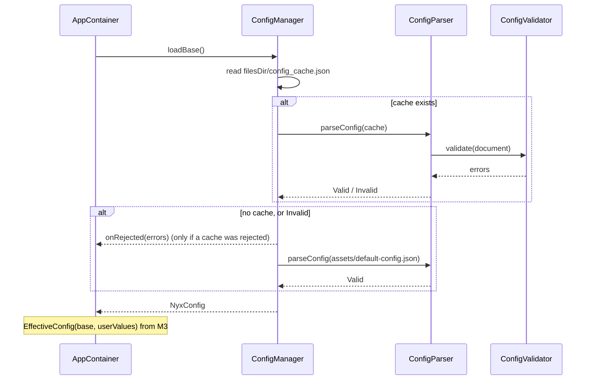

**Files**

| File | Responsibility |
|---|---|
| `shared/config.schema.json` | JSON Schema draft-07 for the document above, with the bounds table |
| `shared/default-config.json` | The built-in defaults |
| `shared/fixtures/valid/`, `invalid/` | As above |
| `config/NyxConfig.kt` | The `@Serializable` models, `Setting`, `Category`, `SCHEMA_VERSION` |
| `config/BubbleTrigger.kt` | The bubble triggers and their JSON names |
| `config/ConfigParser.kt` | `parseConfig(json): ConfigResult` (`Valid(config)` / `Invalid(errors)`) and `ConfigError`. A kotlinx `SerializationException` becomes a `schema` error; it's never swallowed |
| `config/ConfigValidator.kt` | `validateConfig(config): List<ConfigError>` and the `ConfigRule` IDs: bounds, then the cross-field rules |
| `config/EffectiveConfig.kt` | `Setting.resolve`, `EffectiveConfig`, `SettingPaths` |
| `config/ConfigManager.kt` | `loadBase()`: cache or built-in. Takes `readBuiltIn: () -> String`, `cacheFile: File`, `onRejected` |
| `AppContainer.kt`, `PetApp.kt` | `AppContainer(context)` builds `ConfigManager` from assets and `filesDir` |
| `android/app/build.gradle.kts` | Copy task + unit-test system property (below) |

- If `NyxConfig.kt` or `ConfigValidator.kt` passes ~250 lines, it's split by block (AGENTS §4).

**Build**
- A small `CopyDefaultConfig` task (`@InputFile` → `@OutputDirectory`), registered once per variant as `copy<Variant>DefaultConfig`, copies `shared/default-config.json` into a generated assets folder. It's wired with `androidComponents.onVariants { it.sources.assets?.addGeneratedSourceDirectory(task, CopyDefaultConfig::outputDir) }` (checked against `gradle-api` 9.4.1: `Sources.getAssets(): SourceDirectories.Layered`, `addGeneratedSourceDirectory(TaskProvider, (Task) -> DirectoryProperty)`).
  - So only that one file reaches the APK. The schema and fixtures stay out.
  - A changed `default-config.json` triggers a rebuild; nothing is committed under `android/`.
- Unit tests get the path to `shared/` as the system property `nyx.sharedDir`, set in `testOptions.unitTests.all`. Tests never guess relative paths. `shared/` is also a declared test input, so editing a fixture re-runs the tests.
- CI (`.github/workflows/android.yml`) also runs on changes to `shared/**`.

**Tests**

| Test | Where | Checks |
|---|---|---|
| `US21_ConfigFixturesTest` | `src/test/` | Every `valid/` file is accepted · every `invalid/` file is rejected with the rule ID from its file name · the fixture folders aren't empty (a wrong path can't make the test pass) |
| `US21_DefaultConfigTest` | `src/test/` | `shared/default-config.json` is valid · ≥ 2 enabled personalities · Cat and Blob both present and enabled |
| `ConfigValidatorTest` | `src/test/` | What fixtures don't show well: several errors reported at once, with the right paths · `nothing-enabled` for personalities as well as pets · bounds at exactly the edges pass · min > max · duplicate personalities and bands · bands ending early or backwards · a pool key that's neither `any` nor a band · blank texts and bad ids · the D-54 differences, pinned |
| `US22_EffectiveConfigTest` | `src/test/` | No user value → default · user value inside range → used · outside range → clamped · range narrowed → clamped, and the stored value is unchanged · widened again → restored · locked → default · `valueOf` for a missing setting → `null` · `settings` lists every path in `SettingPaths` |
| `US21_ConfigManagerTest` | `src/test/` | No cache → built-in · valid cache → cache · invalid cache → built-in and `onRejected` called with the rule IDs · not-JSON cache → built-in · cache with `schemaVersion` 2 → built-in · invalid built-in → throws (uses `TemporaryFolder`) |
| `US21_BuiltInConfigTest` | `src/androidTest/` | On a device, `AppContainer`'s `ConfigManager` loads the asset and gets `configVersion` 1, which proves the Gradle copy works |

- Test helper: `src/test/…/config/SharedFiles.kt` reads `shared/` through `nyx.sharedDir` (fixtures are listed as `*.json`, since the folders also hold a `.gitkeep`).
- Coverage: ≥ 90% on `config/` (ROADMAP §2). Measured 2026-10-19: 98.0% lines, 95.5% branches.
- **Known differences from JSON Schema (D-54):** kotlinx.serialization 1.11.0 reads `"3"` as 3 and `"true"` as true, which JSON Schema rejects, and rejects `3.0`, which JSON Schema accepts. Neither can reach a phone: the console sends JSON numbers, the backend rejects quoted values on save, and the server re-serialises the document it serves (M10). The fixtures avoid these cases, and `ConfigValidatorTest` pins the phone's behaviour.

**Not in M2:** fetching and writing the cache (→ M12), storing user values and the config `StateFlow` (→ M3), reading any of these values in features (→ M3 onwards), line placeholders and pool lookup (→ M6), positive goals (→ M13).

### 14.3 M3 — Setup flow, storage, app categories

Approved 2026-10-19, with D-55 to D-61, A-29, A-30 and CR-08.

**Purpose:** a fresh install walks through S-01 to S-07 and lands on Home. After that, the launcher opens Home. M3 also creates the Room database and the `settings` DataStore (D-50) and connects the user's values to `EffectiveConfig` (§14.2). Stories: US-01, US-02, US-03, US-04, US-05, US-24 (the choice only).

**Flow and navigation**

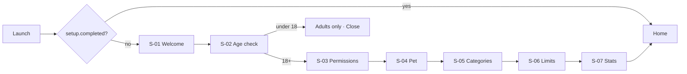

- New `NavKey`s: `Welcome`, `AgeCheck`, `AdultsOnly`, `Permissions`, `ChoosePet`, `AppCategories`, `Limits`, `StatsOptIn`. They sit in `AppNavigation.kt` with the M1 keys. If the file passes ~250 lines, the setup entries move to `setup/`.
- **Gating:** `AppNavigation` reads `setup.completed` once (`produceState`, initial `null`) and draws nothing until it knows. Then it creates the back stack with `Home` or `Welcome` as the start. The read is a small local file, so the blank frame is very short. Once setup is done, the flag is true for good. M3 has no way back into setup; Settings (M7) opens single steps.
- **Each step screen takes an `onNext` callback.** In setup it pushes the next step. When Settings reuses S-03 to S-07 (M7), it pops back instead. The screens don't know which flow they're in.
- **Back** goes to the previous step. Back on Welcome leaves the app.
- **Finishing:** S-07's Finish writes `setup.completed = true` and replaces the whole back stack with `[Home]` (Home is added first, then everything before it removed, so the stack is never empty), so Back on Home leaves the app instead of going back into setup.
- **Progress** (D-56): the only progress stored is `setup.completed`. Each step saves its own choices as soon as they're made. The back stack is saved, so rotation and process death keep the current step. A new launch partway through setup starts again at Welcome, with the earlier choices already filled in.
- **ViewModels per entry** (CR-08, D-55): `NavDisplay` gets `entryDecorators = listOf(rememberSaveableStateHolderNavEntryDecorator(), rememberViewModelStoreNavEntryDecorator())`. A screen's ViewModel then lives as long as its back-stack entry and is cleared when the entry is popped.
  - Without this, every ViewModel is scoped to the Activity. S-05's ViewModel would keep about 200 app icons in memory long after setup, and S-03 to S-07 reopened from Settings would show stale state.
  - Checked against the 2.11.0 sources: `rememberViewModelStoreNavEntryDecorator()` exists and needs the saveable-state decorator from `navigation3-runtime` 1.2.0 next to it; `NavDisplay(entryDecorators = …)` exists in `navigation3-ui` 1.2.0.

**Storage** (follows the §14.1 policies)
- `data/AppDatabase.kt`: version 1, entities `[AppCategoryEntity]`, `exportSchema = true`, KSP argument `room.schemaLocation` → `android/app/schemas/` (committed). File name `nyx.db`. Debug builds use `fallbackToDestructiveMigration(dropAllTables = true)`, release builds don't. Build types are told apart with `BuildConfig.DEBUG`, so `buildFeatures.buildConfig = true` (M12's backend URL needs it too).
- `data/SettingsStore.kt`: the one Preferences DataStore, file `settings`, built once in `AppContainer` with `PreferenceDataStoreFactory`.
- **Keys:** each feature's own `…Settings` class (§14.1).

| Class (package) | Key | Type | Default |
|---|---|---|---|
| `SetupSettings` (`setup/`) | `setup.completed` | Boolean | false |
| | `setup.ageConfirmed` | Boolean | false |
| `PetSettings` (`pet/`) | `pet.petId`, `pet.personalityId` | String | not set → the first enabled one |
| `StatsSettings` (`stats/`) | `stats.optIn` | Boolean | false |
| `ConfigUserValues` (`config/`) | `config.<path>` (§14.2) | Int | not set → the admin default |

- **Under 18** (D-57): the answer isn't stored. The adults-only screen has only Close, which finishes the Activity. The next launch asks again. The age is self-declared (A-06), so storing a "no" protects nobody. It would only lock out someone who tapped the wrong button, until they clear the app's data.
- **User values** (D-61): stored only when the user moves a slider. A setting the user never touched has no stored value, so it follows the admin default, including later changes from the console. Values are clamped to `min..max` before they're stored (and again on every read, §14.2).
- **Effective config:** `AppContainer.effectiveConfig: Flow<EffectiveConfig>` = `configUserValues.observe()` mapped to `EffectiveConfig(base, values)`, on `Dispatchers.IO`. `base` is `configManager.loadBase()`, read once (`lazy`) the first time something collects. M12 swaps `base` for a flow that follows the fetched document.

**`app_categories`** (D-58)

| Column | Type | Notes |
|---|---|---|
| `package_name` | TEXT, primary key | The property is `packageName`: `package` is a Kotlin keyword |
| `category` | TEXT, not null | Room's built-in enum support stores the Kotlin name (`SOCIAL`). Renaming a `Category` constant therefore needs a migration |

- The table holds **only the categories the user chose**. Suggestions aren't stored. They're worked out when needed, so a better admin default reaches every app the user never touched. M4's tracker uses the same rule for new apps (US-04).
- This replaces the "whether the user chose it" column the HLD had in §6: every row is a user choice.
- A row for an app that was later uninstalled stays, which is harmless. The list only shows installed apps.
- `AppCategoryDao`: `observeAll(): Flow<List<AppCategoryEntity>>`, `@Upsert suspend fun upsert(entity)`.

**Category suggestion** (`tracking/CategorySuggestion.kt`, a pure function so it's easy to test)

```kotlin
fun suggestCategory(packageName: String, androidCategory: Int, config: NyxConfig): Category =
    config.categoryDefaults[packageName]
        ?: androidCategoryName(androidCategory)?.let { config.androidCategoryMap[it] }
        ?: Category.NEUTRAL
```

- `androidCategoryName` maps `ApplicationInfo.category` to the keys used in `androidCategoryMap`: `CATEGORY_GAME` → `game`, `AUDIO` → `audio`, `VIDEO` → `video`, `IMAGE` → `image`, `SOCIAL` → `social`, `NEWS` → `news`, `MAPS` → `maps`, `PRODUCTIVITY` → `productivity`. Anything else (`CATEGORY_UNDEFINED`, `CATEGORY_ACCESSIBILITY`, new values) → `null` → Neutral.
- What a row on S-05 shows: the user's choice from `app_categories` if there is one, otherwise the suggestion.

**Installed apps and `<queries>`** (R-10)
- Manifest: `<queries><intent><action android:name="android.intent.action.MAIN" /><category android:name="android.intent.category.LAUNCHER" /></intent></queries>`. No `QUERY_ALL_PACKAGES`.
- `tracking/InstalledApps.kt`: `queryIntentActivities(Intent(ACTION_MAIN).addCategory(CATEGORY_LAUNCHER), 0)` → one entry per package (package name, label, Android category), sorted by label, without Nyx itself. Runs on `Dispatchers.IO`. Icons are loaded per visible row, not up front. M8's allowed-apps picker reuses it.
- What's known: Android's package-visibility docs describe exactly this (`<intent>` signatures inside `<queries>`). Play's policy page only restricts the `QUERY_ALL_PACKAGES` permission.
- **Confirmed on the API 37 emulator (2026-10-20):** with the entry, Nyx sees Chrome, YouTube, Maps and the other launcher apps (`dumpsys package queries`); with it removed, the list shrinks to Play Store, Settings and SIM Toolkit and the device test fails. Settings is visible either way because it runs as the system user, so the test checks for Chrome instead. Also passed on the Pixel 7a (2026-10-20, run by the developer).
- Which apps appear (A-30): every app with a launcher icon, including system apps such as Settings, Camera and Phone (they get Neutral unless mapped). Work-profile apps don't appear (A-23).
- **Fallback** if the device test fails: list the packages seen in the last 7 days of usage events (`UsageStatsManager`, available once usage access is granted). That would be a CR, since S-05 would then depend on S-03.

**Permissions (S-03)** — one screen with four rows. Each row has a one-line reason, a button and a tick. Every row is re-checked on `ON_RESUME` (`LifecycleResumeEffect`), so a row ticks itself when the user comes back from Settings.

| Row | Granted when | Button opens |
|---|---|---|
| Usage access | `AppOpsManager.unsafeCheckOpNoThrow(OPSTR_GET_USAGE_STATS, myUid, packageName)` is `MODE_ALLOWED`. On `MODE_DEFAULT`, `checkSelfPermission(PACKAGE_USAGE_STATS)` decides | `Settings.ACTION_USAGE_ACCESS_SETTINGS` (the user picks Nyx from the list) |
| Display over other apps | `Settings.canDrawOverlays(context)` | `Settings.ACTION_MANAGE_OVERLAY_PERMISSION`. Since Android 11 this always opens the app list and ignores a `package:` URI (Android 11 permissions changes page), so the reason text tells the user to pick Nyx |
| Notifications | `NotificationManagerCompat.areNotificationsEnabled()` | Android 13+: the runtime `POST_NOTIFICATIONS` request. If the request comes back denied (the system stops showing the dialog after two denials), the button opens `Settings.ACTION_APP_NOTIFICATION_SETTINGS` instead. Android 11–12: always that settings screen |
| Battery | `PowerManager.isIgnoringBatteryOptimizations(packageName)` | `Settings.ACTION_IGNORE_BATTERY_OPTIMIZATION_SETTINGS` (§10: not the one-tap request dialog) |

- **Manifest additions:** `PACKAGE_USAGE_STATS` (with `tools:ignore="ProtectedPermissions"`), `SYSTEM_ALERT_WINDOW` and `POST_NOTIFICATIONS`. Nyx only shows up in the Usage access and Display over other apps lists if it declares these permissions.
- **Brand steps** (D-60): `setup/PhoneBrand.kt` maps `Build.MANUFACTURER` (lowercased) to `XIAOMI`, `SAMSUNG`, `VIVO`, `OPPO` or `OTHER`. Only those exact names; other brands get the generic text.
  - Under the battery row: 2–4 short steps for that brand, and an "Open app settings" button (`ACTION_APPLICATION_DETAILS_SETTINGS` with `package:`), the screen where these brands keep autostart and per-app battery options.
  - No brand-private Settings intents: their component names aren't documented and change between OS versions.
  - These extra steps can't be detected, so they have no tick. The battery tick is the system exemption only.
  - The step texts are our own words, written from the brands' help pages and dontkillmyapp.com. They aren't checked on those phones (A-29, R-04).
  - Cut line (ROADMAP §1): if week 1 runs late, Vivo and Oppo fall back to the generic text.
- **"What won't work"** (D-59): Continue with any row not granted opens a dialog that lists each missing row's consequence (the "Without it" column of §10), with **Continue anyway** and **Go back**. The setup can still finish. US-01's "grant it later from Settings" is the S-03 entry in Settings (M7) and the N-03 notification (M4).
- `setup/PermissionChecks.kt` holds the four checks, the Settings intents and `SetupPermission` (the four, in screen order). `PermissionStatus(granted: Set<SetupPermission>)` also gives `missing` in screen order. M4's permission-lost detection (US-26) reuses it.
- If a phone has no screen for a Settings intent (`ActivityNotFoundException`), the app's own details page opens instead and the gap is logged.

**The other screens**

| Screen | Shows | Saves |
|---|---|---|
| S-01 Welcome | What the pet does, in three short lines | Nothing |
| S-02 Age check | "Are you 18 or older?" Yes / No | Yes → `setup.ageConfirmed = true` → S-03. No → adults-only screen |
| S-04 Choose pet | Enabled pets, each with the face for the band that contains `mood.start`. Enabled personalities, each with its `previewLine`. The current choice is preselected (the first enabled one if nothing is stored) | `pet.petId` and `pet.personalityId` when Continue is tapped |
| S-05 App categories | Installed apps (icon, label, category) with a search field (case-insensitive match on the label). Tapping an app opens a menu with the five categories, the current one marked "(current)". Its own layout, not `SetupStep`: the list scrolls by itself between the search field and Continue | One `app_categories` upsert per change, immediately |
| S-06 Limits | One row per limit setting in `EffectiveConfig.settings` (the category daily limits, the total, the stretch), in that order. Editable → a slider within `min..max` showing the effective value, with "Off" at 0. Locked → the value with "Set by Nyx", no slider | `ConfigUserValues.set(path, setting, value)` when the slider is released (D-61) |
| S-07 Stats | What's shared and what isn't (A-09), a switch that starts off, and Finish | `stats.optIn` when the switch changes. Finish → `setup.completed = true` → Home. The install ID and uploads come in M14 |

- **Sliders:** steps of 5 min when the range is longer than 60 and `max − min` divides by 5, otherwise steps of 1 min. Always bounded by `min..max`, so an out-of-range value can't be entered. Tick marks are hidden: with up to ~190 steps they merge into a dotted line. The value follows the finger and is stored on release; 0 reads "Off".
- S-06 doesn't show nag timing, breaks or the day reset hour. Those live in S-11 Settings (M7). "Add goal" (positive goals) comes in M13.
- **Accessibility (§9):** every screen scrolls and uses `Scaffold` insets. Ticks and locks are said in words as well as icons. Sliders announce their value. All text is in `strings.xml`.

**Files** (`android/app/src/main/java/com/companionstudio/nyx/`)

| File | Responsibility |
|---|---|
| `AppContainer.kt` | Adds the DataStore, `AppDatabase`, the `…Settings` classes, `ConfigUserValues`, `effectiveConfig`, `AppCategoryRepository`, `InstalledApps`, `PermissionChecks` |
| `AppNavigation.kt` | Setup keys and entries, gating, entry decorators, finishing |
| `data/AppDatabase.kt` · `data/SettingsStore.kt` | Room database · DataStore factory |
| `config/ConfigUserValues.kt` | `observe(): Flow<Map<String, Int>>` and `set(path, setting, value)` over `config.*` keys; `set` clamps to the setting's range |
| `setup/SetupSettings.kt` · `pet/PetSettings.kt` · `stats/StatsSettings.kt` | Their keys (table above) |
| `setup/SetupStep.kt` | The frame every step shares: heading + scrolling content |
| `setup/WelcomeScreen.kt` · `AgeCheckScreen.kt` (with the adults-only screen) | S-01, S-02. No ViewModel; `AgeCheckRoute` stores the "yes" and then calls back |
| `setup/PermissionsScreen.kt` · `PermissionChecks.kt` · `PhoneBrand.kt` | S-03. State is the `PermissionStatus` re-read on resume, so no ViewModel |
| `setup/ChoosePetScreen.kt` · `ChoosePetViewModel.kt` | S-04 |
| `setup/AppCategoriesScreen.kt` · `AppCategoriesViewModel.kt` | S-05: installed apps × choices × suggestion → rows, plus search |
| `setup/LimitsScreen.kt` · `LimitsViewModel.kt` | S-06 |
| `setup/LimitsViewModel.kt` also holds | `LimitName`, `LimitRow`, `limitRows(effective)`, `sliderStepMinutes(setting)` |
| `setup/StatsOptInScreen.kt` · `StatsOptInViewModel.kt` | S-07 and finishing |
| `tracking/AppCategoryEntity.kt` · `AppCategoryDao.kt` · `AppCategoryRepository.kt` | The table and its access |
| `tracking/CategorySuggestion.kt` · `InstalledApps.kt` | Suggestion rule · launcher-app list |
| `ui/CategoryLabel.kt` | `Category.labelRes`: display names from `strings.xml` (S-05, S-06, later Settings and Home) |
| `AndroidManifest.xml` · `res/values/strings.xml` | Permissions + `<queries>` · all setup text, including the brand steps |
| `android/app/build.gradle.kts` | DataStore dependency, `buildConfig`, `room.schemaLocation`, `lifecycle-viewmodel-navigation3` |
| `android/app/schemas/` | Room's exported schema (committed) |

- ViewModels take their dependencies in the constructor and are created with `viewModel { … }`, like `HomeViewModel`.

**Tests**

| Test | Where | Checks |
|---|---|---|
| `US04_CategorySuggestionTest` | `src/test/` | Admin default wins over the Android category · Android category mapped when there's no admin default · unmapped, undefined or accessibility → Neutral · a map entry pointing at Neutral is used as is · the eight Android category names match the config keys |
| `US04_AppCategoriesViewModelTest` | `src/test/` | Suggestions with no choices · the user's choice wins · search matches anywhere in the label, ignoring case and surrounding spaces · a change is upserted and the list follows · the query filters the list. Uses a fake app list and an in-memory fake DAO |
| `US05_LimitsViewModelTest` | `src/test/` | Only limit settings, in order, with effective values · a category without a limit has no row · locked → read-only with the admin default even if a value is stored · a value outside the range is clamped before it's stored and the rows follow · slider steps (5 vs 1, edges) |
| `US24_StatsOptInViewModelTest` | `src/test/` | Off by default · turning it on is stored · Finish marks setup completed and leaves the opt-in alone |
| `US03_ChoosePetViewModelTest` | `src/test/` | Only enabled pets and personalities · the preview face is the `mood.start` band · nothing stored → the first enabled one · a stored choice is selected unless it was disabled · a tap wins over what's stored · Continue stores the selection |
| `US22_ConfigUserValuesTest` | `src/test/` | Set, then observe, gives the value · out-of-range values are clamped before storing · other features' keys are ignored · `EffectiveConfig` follows a stored value. DataStore on a temporary file |
| `PhoneBrandTest` | `src/test/` | `Xiaomi`, `samsung`, `vivo`, `OPPO` → their brand · anything else → `OTHER` |
| `US01_MissingPermissionsTest` | `src/test/` | `PermissionStatus.missing`: none when all are granted, all in screen order when none are, only the others when some are |
| `US01_PermissionsScreenTest` | `src/androidTest/` | The stateless screen: granted rows say "Done ✓" and have no button · a row's button asks for that permission · all granted → Continue goes straight on · skipped → the dialog lists exactly the missing consequences; Continue anyway / Go back · brand steps and the app-settings button |
| `US01_SetupGatingTest` | `src/androidTest/` | Not completed → Welcome · completed → Home · going through every step → Home, and Back then leaves the app (the back stack is just `[Home]`) · recreating the Activity mid-setup keeps the current step |
| `US02_AgeCheckTest` | `src/androidTest/` | No → the adults-only screen, with no way forward · Yes → S-03 |
| `US05_LimitsScreenTest` | `src/androidTest/` | A locked setting shows its value and "Set by Nyx" and no slider · 0 reads "Off" |
| `US04_InstalledAppsTest` | `src/androidTest/` | R-10 on a real device: the list contains Chrome (an ordinary app that's hidden without `<queries>`; Settings is visible to everyone, so it proves nothing), has no blank labels, lists each package once and doesn't contain Nyx. Run on the emulator and the Pixel 7a |
| `AppCategoryDaoTest` | `src/androidTest/` | In-memory Room: upsert inserts, then replaces; `observeAll` emits the change |

- `US28_NavigationTest` (M1) now marks setup as completed before it launches, since a fresh install would start at Welcome.
- Activity-level device tests wait for the first screen (`waitUntilDisplayed` in `ComposeWaits.kt`): it appears only after the setup flag is read, which Compose's idling doesn't track.
- Device tests set DataStore values through the app's own `AppContainer` (`SetupStateRule`, which clears the `internal` `settingsStore` and can mark setup done before the Activity starts). They never touch the file under a running DataStore.
- ViewModel unit tests use `MainDispatcherRule` (`src/test/`): it sets a test Main dispatcher, and at the end cancels the tracked ViewModels and waits for them before resetting Main. Their flows can be waiting on DataStore's I/O threads; without the wait, a late dispatch to Main failed whichever test ran next (seen 2026-10-20, 3 of 8 full runs). ViewModel writes return their `Job` so tests can wait for them.
- Coverage: screens have no target (ROADMAP §2). The suggestion rule and the ViewModels are covered by the unit tests above. Measured 2026-10-20: `config/` 98.1% lines; `setup/` and `tracking/` are mostly screens and platform calls, covered by device tests and manual QA.
- Permission rows depend on system Settings screens, so they're checked by hand (manual QA), not by an automated test.

**Decisions** (approved 2026-10-19)
- **D-55 / CR-08:** add `androidx.lifecycle:lifecycle-viewmodel-navigation3` 2.11.0 (Apache-2.0). It scopes each ViewModel to its back-stack entry. It only pulls in what's already there: lifecycle 2.11.0 artifacts, `navigation3-runtime` ≥ 1.0.1 (we have 1.2.0), Compose runtime. Cost without it: ViewModels scoped to the Activity (stale state, icons kept in memory), or about 40 lines that copy what the library does. Also adds `datastore-preferences` to the build, which is already in the register.
- **D-56:** setup progress is one flag. Each step saves as it goes; no current step is stored.
- **D-57:** an under-18 answer isn't stored. The next launch asks again.
- **D-58:** `app_categories` stores only the user's choices, and suggestions are computed when needed. (Changes §6.)
- **D-59:** the "what won't work" list appears on S-03 when the user continues with rows not granted.
- **D-60:** brand steps are instructions plus the app-details screen. No brand-private intents; the extra steps aren't tracked.
- **D-61:** a user value is stored only when the user moves a slider, clamped first.
- **A-29:** the brand step texts aren't checked on Xiaomi, Samsung, Vivo or Oppo phones until one is borrowed (R-04).
- **A-30:** S-05 lists every app with a launcher icon, system apps included, except Nyx.

**Not in M3:** the pet appearing and the service starting after setup (→ M4, M5), new-app suggestions while tracking (→ M4), Settings opening single steps (→ M7), positive goals (→ M13), the install ID and uploads (→ M14), an emoji font for the faces on S-04 (→ M5, F-15).

### 14.4 M4 — PetService and usage tracking

Approved 2026-10-20, with D-62 to D-70.

**Purpose:** after setup, an always-on foreground service turns Android's usage events into per-app and per-category daily totals. It comes back after a reboot, an app update and process death. Home shows the real numbers. Stories: US-06 (restart only), US-26, US-28 (real numbers), US-04 (new apps), F-02.

**Service lifecycle**

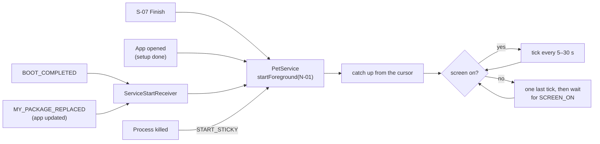

- `PetService` is a `LifecycleService` (`lifecycle-service`, already in the register for M5's overlay; M4 adds it to the build). Its `lifecycleScope` runs the engine coroutine (§3) on `Dispatchers.Default`: reading the event log and package info are blocking calls, and the app's screens share the process. It's still one coroutine, so engine state has one owner.
- **Manifest:** `<service android:foregroundServiceType="specialUse" android:exported="false">` with the `android.app.PROPERTY_SPECIAL_USE_FGS_SUBTYPE` property describing the use case (R-03). Permissions `FOREGROUND_SERVICE`, `FOREGROUND_SERVICE_SPECIAL_USE`, `RECEIVE_BOOT_COMPLETED`.
- **Start points** (D-70), all through `PetService.start(context)` = `ContextCompat.startForegroundService`:
  - S-07 Finish, and every `MainActivity.onStart` once setup is done. The app is in front, so starting is always allowed. Starting an already running service just repeats `onStartCommand`.
  - `ServiceStartReceiver` (manifest, not exported) for `BOOT_COMPLETED` and `MY_PACKAGE_REPLACED`. It reads `setup.completed` (`goAsync` + a coroutine) and starts the service only if setup is done. Both broadcasts are on Android's list of exemptions from the background-start restriction (checked 2026-10-20, "Restrictions on starting a foreground service from the background"), and Android 15's `BOOT_COMPLETED` restriction doesn't cover `specialUse` (§10).
  - Process death: `onStartCommand` returns `START_STICKY`, so the system recreates the service.
  - **Checked on the API 37 emulator (2026-10-20):** app update (`installDebug` over the running app) → the receiver starts it (`Background started FGS: Allowed … code:PACKAGE_REPLACED`); process killed (`run-as … kill -9`) → recreated within 5 s; `adb reboot` → running again without opening the app. All three with the battery exemption *not* granted. The R-09 fallback isn't needed on stock Android; other brands stay R-04.
  - If a start is refused anyway (`ForegroundServiceStartNotAllowedException`, Android 12+), it's logged, never swallowed.
- `onStartCommand` calls `ServiceCompat.startForeground(…, FOREGROUND_SERVICE_TYPE_SPECIAL_USE)` with N-01 every time. The service never stops itself in v1. Setup not done → nobody starts it.
- **Screen on/off:** a receiver registered by the service (these two broadcasts can't be declared in the manifest) feeds a `StateFlow<Boolean>`, seeded from `PowerManager.isInteractive`. Screen on → the tick loop runs. Screen off → one last tick credits up to now, then nothing runs until the screen comes on (§4, no wake locks, no alarms).
- **Errors:** a failing tick is logged and the loop carries on (§9). The cursor only moves when a tick's writes commit, so nothing is lost or counted twice.

**Notifications** (`service/Notifications.kt`)

| ID | Channel (importance) | Content | Tap |
|---|---|---|---|
| N-01 | `pet` "Pet is running" (low: no sound, no status-bar icon nag) | "Nyx is keeping an eye on your screen time." Ongoing | Opens the app (Home) |
| N-03 | `alerts` "Alerts" (default) | Title "Nyx lost a permission"; text lists what stopped working, using the S-03 "without it" strings | Opens S-03 in fix mode (below) |

- Channels are created in `PetApp.onCreate` (idempotent). N-02 and N-04 (M7) reuse `alerts` unless M7's LLD says otherwise.
- Without the notifications permission the service still runs; Android just doesn't show N-01 in the shade.

**How time is credited** (D-62)
- **Source:** `UsageStatsManager.queryEvents(from, to)`, mapped to our own `UsageEvent(type, packageName, className, at)`:

| Android event | Ours |
|---|---|
| `ACTIVITY_RESUMED` (1) | `APP_RESUMED` |
| `ACTIVITY_PAUSED` (2), `ACTIVITY_STOPPED` (23) | `APP_PAUSED` |
| `SCREEN_INTERACTIVE` (15) · `SCREEN_NON_INTERACTIVE` (16) | `SCREEN_ON` · `SCREEN_OFF` |
| `DEVICE_SHUTDOWN` (26) · `DEVICE_STARTUP` (27) | `DEVICE_SHUTDOWN` · `DEVICE_STARTUP` |
| anything else | ignored |

  (Constant values checked in the API 37 `android.jar`.)
- **Segments:** the time between two consecutive events belongs to the app in front at the start of it. "In front" = the most recently resumed activity (`package/class`), until that same activity pauses. A pause from another activity changes nothing, so moving between two screens of the same app, or a pause arriving after the next resume, never loses the app. (Tracking one activity instead of a list means a crashed app that never reports its pause can't come back to the front later.)
- A segment is credited only when the screen is on and the front app is counted (exclusions below). `DEVICE_SHUTDOWN` clears the front app and counts as screen off; `DEVICE_STARTUP` clears it and counts as screen on (on the emulator, Android logs `SCREEN_INTERACTIVE` together with `DEVICE_STARTUP`).
- Tick times are cut to whole milliseconds, like the event log and the cursor, so nothing is lost between ticks.
- **Split at day boundaries:** a segment that crosses the reset hour is split, and each part goes to its own day key (`DayClock.nextDayStart`). The day key is worked out from the moment the time happened, so a time-zone change never counts a day twice (§9).
- **Category at that moment:** the user's choice from `app_categories`, otherwise `suggestCategory(…)` (§14.3) with Android's category from `PackageManager.getApplicationInfo` (cached per package; an app Nyx can't see → Neutral). Read at every tick, so a change made in S-05 applies from the next tick on (US-04). New apps get a suggestion the first time they're used, and nothing is stored (D-58).
- **Exclusions** (A-20, D-69): Nyx itself, `com.android.systemui`, and every app that handles the HOME intent (the launcher and any other installed home app). The home apps are found with `queryIntentActivities(ACTION_MAIN + CATEGORY_HOME)`, which needs a second `<intent>` in `<queries>` (no permission). Read once per service start.
  - Android's fallback home screen is left out: it's `com.android.settings/.FallbackHome` (priority −1000), seen on the API 37 emulator and the Pixel 7a, and Settings time should count. So only home handlers with priority ≥ 0 are excluded.
  - Without the `<queries>` entry the launcher is invisible and only `FallbackHome` resolves (mutation check, 2026-10-20: `US04_ExcludedAppsTest` fails).
- **Cursor and catch-up:** every tick commits its new totals **and** the cursor ("credited until") in one Room transaction. On start, the tracker replays events from 24 h before `min(cursor, start of today)` to rebuild who's in front and the stretch, and credits only what lies after the cursor. So time used while the service was dead (killed, rebooted, updated) is still counted, and nothing is counted twice.
  - First start ever (no cursor): credit from the start of today, so Home's first numbers match Digital Wellbeing's.
  - At most 7 days are caught up (Android keeps the event log for about that long); older gaps are skipped and logged.
- **While usage access is missing**, ticks don't credit and the cursor stays put. Otherwise the last front app would keep collecting time with no events to stop it. When access comes back, catch-up fills the gap from Android's log.

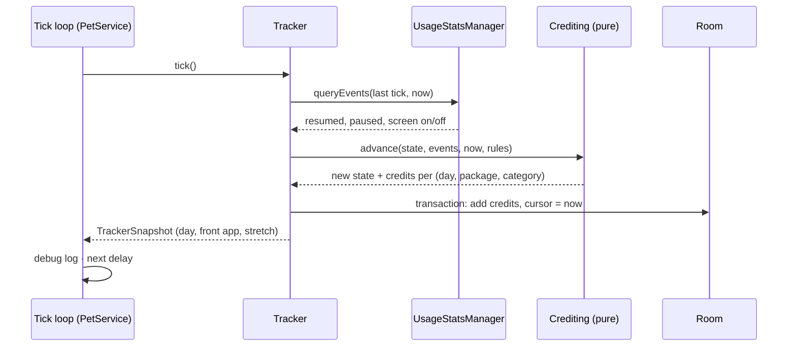

**Stretch** (D-65, US-09, D-27)
- The stretch is the time spent in the `limits.stretch.categories` apps since the last break or the start of the day.
- Time in other apps neither adds to it nor resets it. Only a break resets it: a `SCREEN_OFF` → `SCREEN_ON` gap of at least `breaks.breakMinutes`. The day reset also resets it (§9).
- Rebuilt by the catch-up replay, so it survives a restart. M7's `stretch_reached` trigger reads it from the snapshot.

**Tick interval** (H-01)
- M4: `fastTickSeconds` when a daily limit or the stretch limit that covers the front app is less than one slow tick away from being reached, otherwise `slowTickSeconds`. A pure function, `tickDelay(snapshot, totals, effective)`.
- M7 (active nag) and M8 (focus session) add their own "fast" conditions to the same function.

**Day reset and cleanup**
- The day key is recomputed at every tick. When it changes (and once at service start), rows older than 31 days are deleted: `day < today − 31` (A-13). ISO day keys compare correctly as text.
- Changing the reset hour moves the boundary from the next tick on. Time already credited stays on its day.

**Permission lost** (US-26, D-66)
- Checked at every tick with `PermissionChecks` (§14.3). Required: usage access and display over other apps. Notifications and battery aren't: without notifications N-03 couldn't be shown anyway, and the battery exemption isn't something the user "loses".
- N-03 is posted when a required permission is missing at this check but wasn't at the previous one. A service start counts as "all granted before", so a permission skipped in setup gets one N-03 per service start. It's cancelled once everything is granted again.
- Tapping it opens `MainActivity` with a fresh task and `open=permissions`: the back stack starts as `[Home, FixPermissions]`. `FixPermissions` is S-03 with `onNext` = back to Home. M7's Settings reuses the same key.

**Storage** — `AppDatabase` version 2 (debug builds wipe local data on the upgrade, §14.1; the developer's phone loses its M3 category choices once)

`daily_app_usage` (D-63)

| Column | Type | Notes |
|---|---|---|
| `day` | TEXT | ISO day key, e.g. `2026-10-21` (confirms §14.1) |
| `package_name` | TEXT | |
| `category` | TEXT | Kotlin enum name, as in `app_categories` |
| `duration_ms` | INTEGER | Milliseconds, not seconds: most segments are a few seconds long, and rounding each one would drift by minutes over a day |
| | | Primary key `(day, package_name, category)`. The key starts with `day`, so per-day reads and the cleanup use it as their index |

- Adding time is one statement: `INSERT … ON CONFLICT(day, package_name, category) DO UPDATE SET duration_ms = duration_ms + excluded.duration_ms` (SQLite ≥ 3.24; Android 11 ships 3.28).
- `tracking_cursor`: one row (`id` = 0), `credited_until_ms` INTEGER. In Room, not DataStore, so it commits in the same transaction as the totals.
- **`events` moves to M6/M7** (D-64): nothing writes it in M4. Same rule as D-50: a table arrives with its first real use.
- `DailyUsageDao`: `addAll(credits)` and `setCursor` in one `@Transaction`, `cursor()`, `observeDay(day): Flow<List<DailyUsage>>`, `deleteBefore(day)`.

**Home (S-08) with real data** (D-68)
- `TrackingSummaryRepository` replaces `FakeSummaryRepository` (deleted; its sample moves to the screen's preview and test).
- Today's key comes from a small flow that re-checks the day every minute, so Home rolls over at the reset hour without a restart. Totals follow the table through Room's `Flow`, so Home updates after every tick (≤ 30 s behind; Nyx's own screens aren't counted).
- **Total** = all counted time · **Productive** = `productive` · **Doomscrolling** = `tracking.doomscrollCategories` (A-15).
- **Goals in M4 are the limit goals:** one row per category with a daily limit above 0, and one for the total limit if it's on. Label "Social & scrolling ≤ 1 h", built on screen from the category name, so `GoalProgress` holds a `Category?` (`null` = total) instead of a text. Positive goals come in M13.
- **Face:** the chosen pet's face for the band containing `mood.start`, like S-04, until mood exists (M6).

**Debug tools** (Track A, ROADMAP §2, D-67) — debug builds only
- **Scenario files** in `android/app/src/debug/assets/scenarios/*.txt`, one step per line:

```text
# 65 minutes of Instagram, then the home screen
app com.instagram.android 65m
idle 2m
```

  - Steps: `app <package> <duration>` (that app in front) · `idle <duration>` (screen on, nothing counted in front) · `screen_off <duration>`. Durations `90s`, `65m`, `2h`. `#` starts a comment. Any other line rejects the whole file with its line number.
  - Shipped: `instagram-65min`, `stretch-break` (Instagram 20 min → screen off 6 min → Instagram 15 min: the stretch restarts) and `app-switching` (Instagram, Chrome, YouTube, Instagram).
- **Fast clock:** `AppContainer.clock` is an `AdjustableClock`. In release it's always the system clock. In debug it can run N× faster from the moment the speed is set; the tick loop divides its delays by the same speed.
- **Run them over adb:** a debug-only receiver, exported but guarded by `android.permission.DUMP`, which only the shell (adb) holds:
  - `adb shell am broadcast -n com.companionstudio.nyx/.debug.ScenarioReceiver --es scenario instagram-65min --ei speed 60` → today's tracking is cleared, the clock runs 60× and the tracker reads the scenario instead of Android's events. 65 min of Instagram takes about 65 s.
  - `… --ez stop true` → tracking cleared, real clock, real events again.
- Main code only has two hooks for this, both explicit in `AppContainer`: `clock` and `usageSource: MutableStateFlow<UsageSource>`. The service restarts its tracker whenever `usageSource` changes.

**Files** (`android/app/src/main/java/com/companionstudio/nyx/` unless stated)

| File | Responsibility |
|---|---|
| `service/PetService.kt` | Foreground service, screen receiver, tick loop, permission watch, N-01 |
| `service/ServiceStartReceiver.kt` | Boot and app-update restart |
| `service/Notifications.kt` | Channels, N-01, N-03 |
| `service/PermissionWatch.kt` | Pure: which required permissions just went missing |
| `tracking/UsageEvent.kt` · `UsageSource.kt` | Our event type · `UsageSource` interface + `SystemUsageSource` (`UsageStatsManager` → `UsageEvent`) |
| `tracking/Crediting.kt` | Pure: `TrackerState`, `CreditRules`, `advance(…)` → state + credits (segments, day split, exclusions, stretch) |
| `tracking/Tracker.kt` | Catch-up, `tick()`, category lookup, writes; returns `TrackerSnapshot` |
| `tracking/TickDelay.kt` | Pure: the tick interval |
| `tracking/DailyUsage.kt` · `DailyUsageDao.kt` | The two tables and their DAO |
| `tracking/ExcludedApps.kt` | Nyx, System UI, home apps |
| `home/TrackingSummaryRepository.kt` | Today's summary from Room + config + pet choice; `todaySummary(…)` is pure |
| `data/DayClock.kt` | + `startOfDay(day, resetHour)`, `nextDayStart(instant, resetHour)` |
| `data/AdjustableClock.kt` | The clock with a speed (1 outside debug tools) |
| `data/AppDatabase.kt` | Version 2, the new entities |
| `AppContainer.kt` · `PetApp.kt` · `MainActivity.kt` · `AppNavigation.kt` | Wiring, channels, start on open, `FixPermissions` |
| `setup/StatsOptInScreen.kt` | Finish also starts the service |
| `AndroidManifest.xml` | Service, receiver, permissions, HOME `<queries>` |
| `src/debug/AndroidManifest.xml` · `src/debug/java/…/debug/` · `src/debug/assets/scenarios/` | `ScenarioReceiver`, `Scenario` parser + `ScenarioUsageSource`, scenario files |

**Tests**

| Test | Where | Checks |
|---|---|---|
| `F02_CreditingTest` | `src/test/` | App switches credit each app its own time · same-app screen changes and a late pause don't lose time · screen off isn't counted · excluded apps aren't counted · a segment over the reset hour is split onto two days · a change of category between ticks applies from then on · nothing before the cursor is credited, but replaying it still rebuilds the front app and stretch · shutdown clears the front app |
| `US09_StretchTest` | `src/test/` | Only stretch categories add to it · other apps don't reset it · screen off ≥ break resets it, shorter doesn't · the day reset resets it |
| `TickDelayTest` | `src/test/` | Slow by default · fast when the front app's category limit, the total or the stretch is within one slow tick · a limit of 0 (off) never makes it fast · excluded or no front app → slow |
| `US26_PermissionWatchTest` | `src/test/` | Newly missing → notify · still missing → no repeat · granted again → cancel · missing at service start → notify once · only usage access and overlay count |
| `US28_TrackingSummaryTest` | `src/test/` | Totals, productive and doomscrolling from rows · limit goals only for limits above 0, total included when on · user values used (effective config) · face of the chosen pet |
| `DayClockTest` (+) | `src/test/` | `startOfDay` and `nextDayStart` with reset hours 0 and 4, and on a time-zone change |
| `ScenarioTest` | `src/testDebug/` | Parses every shipped file · durations · events at the right times · a bad line is rejected with its number |
| `DailyUsageDaoTest` | `src/androidTest/` | Adding twice sums · totals and cursor commit together · `deleteBefore` keeps the 31st day · `observeDay` emits on change |
| `US04_ExcludedAppsTest` | `src/androidTest/` | On a device, the home app list isn't empty and contains the default launcher (checks the new `<queries>` entry) |

- Coverage: ≥ 90% lines on `Crediting.kt`, `TickDelay.kt`, `PermissionWatch.kt` and `DayClock` (ROADMAP §2 lists "usage-event → time crediting").
- **Checked by hand on the emulator** (adb): N-01 shows; the service runs after Finish and after an app open; `adb reboot` → running again without opening the app; `adb install -r` (update) → running again; process killed → recreated; scenarios give the expected totals on Home; revoking usage access → N-03 → tap → S-03 → grant → back to Home → catch-up fills the gap.
- **On the Pixel 7a** (the developer): an hour of normal use vs Digital Wellbeing (± 2 min), and a reboot. Passed 2026-10-21.

**Decisions** (approved 2026-10-20)
- **D-62:** time is credited from Android's usage event log with a stored cursor. After any restart the tracker replays the log and credits the gap (≤ 7 days). The first start credits from the start of today.
- **D-63:** durations are stored in milliseconds (`duration_ms`). The HLD's "seconds per app per day" stays true for everything shown.
- **D-64:** the `events` table arrives with its first writer (M6/M7), not in M4 as §14.1 said.
- **D-65:** the stretch counts only time in the stretch categories; other apps neither add nor reset; a break or the day reset resets it.
- **D-66:** N-03 covers usage access and overlay. It fires when one goes missing since the last check, once per service start for one that was never granted; tracking pauses meanwhile and catches up afterwards.
- **D-67:** debug test tools: scenario files and a fast clock, run with adb through a debug-only receiver guarded by `DUMP`. Main code gets an adjustable clock (always real in release) and a swappable usage source.
- **D-68:** Home's goals in M4 are the limit goals from the effective config; the face is the chosen pet's starting face until M6.
- **D-69:** excluded apps are Nyx, `com.android.systemui` and every HOME handler with priority ≥ 0 (not Settings' fallback home), found through a second `<queries>` intent.
- **D-70:** the service starts on Finish, on every app open, on boot and on app update, and is sticky after process death. M4's tick is fast only when a limit on the front app is less than one slow tick away.

**Not in M4:** the pet on screen and the "Show pet" action on N-01 (→ M5), mood and the `events` table (→ M6), triggers, nags, break reminders and their fast-tick conditions (→ M7), focus (→ M8), a Home banner when usage access is missing (parking lot), Settings opening S-03/S-05 (→ M7).

### 14.5 M5 — Pet overlay: pet, summary panel, hide

Written 2026-10-21 and built in the same session at the developer's request; D-71 to D-78 approved 2026-10-21 at the end of M5.

**Purpose:** the pet floats over every app and the home screen, can be dragged and snaps to an edge, opens a live summary panel on tap, and can be hidden for a while. Stories: US-06 (on screen, drag, snap, taps elsewhere pass through), US-07 (summary panel), US-29 (hide, show again), F-15 (same emoji everywhere).

**One overlay window** (D-71)

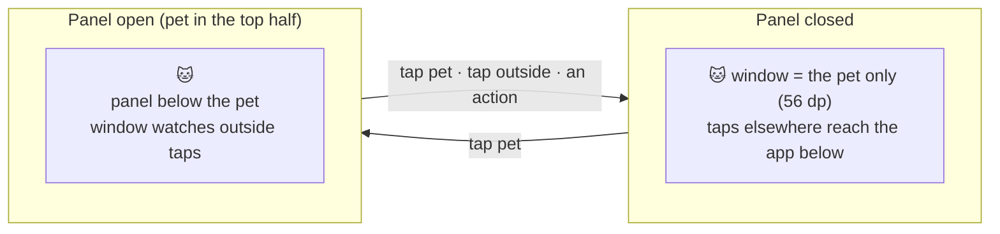

- `PetService` owns one `PetOverlay`. Its window is `TYPE_APPLICATION_OVERLAY`, `FLAG_NOT_FOCUSABLE`, `WRAP_CONTENT` both ways, so with the panel closed it is exactly the pet's size and every tap outside it reaches the app below (US-06). Not focusable: the overlay never takes the keyboard or Back (H-05).
- **The panel lives in the same window.** Opening it makes the window grow; the window is anchored so the pet doesn't move:
  - horizontally to the pet's edge (`Gravity.START` or `END`, `x = 0`),
  - vertically to the nearer of top and bottom (`TOP` with `y` = the pet's distance from the top, or `BOTTOM` with `y` = its distance from the bottom). In the top half the panel opens below the pet; in the bottom half, above it.
  - The panel's height is capped to the space on its side (`heightIn(max)`) and scrolls inside, so it fits in landscape too.
- **Outside taps:** while the panel is open, and only then, the window has `FLAG_WATCH_OUTSIDE_TOUCH`; an `ACTION_OUTSIDE` closes the panel (the tap still reaches the app below). Only while open, so the process isn't woken for every touch on the phone.
- Tapping the pet toggles the panel. Because pet and panel are one window, a tap on the pet is never also an "outside" tap.
- Rejected: a separate panel window (a tap on the pet would also be an outside tap for the panel, closing and reopening it); a full-screen scrim window (blocks the app below).

**Coordinates** (`pet/PetPlacement.kt`, pure)
- The usable area is the window metrics' bounds minus the system bars and display cutout (`WindowMetrics.windowInsets.getInsetsIgnoringVisibility(systemBars() or displayCutout())`). The window sets the same `fitInsetsTypes`, so its `x`/`y` are measured inside that area.
- Stored position (D-73): `side` (left/right) + `yFraction` (0 = top, 1 = bottom of the area minus the pet). It survives rotation and different screen sizes. Default: right edge, 30% down.
- `placement(position, area, petPx)` → side, `fromBottom` (yFraction > 0.5), offset `y`. `panelMaxHeight = area.height − y − petPx` on either side.
- `snapToEdge(left, top, area, petPx)` → the side whose half holds the pet's centre, `yFraction = top / (area.height − petPx)` clamped to 0–1.

**Touch handling** (D-72)
- **Taps** stay in Compose: the pet is a `clickable` with a content description, so TalkBack can open the panel too. Touch target 56 dp ≥ 48 dp (§9).
- **Drags** are caught by `PetDragLayout`, a `FrameLayout` that wraps the `ComposeView`. Once the finger moves past the touch slop it intercepts the gesture (Compose gets `ACTION_CANCEL`, so no click), moves the window with `updateViewLayout` using raw screen coordinates, and on release snaps to the nearest edge and stores the position. Raw coordinates matter: the window moves under the finger, so the local coordinates Compose's drag detector uses would jump each frame. (Compose's `pointerInteropFilter` would give raw coordinates too, but it's experimental.)
- While dragging, the window uses `TOP|START` with free `x`/`y` clamped to the area; after the snap it goes back to the anchored placement above.
- Drag is off while the panel is open. Rotation → the service's `onConfigurationChanged` re-places the window.

**Compose inside a service** (D-78)
- Windows are added through a window context: `createDisplayContext(default display).createWindowContext(TYPE_APPLICATION_OVERLAY, null)` (API 30), not the service context (Android flags UI from a non-visual context).
- Compose needs a lifecycle and a saved-state registry on the view tree. `OverlayOwner` gives both: its own `LifecycleRegistry`, resumed from creation until the service is destroyed, and a `SavedStateRegistryController` restored with nothing (the overlay starts fresh with the service). No new dependency: `LifecycleRegistry` comes with `lifecycle-service`, and `androidx.savedstate` is part of `activity`'s public API (its Gradle metadata lists it as an `api` dependency).
- The content is wrapped in `NyxTheme`, so it follows dark mode and dynamic colour like the app.

**What's on screen**
- **O-01 Pet:** the face from `SummaryRepository.observeToday()` — in M5 still the chosen pet's starting face (D-68) — in a 56 dp circle with a light surface and shadow, so it reads over any app. Emoji size is set in dp, so large system text doesn't make it overflow its circle. Glow (M7) and the focus timer badge (M8) come later.
- **O-03 Summary panel:** the same composable as Home's numbers (`home/SummaryNumbers`: total, productive, doomscrolling, limit goals), so the two can't disagree. Buttons:
  - **Start focus** (only when `features.focus` is on): opens the app at `[Home, FocusSetup]` — the placeholder until S-09 (M8).
  - **Open Nyx:** opens Home.
  - **Hide for N min** (`hide.minutes`, 30 by default).
  - Each action closes the panel. Activities are started from the service with `FLAG_ACTIVITY_NEW_TASK`; Android allows it because the user granted "display over other apps" (an exemption from the background activity-start limits).
- **O-02 Speech bubble:** M5 ships the `SpeechBubble` composable (line, optional Snooze, Dismiss) and its test. Its window and placement arrive in M6 with the bubble arbiter, its first caller (D-75; same rule as D-50 and D-64).

**Panel numbers ≤ 1 min old** (US-07, D-77)
- Opening the panel sends a request on a conflated `Channel` that the engine loop waits on between ticks (`withTimeoutOrNull(delay) { receive() }`), so the tick runs at once on the one engine coroutine (§3).
- The panel shows Room's current numbers immediately (≤ 30 s old) and updates when that tick commits, well within 1 s.

**Hide and show** (US-29, D-74)
- Hide stores `pet.hiddenUntil` (epoch ms) = now + `hide.minutes`. "Shown" = no value or a time already past.
- `petShown(hiddenUntil, recheck, clock)` (pure flow): emits `false`, waits until the time is up (the wait divided by the debug clock speed, D-67), then emits `true`. It re-reads the clock whenever `recheck` emits — the service passes its screen-on flow — because a coroutine timer can stall while the phone is in deep sleep. So the pet is back at the first screen-on after the time is up at the latest.
- **Show pet early** writes "no value" (screens and buttons write storage, the service follows it, D-44):
  - N-01 while hidden reads "The pet is hidden until 14:30." (12/24 h per the phone) and has a **Show pet** action → `ShowPetReceiver` (manifest, not exported) clears the value.
  - Home shows a **Show pet** button while the pet is hidden.
- A reboot while hidden keeps the pet hidden until the time is up.
- Once the time has passed, the service removes the stored value, so setting the clock back later (or the debug fast clock resetting) can't hide the pet again. It compares with the clock, not with "shown": right after Hide the stored value changes a moment before "shown" does, and comparing with "shown" cleared the fresh value (found on the emulator).
- N-01 is on the low-importance `pet` channel, so the shade shows it collapsed: **Show pet** appears once the notification is expanded.
- What hiding changes for nags and break reminders (they become notifications, D-24) is M7's.

**When the window is on screen**
- `overlayAllowed && petShown`. `overlayAllowed` is updated at every tick from the permission watch (§14.4) and on every `onStartCommand` (so granting it and returning to the app shows the pet at once). Revoked → the window is removed; granted again → added back.
- `addView` can still fail if the permission goes away in between: the error is logged and the next change retries.

**emoji2** (F-15, D-76)
- `PetApp.onCreate` calls `EmojiCompat.init(DefaultEmojiCompatConfig.create(context).setReplaceAll(true))`; the library's own startup initializer is removed in the manifest (`tools:node="remove"`).
  - Why not the default: it waits for the first Activity to resume before loading the font, so after a reboot (service only, no Activity) the overlay would draw the phone's own emoji.
  - The config finds Google Play services' font provider and loads on its own background thread. No provider (no Play services) → `create` returns `null`, and the phone's emoji are used (TECH_STACK §5).
- Compose text uses `EmojiCompat` automatically once it has loaded, everywhere: setup, Home and the overlay. The load result is logged (no app names in it).
  - **Checked on the API 37 emulator (2026-10-21):** "Emoji font loaded" after a reboot with only the service running (no Activity), so no `<queries>` entry is needed for the font provider.
- `androidx.emoji2:emoji2` 1.7.0 (already in the register) is added to the build; Compose brought 1.4.0 transitively.

**Storage** — DataStore, in `PetSettings` (all pet keys in one place)

| Key | Type | Notes |
|---|---|---|
| `pet.side` | String | `left` / `right`; missing → default |
| `pet.yFraction` | Float | 0–1, clamped on read |
| `pet.hiddenUntil` | Long | Epoch ms; removed by Show pet |

**Files** (`android/app/src/main/java/com/companionstudio/nyx/` unless stated)

| File | Responsibility |
|---|---|
| `pet/PetOverlay.kt` | The window: add/remove, placement, drag, panel open/close, actions |
| `pet/PetDragLayout.kt` | Drag detection with raw coordinates; outside-tap callback |
| `pet/OverlayOwner.kt` | Lifecycle + saved state for Compose in the window |
| `pet/PetPlacement.kt` | Pure: area, position, placement, snap |
| `pet/PetWindow.kt` | Composables: the pet face, the panel and their layout in the window |
| `pet/SpeechBubble.kt` | O-02 composable (window in M6) |
| `pet/PetVisibility.kt` | `petShown(…)` (pure flow), hide / show |
| `pet/PetSettings.kt` | + position and `hiddenUntil` |
| `home/SummaryNumbers.kt` | Totals and goal rows, shared by Home and the panel |
| `home/HomeScreen.kt` · `HomeViewModel.kt` | + Show pet while hidden |
| `service/PetService.kt` | Creates the overlay, tick requests, overlay permission flow, N-01 updates, rotation |
| `service/Notifications.kt` | N-01 with the hidden text and Show pet action |
| `service/ShowPetReceiver.kt` | N-01's Show pet action |
| `PetApp.kt` · `AppContainer.kt` · `MainActivity.kt` · `AppNavigation.kt` | emoji2 init, `petVisibility`, open at Focus |
| `AndroidManifest.xml` | `ShowPetReceiver`, emoji2 initializer removed |

**Tests**

| Test | Where | Checks |
|---|---|---|
| `US06_PetPlacementTest` | `src/test/` | Snap to the side holding the centre · yFraction clamped to 0–1 · top half anchors from the top, bottom half from the bottom, and the pet stays at the same pixel either way · panel max height · an area smaller than the pet |
| `US29_PetShownTest` | `src/test/` | Never hidden → shown · hidden until exactly the stored time, then shown · Show pet early · a time in the past → shown · a stalled timer is caught up at the next recheck · the debug speed divides the wait |
| `PetSettingsTest` | `src/test/` | Position default, round trip and clamping · `hiddenUntil` set and cleared |
| `HomeViewModelTest` (+) | `src/test/` | `petHidden` follows storage · `showPet` clears it |
| `US07_SummaryPanelTest` | `src/androidTest/` | The panel shows exactly Home's numbers and goal lines for the same summary · buttons call back · Start focus hidden when focus is off · Hide label shows the minutes |
| `SpeechBubbleTest` | `src/androidTest/` | Line shown · Snooze only when offered · both buttons call back |
| `US28_HomeScreenTest` (+) | `src/androidTest/` | Show pet only while hidden, and it calls back |

- Screens and the window aren't held to a coverage number (ROADMAP §2); the pure placement and visibility logic is tested above.
- **Checked by hand on the emulator** (adb, 2026-10-21): pet over YouTube, Chrome, the home screen and Nyx itself; the window is exactly the pet (147 × 147 px) while closed; drag → snaps to the nearer edge; position kept after rotation and after the process is killed; landscape keeps the edge and relative height, and the panel is capped and scrolls; tap → panel at once, with a tick logged 150 ms after the tap; a tap outside and a tap on the pet close it; Start focus opens `[Home, FocusSetup]` and Open Nyx opens the app (no background-start block); Hide → window gone, N-01 "hidden until …" with Show pet; back after the time (30 min at 60× ≈ 30 s), from N-01's action and from Home's button; overlay revoked → gone + N-03, granted + app opened → back at once; after `adb reboot` the pet is back without opening the app and the emoji font loaded. Android hides the pet over the system permission dialog (its own rule for overlays), as expected.
  - On the emulator `BOOT_COMPLETED` reached Nyx about 3 minutes after boot: it waits in Android's queue behind every other app's boot receiver. Same path as M4; not something the app controls.
- **On the Pixel 7a** (the developer): the same over Instagram/YouTube, and after a reboot. Passed 2026-10-21.

**Decisions** (approved 2026-10-21)
- **D-71:** one overlay window holds the pet and, when open, the summary panel; it grows away from the pet's edge and from the nearer of top/bottom so the pet stays put. Outside taps are watched only while the panel is open.
- **D-72:** taps are Compose clicks (accessible); drags are a `FrameLayout` that intercepts past the touch slop and moves the window with raw screen coordinates.
- **D-73:** the position is stored as side + vertical fraction of the usable area; default right edge, 30% down.
- **D-74:** hide stores `pet.hiddenUntil`; the pet returns when it passes, re-checked at every screen-on; Show pet (N-01 action, Home button) clears it through storage.
- **D-75:** the speech bubble's window arrives in M6 with the arbiter; M5 ships the composable and its test.
- **D-76:** the app initialises emoji2 itself with replace-all and removes the library's startup initializer, so the font also loads when only the service runs (after a reboot).
- **D-77:** opening the panel forces a tick through a conflated channel the engine loop waits on; the panel shows stored numbers at once and updates after that tick.
- **D-78:** overlay windows use a window context; Compose's lifecycle and saved state come from a small `OverlayOwner` (no new dependency).

**Changed later:** from M7 the summary panel becomes the actions ring (CR-09, D-87, D-90 to D-92): a half ring of icons opening towards the middle of the screen; the pet slides along its edge when the ring wouldn't fit. M7's LLD replaces the panel parts of this section (D-71's growth, `SummaryPanel`), keeping the window, drag, hide and emoji parts.

**Not in M5:** what the pet says, the bubble window and mood faces (→ M6), glow, nags, N-04 and the hidden-pet notification rules (→ M7), the focus timer badge and S-09 (→ M8), Trends from the panel (→ M13).

### 14.6 M6 — Event log, mood, bubble arbiter, line picker

Written 2026-10-21 and built in the same session at the developer's request; D-79 to D-86 approved 2026-10-21 at the end of M6.

**Purpose:** the pet gets a mood that its face shows, runs away at 0 and comes back, and speaks through a speech bubble beside it. The bubble arbiter and the line picker are built for every trigger, but in M6 only `pet_returned` asks for a bubble: limits, nags, breaks and idle lines come in M7, focus in M8. Stories: US-15 (mood), US-16 (low point, ran away, return), US-03 (lines in the chosen personality).

**Per tick** — after the tracker (§14.4), on the same engine coroutine (§3)

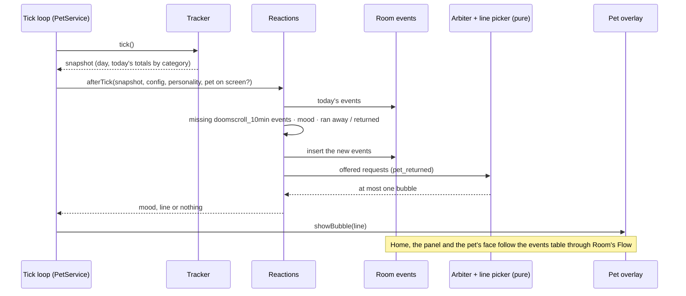

- `Reactions` (`rules/`) holds what the engine remembers between ticks that isn't stored: the arbiter's state and the recent lines. One instance per engine run, like `Tracker`; a service restart starts it fresh (D-83).

**Event log** — table `events` (D-64), Room version 3

| Column | Type | Notes |
|---|---|---|
| `id` | INTEGER | Primary key, auto-increment: the order events were logged in |
| `day` | TEXT | ISO day key of the moment it was logged (§9); indexed |
| `at_ms` | INTEGER | Epoch ms, from the app clock (fast in debug scenarios, D-67). For stats and debugging; not used for ordering |
| `type` | TEXT | `PetEventType` by Kotlin name, like `Category` |

- **Types in M6:** the six that carry a mood weight — `DOOMSCROLL_10MIN`, `LIMIT_EXCEEDED`, `SNOOZED`, `BREAK_TAKEN`, `GOAL_MET`, `FOCUS_COMPLETED` — plus `RAN_AWAY` and `PET_RETURNED` (weight 0). Only `DOOMSCROLL_10MIN`, `RAN_AWAY` and `PET_RETURNED` are written in M6; the others are declared so the mood maths is complete and tested now, and M7, M8 and M13 write them. M7 adds what it needs to log nags (e.g. which limit an event is about) with its own migration.
- `PetEventDao` (interface, so unit tests can fake it): `insertAll`, `eventsOn(day)` and `observeDay(day)` in log order (`id`, not time: found on the emulator, where events logged after the debug fast clock stopped sorted before the sped-up ones and changed the mood; a phone clock set back would do the same), `deleteBefore(day)` (31 days, A-13, at the first tick of a new day, like the tracker), `clearAll()` (debug scenarios only).
- **Migration** (D-85): an `AutoMigration(from = 2, to = 3)` generated by Room from the exported schemas. Adding a table is what auto-migrations handle without a spec, so a debug build installed over M5 keeps the S-05 categories and today's totals instead of wiping them (§14.1's destructive fallback stays for anything else). No migration test yet: `room-testing` goes through approval at v1.0.0 (§14.1). Checked by hand: install over the M5 build.

**`doomscroll_10min`** (D-81, `rules/Doomscroll.kt`, pure)
- Due events = ⌊doomscrolling ms today ÷ 10 min⌋ − the `DOOMSCROLL_10MIN` events already logged today, never below 0. Doomscrolling = the `tracking.doomscrollCategories` totals, as on Home (A-15).
- Logged at the tick that notices, with that tick's time. Derived from the stored totals, so a restart, a catch-up or a missed tick neither loses nor repeats one.
- Time caught up for an earlier day (§14.4) isn't turned into events: that day's mood no longer shows anywhere.

**Mood** (SM-01, US-15, D-79, `mood/Mood.kt`, pure)

```kotlin
fun moodOf(events: List<PetEventType>, mood: MoodConfig): Int =
    events.fold(mood.start) { value, event -> (value + weightOf(event, mood.weights)).coerceIn(0, 100) }
```

- Today's events in log order, with the weights of the config in force now (H-03: an admin change of weights applies at once). The day reset gives an empty log, so mood is back to `mood.start`.
- **Clamped after every event, not once at the end.** With a single clamp, a pet that had fallen to "−40" would need +45 before it came back, and a break (+5) wouldn't bring it back as US-16 promises. Likewise, gains above 100 aren't banked.
- **Face:** the chosen pet's face for the band that contains the mood (`MoodConfig.bandAt`, also used by S-04 and Home now). The validator guarantees every value 0–100 has a band and every pet has a face for it. "Ran away" is mood 0, not a band id (§14.2); with the default bands, 0 is the `ran_away` band, so the face is 🐾 (Cat) or 💨 (Blob).
- **Where mood is computed:** `todaySummary(…)` computes it from the events table, so Home's face, the pet's face and the panel follow the log through Room's `Flow` (D-44). `Reactions` computes it with the same function for the band of a line and the ran-away check. Nothing stores a mood number.

**Ran away and back** (US-16, A-11, D-80, `mood/Mood.kt`, pure)
- `presenceChange(events, mood)`: `RAN_AWAY` when the mood is 0 and the last of today's `RAN_AWAY`/`PET_RETURNED` events isn't `RAN_AWAY`; `PET_RETURNED` when the mood is above 0 and it is. Otherwise nothing.
- Logged like any event, so a restart doesn't announce a return twice. Logging `PET_RETURNED` offers a `pet_returned` bubble.
- The day reset brings the pet back silently: the new day's log is empty, so there's nothing to return from (SM-01).
- Only a positive event can lift mood above 0: a break after a reminder (M7, A-26), a completed focus session (M8) or a met positive goal (M13).

**Bubble arbiter** (bubble rules in DISCUSSION, A-21, D-82, `rules/BubbleArbiter.kt`, pure)

| Tier (highest first) | Triggers | Gap applies | While hidden |
|---|---|---|---|
| Focus | `focus_drift`, `focus_started`, `focus_checkin`, `focus_broken` | yes, except `focus_drift` | skipped |
| Stretch nag | `stretch_reached` | yes | notification (N-04, M7) |
| Daily-limit nag | `limit_reached`, `limit_repeat` | yes | notification (N-04, M7) |
| Break reminder | `break_due` | yes | notification (N-02, M7) |
| Reward | `goal_met`, `focus_completed`, `break_taken`, `pet_returned` | yes | skipped |
| Idle | `idle` | yes | skipped |

- **Input per tick:** the requests offered this tick (`BubbleRequest(trigger, values, key)`; `key` defaults to the trigger, M7 uses one per limit), whether the pet is on screen, whether a focus session runs (always no until M8), `bubbles.minGapSeconds` and the clock.
- **Pending:** a request that can't show yet waits in the arbiter's state; a newer request with the same key replaces it, so the list never grows past one per key.
- **Pet on screen** = shown (not hidden, §14.5) and the overlay permission granted. Not on screen → nag and break requests come back as notifications (delivered from M7) and the others are dropped (D-24).
- **Focus session** (from M8) → only the focus tier can show; nags, breaks and rewards stay pending until it ends (D-25); idle requests are dropped (D-26). Focus beats hidden: held requests stay held.
- **Otherwise** the highest tier wins (earliest offered within a tier). It shows if no bubble has appeared in the last `minGapSeconds`, or if it's `focus_drift`; the rest keep waiting. At most one bubble per tick.
- **The gap runs from when the previous bubble appeared** (D-82), not from when it closed. The arbiter needs no message back from the window, and with the default 60 s gap and 8 s on screen there's still 52 s of quiet. If an admin sets the gap below `showSeconds`, a new bubble replaces the one showing: still one at a time.

**Line picker** (§4, D-83, `rules/LinePicker.kt`)
- **Pool:** `lines[personality][trigger]`, the current mood band's pool if it exists and isn't empty, otherwise `any` (which the validator guarantees). The personality is the user's choice if it's still enabled, otherwise the first enabled one, like the pet (§14.4).
- **No repeats:** random from the pool minus the last 3 lines shown for that trigger (fewer when the pool is small: at most pool size − 1 are left out, so a 1-line pool still works). The history lives in memory, per trigger; after a service restart a recent line can come back once.
- **Placeholders** are filled from the request's values. Which trigger may use which is fixed in code (`BubbleTrigger.placeholders`) and checked by a new validator rule, `line-placeholders`:

| Trigger | May use | Filled with (by the milestone that offers it) |
|---|---|---|
| `limit_reached`, `limit_repeat` | `{app}` `{category}` `{limit}` | Front app's label, category name, the limit as on Home ("1 h") — M7 |
| `stretch_reached` | `{app}` `{minutes}` | Front app's label, the stretch limit in minutes — M7 |
| `break_due` | `{minutes}` | `breaks.breakMinutes` — M7 |
| `focus_drift` | `{app}` | The app that isn't allowed — M8 |
| `focus_checkin` | `{minutes}` | Minutes into the session — M8 |
| every other trigger | none | — |

  - `line-placeholders` rejects any `{…}` in a line of a known trigger that isn't in its list, including typos such as `{App}`. Unknown triggers are still ignored (D-52). New fixture: `line-placeholders--not-allowed-for-trigger.json`. The backend implements the same rule in M10 (D-53). The default config already passes it.
  - A placeholder without a value is left as written; each milestone's tests check that its requests fill every placeholder their trigger allows.

**Bubble window** (O-02, D-75, D-84)
- The bubble shows **in the pet's window, in the panel's place**: away from the pet's edge, below the pet in the top half and above it in the bottom half, with the panel's maximum height. The window is anchored as in D-71, so the pet doesn't move when the bubble appears.
- The panel wins: while it's open, the bubble waits behind it and appears if the panel closes before the bubble's time is up.
- Shown for `bubbles.showSeconds`, then removed. Always real seconds, even under the debug fast clock (D-67): it's time to read the line, not usage time. (First built divided by the speed, like the engine's waits; at 60× the bubble vanished after 0.13 s on the emulator.) **Dismiss** removes it at once. Starting a drag removes it too, so the pet doesn't jump inside a window that changes size under the finger. Snooze arrives with nags in M7.
- While the bubble shows, the window is the bounding box of pet + bubble, so the transparent corner beside the pet catches taps for those few seconds. Accepted: at most `showSeconds` (8 s), and the alternative — a second window kept next to the pet during drags and rotations — is much more code.
- TalkBack reads a new bubble (polite live region).
- The engine hands the line to `PetOverlay.showBubble(line)`, which switches to the main thread itself. The arbiter only delivers a bubble when the pet is on screen, so there's no window to wait for.

**Debug tools** (D-67, D-86)
- New scenario `instagram-4h`: four hours of Instagram. With the default weights, 4 h walks the Cat from 😸 70 down every band to 🐾 0 (−3 every 10 min reaches 0 after 240 min); at `--ei speed 60` that's 4 minutes.
- New extra on `ScenarioReceiver`: `--es event break_taken` logs one event of that type now (any `PetEventType`, case-insensitive), without clearing anything. It stands in for the positive events M7, M8 and M13 will write, so a ran-away pet's return can be checked now.
- Starting a scenario (or `--ez stop true`) also clears the event log, like the tracking tables.

**Files** (`android/app/src/main/java/com/companionstudio/nyx/` unless stated)

| File | Responsibility |
|---|---|
| `rules/PetEvent.kt` · `rules/PetEventDao.kt` | `events` entity, `PetEventType`, DAO |
| `rules/Doomscroll.kt` | Pure: `doomscroll_10min` events due |
| `rules/BubbleArbiter.kt` | Pure: tiers, `BubbleRequest`, `arbitrate(…)` |
| `rules/LinePicker.kt` | Pool lookup, no-repeat pick, placeholder fill |
| `rules/Reactions.kt` | Per tick: log events, mood, ran away/back, arbiter, line |
| `mood/Mood.kt` | Pure: `moodOf`, weights, `bandAt`, `presenceChange` |
| `config/BubbleTrigger.kt` · `ConfigValidator.kt` | Placeholders per trigger; rule `line-placeholders` |
| `data/AppDatabase.kt` | Version 3, `events`, auto-migration 2 → 3 |
| `data/DayClock.kt` | `RETENTION_DAYS` (A-13), now shared by tracker and event log |
| `home/TrackingSummaryRepository.kt` | Face from today's mood |
| `setup/ChoosePetViewModel.kt` | Uses `bandAt` |
| `pet/PetWindow.kt` · `SpeechBubble.kt` · `PetOverlay.kt` | What sits beside the pet (panel or bubble); bubble timing and dismissal |
| `service/PetService.kt` · `AppContainer.kt` | "Pet on screen" flow, `Reactions` per engine run, wiring |
| `src/debug/…/ScenarioReceiver.kt` · `src/debug/assets/scenarios/instagram-4h.txt` | Event extra, clearing the log, the 4 h scenario |
| `shared/fixtures/invalid/line-placeholders--not-allowed-for-trigger.json` · `shared/config.schema.json` (description) | The new rule |

**Tests**

| Test | Where | Checks |
|---|---|---|
| `US15_MoodTest` | `src/test/` | Starts at `mood.start` · every weight moves it by its configured amount · clamped at 100 and at 0 after each event, so a rise after hitting 0 starts from 0 · `RAN_AWAY`/`PET_RETURNED` weigh nothing · every value maps to its band · weights from the config in force |
| `US16_PresenceTest` | `src/test/` | Mood 0 → `RAN_AWAY` once · still 0 → nothing · above 0 after running away → `PET_RETURNED` once · a second run-away and return in a day · a fresh day starting above 0 → nothing |
| `DoomscrollTest` | `src/test/` | 9 min 59 s → 0, 10 min → 1 · only the doomscroll categories count · already logged → only the missing ones · fewer due than logged (categories changed) → 0 |
| `BubbleArbiterTest` | `src/test/` | Tier order · earliest first within a tier · the gap holds a bubble back, then lets it show · `focus_drift` ignores the gap · one bubble per tick · same key replaces · hidden → nag and break as notifications, others dropped · focus → focus tier only, others held, idle dropped · focus + hidden → held stay held |
| `LinePickerTest` | `src/test/` | Band pool first · empty or missing band pool → `any` · no repeat of the last 3 over many seeded picks · pools of 1 and 2 · placeholders filled, a missing value left as written |
| `ReactionsTest` | `src/test/` (fake DAO) | Doomscroll events logged once · walking to 0 logs `RAN_AWAY` · a positive event → `PET_RETURNED` + a `pet_returned` line in the chosen personality · pet not on screen → no bubble, event still logged · a disabled personality → the first enabled one · old days cleaned up once per day |
| `US28_TrackingSummaryTest` (+) | `src/test/` | The face follows today's events; mood 0 → 🐾 / 💨 |
| `ConfigValidatorTest` (+) · `US21_ConfigFixturesTest` (+) | `src/test/` | `line-placeholders`: a placeholder another trigger allows, an unknown one, a typo; unknown triggers ignored; the default config passes; the new fixture is rejected with exactly that rule |
| `PetEventDaoTest` | `src/androidTest/` | Insert and read back in log order · `observeDay` emits on insert · `deleteBefore` keeps the 31st day · `clearAll` |
| `PetWindowBubbleTest` | `src/androidTest/` | The bubble shows beside the pet without Snooze · Dismiss calls back · the panel replaces it while open |
| `US07_SummaryPanelTest` (changed) | `src/androidTest/` | Same checks with the new `PetWindow` signature |

- Coverage: ≥ 90% lines on `rules/` and `mood/` (ROADMAP §2).
- **To check by hand** (adb, fast clock): install over the M5 build keeps categories and totals; `instagram-4h` at 60× walks the face down every band to 🐾 on the pet, the panel and Home; `--es event break_taken` → 🙀 (mood 5) and a "pet_returned" bubble in the chosen personality; Dismiss; the bubble disappears after 8 s; the bubble opens below the pet in the top half and above it in the bottom half; a drag removes it; hidden → no bubble. Start the 4 h scenario before 20:00 at 60× (or with more speed), or it crosses midnight and the day reset puts the mood back to 70.
- **Checked on the API 37 emulator** (2026-10-21): installing over the M5 build moved the database from version 2 to 3 and kept today's totals (207 min); the service came back on its own and logged mood 70. `instagram-4h` at 60×: mood 52 at 68 min, 😼 at 70 min, 😾 mid-way, mood 1 at 238 min, 0 and 🐾 at 240 min, with `RAN_AWAY` logged once. `--es event break_taken` → mood 5, 🙀, and the tick logged a `pet_returned` line ("I'm home! Thanks for taking care of things."). A `goal_met` from 0 → 😿 (mood 10) with the bubble below the pet in the top half, the pet not moving; after a drag to the bottom half the next bubble opened above it, with a different line; Dismiss removed it; it timed out after 8 real seconds; a drag removed one at once. Hidden (Hide for 30 min) and brought back from 0 → no bubble, no pet window, `PET_RETURNED` still logged; Home showed 😿 and "Show pet". After an emulator reboot, 3 device-test runs in a row were green.
  - Two bugs found this way and fixed: the bubble's time was first divided by the debug clock's speed, so at 60× it vanished after 0.13 s (it's reading time, so it's real seconds now); and the log was first ordered by `at_ms`, so events logged after the fast clock stopped sorted before the sped-up ones and gave the wrong mood (it's ordered by `id` now, which a clock set back can't disturb either).
- Not checked: TalkBack reading the bubble; the Pixel 7a (the developer closed M6 without a Pixel result recorded).

**Decisions** (approved 2026-10-21)
- **D-79:** mood is today's events folded from `mood.start` in log order with today's weights, clamped to 0–100 after every event; nothing stores a mood number.
- **D-80:** running away and coming back are logged events (`RAN_AWAY`, `PET_RETURNED`, weight 0); logging `PET_RETURNED` offers the `pet_returned` bubble; the day reset brings the pet back without a line.
- **D-81:** `doomscroll_10min` events are derived from today's doomscroll total: one per full 10 min, minus those already logged, logged at the tick that notices.
- **D-82:** the arbiter uses the six tiers above; pending requests wait (one per key); the gap runs from the previous bubble's appearance, `focus_drift` ignores it; not on screen → nags and breaks become notifications (from M7), others are dropped; during focus only focus bubbles show, others wait, idle is dropped.
- **D-83:** lines come from the band pool, else `any`; never one of the last 3 lines of that trigger (kept in memory); placeholders per trigger are fixed in code and enforced by the new `line-placeholders` validator rule (backend in M10).
- **D-84:** the bubble shows in the pet's window in the panel's place; the panel wins; it lasts `showSeconds`, Dismiss or a drag removes it; its window corner may catch taps for those seconds.
- **D-85:** Room version 3 adds `events` through an auto-migration from version 2, so debug installs keep their data; still no migration tests before v1.0.0.
- **D-86:** M6's "done when" uses a 4 h scenario instead of 2 h (2 h of Instagram only reaches 34 😾 with the default weights), and the return is checked with a debug-logged `break_taken`: a real break raises mood only after a reminder (A-26), which arrives in M7. M7's "done when" adds the real path.

**Not in M6:** limit, stretch, snooze and break events and their bubbles, N-02/N-04 and the glow (→ M7); idle lines (→ M7); focus requests and the focus hold's input (→ M8); `goal_met` (→ M13); a mood number or band name on Home and in TalkBack's description of the pet (parking lot).

### 14.7 M7 — Limits, nags, breaks, idle lines, actions ring, break screen

Written 2026-10-21; D-93 to D-108 approved 2026-10-21. Built in the same session at the developer's request.

**Purpose:** the pet reacts to the day. It glows and nags when a limit is crossed and repeats while you stay, a nag can be snoozed, it reminds you to take breaks and notices when you do, it says something now and then, and while hidden it uses notifications. Tapping it opens the actions ring. Users who pick it get the obstructive break screen. Stories: US-08, US-09, US-10, US-11, US-17 (limit goals), US-27, US-29 (notifications while hidden), US-07 + US-30 (ring, continuous screen use, reaction mode; CR-09, CR-10).

**Per tick** — the M6 step (§14.6) grows; still one engine coroutine (§3)

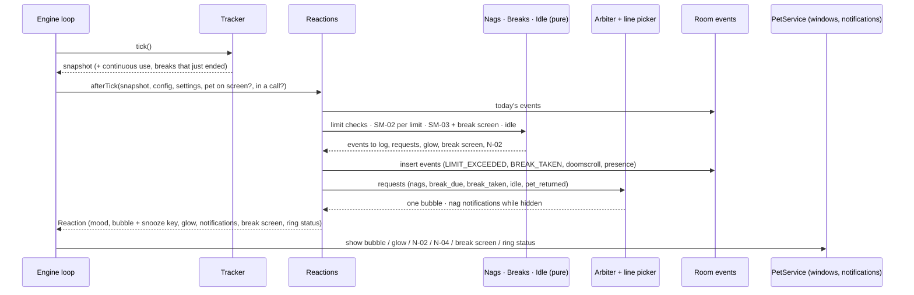

- `Reactions` stays the one place that remembers things between ticks (nag states, break state, idle baseline, arbiter, recent lines). The rules themselves are pure functions in their own files, each tested on its own.
- **Requests into the engine** (D-103): the conflated tick channel (D-77) becomes one unlimited `Channel<EngineRequest>`: `Tick` (ring opened), `Snooze(key)` (bubble button), `BreakScreenAnswer(takeBreak | fiveMore)`. The loop waits on it between ticks as today, handles the request on the engine coroutine, then ticks. So a tap and a tick never race.
- **File split** (§4's 250-line rule): the loop and `tick()` move from `PetService` to `service/Engine.kt`. `PetService` keeps the lifecycle, receivers, windows and notifications, and does what the `Reaction` says.

**Limits** (`rules/Limits.kt`, pure)

| Key | Limit | Used | Covers the front app when | Trigger (first · repeat) | Placeholders |
|---|---|---|---|---|---|
| `limit:<category>` | `limits.categories.<c>.dailyMinutes` | today's total for that category | its category is `<c>` | `limit_reached` · `limit_repeat` | `{app}` app label · `{category}` category name · `{limit}` as on Home ("1 h") |
| `limit:total` | `limits.totalDailyMinutes` | today's total | any counted app | same | `{category}` = "screen time" ("That's 2 h of screen time today") |
| `stretch` | `limits.stretch.minutes` | `snapshot.stretchMs` | its category is a stretch category | `stretch_reached` · `stretch_reached` again | `{app}` · `{minutes}` the limit |

- Values are the effective ones (user's choice in the admin's range, §5); a limit of 0 is off and has no key. `{app}` comes from a new `InstalledApps.label(packageName)` (`PackageManager.getApplicationLabel`, cached per package like the Android category); an app Nyx can't see gets its package name.
- `stretch_reached` repeats with its own pool: `limit_repeat`'s placeholders (`{category}`, `{limit}`) don't fit a stretch. No config change.

**SM-02 per limit** (`rules/Nags.kt`, pure; D-93, D-94, D-95)

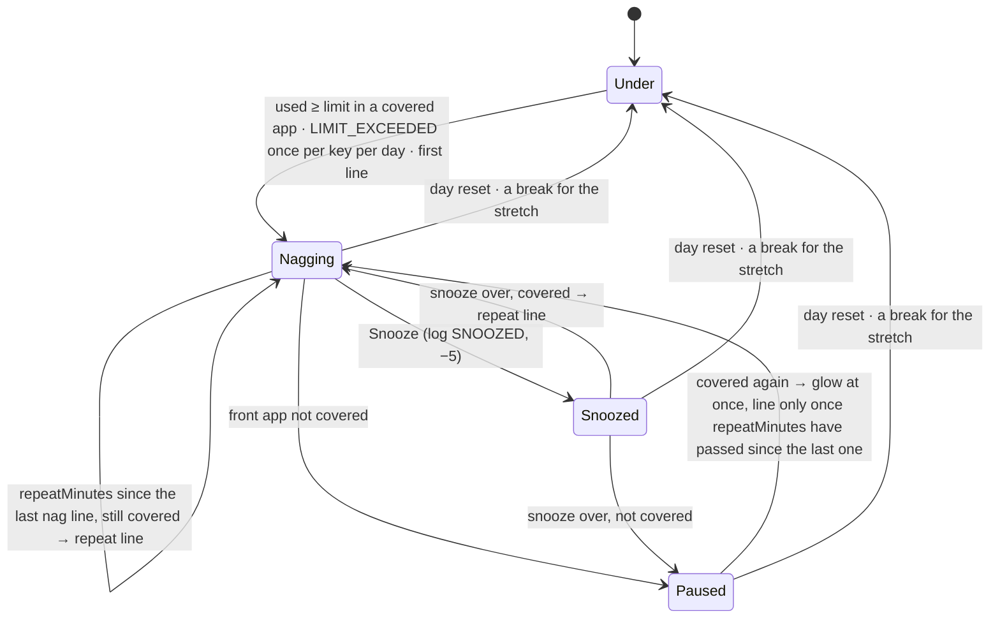

- SM-02's Glowing / Bubble / Waiting are one state here, **Nagging**: the bubble is just the request it offers (shown, waiting behind the gap, or turned into N-04). The pet glows while any limit is Nagging; not while Paused or Snoozed (SM-02's rule).
- `NagState(phase, lastLineAt, snoozedUntil)` per key, in memory. **Rebuilt at the first tick of an engine run and of a day** (D-93): a limit that's already over and has a `LIMIT_EXCEEDED` for its key in today's log starts in Paused with `lastLineAt` = now, so a restart neither repeats the −10 nor nags at once; it glows again at the next covered tick. Over but not logged (crossed while the service was dead) → treated as just crossed.
- **Mood:** `LIMIT_EXCEEDED` −10 once per key per day, from the log (D-93). The stretch can be reached again after a break; the second time it nags again but costs nothing more (§4: once per stretch limit per day).
- **Coming back to a covered app** (D-94, refines SM-02's "Paused → Glowing → Bubble immediately"): the glow is back at once, but the next line waits until `nags.repeatMinutes` have passed since that limit's last line. Hopping Instagram → WhatsApp → Instagram doesn't fire a nag each time.
- **Snooze** (US-10, D-95): only from the bubble. The bubble shows **Snooze** when it's a nag (any of the three triggers) and today's `SNOOZED` events are fewer than `nags.maxSnoozesPerDay`. All nags share the daily count; a snooze silences only its own key for `nags.snoozeMinutes` (D-28). The end time is in memory: a restart ends a snooze early (then the rebuild rule above applies). N-04 has no Snooze action in v1 (parking lot).
- **Withdrawn requests:** a nag request still waiting in the arbiter when its limit stops nagging (Paused, Snoozed, Under) is removed, so a nag never appears after you've left the app. New `ArbiterState.without(key)`.
- **Hidden:** the arbiter already turns nag requests into notifications (D-82). They're posted as **N-04**. Focus (M8) holds them as today.
- Bubble timing: the first line can wait behind the 60 s gap (D-82) if another bubble appeared just before. The glow isn't gated, so US-08's "glows within 60 s" always holds; the bubble can be a few seconds later in that case. Accepted.

**Continuous screen use and SM-03** (`tracking/Crediting.kt`, `rules/Breaks.kt`; A-31, D-96, D-97)
- **Continuous use** (D-96) = screen-on time since the last break, whatever is in front: apps, the launcher, the lock screen, Nyx itself. `TrackerState.continuousMs` grows in `creditPiece` for every screen-on piece (before the "is it counted?" check) and resets where the stretch does: a screen-off gap ≥ `breaks.breakMinutes`. Unlike the stretch, the day reset doesn't reset it: it's about your eyes, not the calendar. Rebuilt by the replay like the stretch (24 h look-back, §14.4), so it survives restarts. `TrackerSnapshot.continuousMs` exposes it.
  - It only counts once the replay has seen a screen event (`TrackerState.screenKnown`): before that, "screen on" is the tracker's starting guess, and the whole 24 h look-back counted (BUG-02, found on the Pixel with a scenario, which now starts with a screen-on event). Apps are credited as before.
- **Breaks that just ended:** `advance` also returns `EndedBreak(endedAt, continuousBeforeMs)` for every break whose screen-on lies at or after the cursor. Replayed breaks are before the cursor, so a restart never reports one twice.
- **Reminders** (gentle mode, US-11): the first when continuous use reaches `breaks.afterMinutes` (effective), then every `breaks.repeatMinutes` while there's no break. Each one offers a `break_due` bubble (`{minutes}` = `breaks.breakMinutes`) **and** posts **N-02** with the same line, pet on screen or not (US-11: "bubble and notification"). The count of reminders since the last break is in memory; a restart can bring one early.
- **Break taken** (D-97): an ended break counts when `continuousBeforeMs` had reached `breaks.afterMinutes`, i.e. a reminder was due (A-26). Then: log `BREAK_TAKEN` (+5), offer a `break_taken` bubble (the tick at screen-on, so the pet greets you; a pet that comes back from running away at that moment says its `pet_returned` line instead, one line for one moment), cancel N-02, reset reminders and break-screen snoozes. Derived from the tracker, so a restart neither loses nor repeats it, and a phone left overnight after 10 minutes of use earns nothing. Any break resets SM-03, rewarded or not.
- `features.breaks` off → no reminders, no break screen, no `BREAK_TAKEN`. The ring still shows continuous use (US-30 is about seeing it).

**Reaction mode and the break screen** (O-04, CR-10, D-88, D-89, D-98, D-99)
- **The setting:** `breaks.mode` in DataStore, `gentle` (default) or `obstructive`. **Effective mode** = obstructive only if stored obstructive **and** `breaks.obstructive.allowed`. The stored value is kept when the admin forbids it, like narrowed ranges (§5), so allowing it again restores the user's choice.
- **Admin config** — a new block with a Kotlin default (additive, `schemaVersion` stays 1, like positive goals in §14.2):

```json
"breaks": { "…": "…", "obstructive": { "allowed": true, "buttonDelaySeconds": 10, "snoozeMinutes": 5, "maxSnoozes": 3, "returnAfterTakeBreakSeconds": 60 } }
```

  Bounds (`schema` rule): `buttonDelaySeconds` 0–60 · `snoozeMinutes` 1–60 · `maxSnoozes` 0–10 · `returnAfterTakeBreakSeconds` 10–600. Not required in the schema, so a document without the block (M10's first server copy, older fixtures) is valid and gets the defaults. Added to `shared/default-config.json` so the console shows it.
- **When obstructive:** at each reminder (the same timing as gentle), instead of the bubble and N-02, the engine asks for the break screen. Then:

| Answer | What happens |
|---|---|
| **5 more minutes** (shown while this sitting's snoozes < `maxSnoozes`) | Screen closes; it comes back after `snoozeMinutes` if there's still no break |
| **Take a break** | Screen closes; if the screen is still on after `returnAfterTakeBreakSeconds`, it comes back (D-98) |
| A break (screen off ≥ `breakMinutes`) | Screen removed at the next screen-on tick; `BREAK_TAKEN` as above; snoozes reset |

  - **Why "Take a break" comes back after 60 s** (D-98): with the normal `breaks.repeatMinutes` (10) it would return later than "5 more minutes" does, so tapping it would be a better snooze than Snooze, and the cap of 3 would mean nothing. 60 s is time to finish a sentence and put the phone down.
  - "Sitting" = the time since the last break; snoozes count per sitting, in memory. No `SNOOZED` event and no mood change (D-88).
- **Never shown** (D-89), checked each time it would appear:
  - pet hidden → gentle N-02 only (D-24);
  - in a call → gentle bubble + N-02 for this reminder; the next one tries again;
  - focus session (M8) → held until it ends, then shown if a reminder is still due (D-25);
  - no overlay permission → nothing can draw; N-02 only.
- **Call detection** (D-99): `AudioManager.getMode()` needs no permission (checked in the API 37 sources: no `@RequiresPermission`, while `TelephonyManager.getCallState` and `TelecomManager.isInCall` need `READ_PHONE_STATE`). "In a call" = `MODE_RINGTONE`, `MODE_IN_CALL`, `MODE_IN_COMMUNICATION`, `MODE_CALL_SCREENING` (API 30), `MODE_CALL_REDIRECT`, `MODE_COMMUNICATION_REDIRECT` (API 33). `MODE_IN_COMMUNICATION` is what VoIP apps (WhatsApp, Meet) set, so their calls count too. Read on the engine coroutine at each tick while the effective mode is obstructive (also while the screen shows, so a call coming in closes it); behind a small `CallState` interface so tests fake it. D-89's "if it needs a permission, ask" doesn't arise.
- **The window** (`pet/BreakScreenOverlay.kt`): a second `TYPE_APPLICATION_OVERLAY` window, `MATCH_PARENT` both ways, `FLAG_NOT_FOCUSABLE` (it never takes the keyboard or Back), added after the pet's window so it's on top. Android keeps the status bar and navigation above app overlays, so Home, Recents and the shade still work: the phone is never locked (D-07 stands). Window context and `OverlayOwner` as in D-78.
- **What's on it** (`pet/BreakScreen.kt`): a dim scrim (`scrim` colour at 80%), the pet's face large in the middle, the heading "You've been on your screen for 1 h 32 min without a break" (app string), a `break_due` line in the chosen personality and band (the "line" of D-88), and the two buttons. The buttons are disabled for `buttonDelaySeconds` real seconds from when it appears (reading time, like bubbles, not the debug fast clock), with "Available in 8 s" on them. TalkBack: the heading is a heading and a polite live region; the disabled buttons say why.
- The pet's window stays underneath; the ring and any bubble close when the break screen appears.

**Idle lines** (US-27, D-100, `rules/Idle.kt`, pure)
- Offered when today's counted screen time since the last bubble (of any kind) reaches `idle.everyMinutes`, and `features.idleLines` is on and the user's `idle.enabled` (DataStore, default on) is on. The baseline is set whenever a bubble shows or an idle request is offered, and at engine start to the current total, so a restart doesn't speak at once. Counted screen time = the same total Home shows. The day reset (total drops) moves the baseline to the new total.
- The arbiter already drops idle while hidden or in focus (D-82); "about every 30 min" holds because a dropped one resets the baseline too.
- An idle request still waiting when any other bubble shows is withdrawn: it was due at the same tick as a nag and appeared a minute after it (BUG-03, Pixel).

**Notifications** (D-104, `service/Notifications.kt`)

| ID | Channel | Text | Posted | Removed |
|---|---|---|---|---|
| N-02 | `alerts` | Title "Break time", text the `break_due` line | Each gentle reminder, and in obstructive mode whenever the screen can't show | When the break is taken; auto-cancel on tap |
| N-04 | `alerts` | Title "Nyx", text the nag line | A nag while the pet isn't on screen (D-24) | Auto-cancel on tap |

- One of each at a time: a new one replaces the old (fixed IDs). Tapping either opens Home. Without the notifications permission they're skipped and logged, like N-03.

**Glow** (O-01): a 3 dp ring in the theme's `error` colour around the pet's circle while any limit is Nagging, and the pet's TalkBack description adds "Over a limit". Colour plus the bubble plus the "!" on the ring, so never colour alone (§9).

**Actions ring** (O-03, US-07, CR-09, D-87, D-90 to D-92, D-101, D-102; replaces §14.5's panel)

```text
   pet on the right edge, ring open (7 slots, 30° apart, radius 120 dp)

                    📱 3h12            ← total today
              🌱 1h05·47m              ← productive · doomscrolling
          🚦 !52/45m                   ← limits (worst one); tap → list
   [caption]  ⏳ 38m           🐱      ← continuous use; the pet stays on its edge
          🎯                           ← start focus (M8: the timer)
              🏠                       ← open Nyx
                    🙈 30m             ← hide for 30 min
```

- **Slots** (D-101), top to bottom: Total today · Productive vs doomscrolling · Limits · Continuous use · Start focus (only when `features.focus` is on; the M8 timer takes this slot while a session runs) · Open Nyx · Hide. Spread evenly over the half circle facing the middle of the screen (−90° to +90°), so 6 or 7 slots. Each is a 56 dp circle (≥ 48 dp target) with an emoji glyph and a short value (`3h12`, `47m`, `!52/45m`) sized in dp, like the pet's face, so large text can't burst the circle; the full text is in the caption and TalkBack. Emoji instead of an icon library: no new dependency, and they match the pet.
- **Values** come from the same `TodaySummary` as Home (total, productive, doomscrolling, goals), so the two can't disagree. The Limits slot shows the goal with the highest used/limit share, `!` in front when over, `—` when no limit is on. Continuous use comes from the engine (below).
- **Caption** (D-101): a small surface beside the middle slot, towards the screen's middle, showing the full label of the last pressed slot: "Screen time today: 3 h 12 min", "Productive 1 h 5 min · doomscrolling 47 min", "Social & scrolling: 52 min of 45 min — over", "On screen for 38 min without a break · reminder at 45 min". Tapping a value slot shows its caption; tapping an action slot does the action; a long press on an action slot shows its caption. TalkBack reads the same text as each slot's description, with role Button; the caption itself is readable too.
- **Limits list:** tapping the Limits slot swaps the ring for a card beside the pet (width ≤ 280 dp, scrolls): Home's goal rows (`SummaryNumbers`' `GoalRow`, made shareable) plus the stretch ("Unbroken stretch: 12 of 30 min") and each limit's nag state ("Snoozed until 14:30", "Over"). A **Back** button returns to the ring.
- **Geometry** (`pet/RingLayout.kt`, pure; D-102): while the ring is open the window has a fixed size, the bounding box of pet + ring + caption (height 2 × (120 + 28) = 296 dp), with the pet at its vertical centre on its edge. The pet's centre is clamped so the box fits in the usable area: near the top or bottom the pet moves along its edge (D-91) and moves back when the ring closes (A-32). No animation in M7. If the area is shorter than the box (split screen), the box is centred and the end slots can be cut off; accepted, rare.
  - The window gets the box's size explicitly while the ring is open (`ringBoxWidth`), `WRAP_CONTENT` again when it closes. A `WRAP_CONTENT` window is first measured at the dialog width (`config_prefDialogWidth`, ~320 dp, `ViewRootImpl.measureHierarchy`), and Compose doesn't report "too small", so the 364 dp ring was squeezed into ~320 dp and ran off the right edge (BUG-01, Pixel 7a, 2026-10-22).
- **Closing** (D-92): tapping the pet, an action, or anywhere outside the ring closes it: outside the window by `FLAG_WATCH_OUTSIDE_TOUCH` (D-71), and the window's own empty space by a click handler behind the slots. Drag stays off while open.
- **Ring status from the engine:** `PetService` holds a `StateFlow<RingStatus>` (continuous use, glow, each limit's nag state and snooze end), updated after every tick. Opening the ring forces a tick (D-77), so continuous use is at most a second old.
- **Bubbles and the ring:** the ring wins, as the panel did (D-84). A bubble shows beside the closed pet exactly as in M6, now with Snooze on nags.

**Settings S-11** (`settings/`, D-106) — from Home's Settings button

| Row | Edits | Notes |
|---|---|---|
| Pet & personality | → S-04 | Continue goes back |
| App categories | → S-05 | |
| Limits & goals | → S-06 | Continue goes back |
| Nag interval · Snooze length | `nags.repeatMinutes` · `nags.snoozeMinutes` | Sliders in the admin's range; read-only with "Set by Nyx" when locked (D-16: max snoozes is admin-only) |
| Break reminder after | `breaks.afterMinutes` (= the continuous-use limit) | Section hidden when `features.breaks` is off |
| When a break is due | Gentle / Obstructive | Obstructive explained in one line ("Covers the screen until you choose; you can always close it"); disabled with "Turned off for everyone" when not allowed |
| Idle chatter | On / Off (`idle.enabled`) | Hidden when `features.idleLines` is off |
| Day starts at | `day.resetHour` | 00:00–06:00 |
| Share anonymous stats | → S-07 | Finish goes back (it marks setup done again, which it already is) |
| Permissions | → S-03 (`FixPermissions`) | |

- The slider row moves from `setup/LimitsScreen.kt` to `ui/SettingSlider.kt`, used by S-06 and S-11 (its second user; a small move, not a new abstraction).
- `rules/ReactionSettings.kt` holds the two new DataStore keys, `breaks.mode` and `idle.enabled`. The service observes them (D-44).
- The privacy policy row arrives with the policy in M15.

**Limit goals** (US-17, CR-05, D-105): "judged at the day reset" needs nothing written in M7. A limit goal of a day is **missed** if that day's log has a `LIMIT_EXCEEDED` for its key, otherwise **kept**. Which goals were on each day is M13's to record, with Trends. No mood effect, as CR-05 says.

**Tick interval** (H-01, D-107): `tickDelaySeconds` is also fast while the pet glows (so the glow stops within 5 s of leaving the app) and when continuous use is less than one slow tick from the break limit.

**Storage**
- `events` gets `subject TEXT NULL`: the limit key for `LIMIT_EXCEEDED` and `SNOOZED`, `null` otherwise. Room version 4, `AutoMigration(from = 3, to = 4)` (adding a nullable column needs no spec), same reasoning as D-85.
- DataStore: `breaks.mode` (String, default `gentle`), `idle.enabled` (Boolean, default `true`).
- Nothing else is stored: nag states, reminder counts, break-screen snoozes and the idle baseline are memory, rebuilt as described.

**Debug tools** (D-67, D-108)
- New scenarios: `instagram-90min` (glow + bubble at 60 min, repeats at 70, 80, 90), `screen-on-50min` (Chrome 50 min → reminder at 45), `break-after-reminder` (Chrome 50 min → screen off 6 min → Chrome 2 min: `BREAK_TAKEN`, the `break_taken` bubble), `instagram-4h-break` (4 h → 🐾, then screen off 6 min → back with a `pet_returned` line: D-86's real path).
- At 60× the break screen's snooze and "come back" times run fast (usage time); its button delay doesn't (reading time).

**Files** (`android/app/src/main/java/com/companionstudio/nyx/` unless stated)

| File | Responsibility |
|---|---|
| `rules/Limits.kt` | Pure: today's limit checks (key, used, limit, covered, placeholders) |
| `rules/Nags.kt` | Pure: SM-02 per key, rebuild, snooze, glow |
| `rules/Breaks.kt` | Pure: SM-03 reminders, break taken, break-screen state and answers |
| `rules/Idle.kt` | Pure: idle due + baseline |
| `rules/Reactions.kt` | Orchestrates the above, the log, mood, arbiter, lines; handles `Snooze` and break-screen answers |
| `rules/BubbleArbiter.kt` | + `without(key)` |
| `rules/PetEvent.kt` · `PetEventDao.kt` | + `subject` |
| `rules/ReactionSettings.kt` | `breaks.mode`, `idle.enabled` |
| `rules/CallState.kt` | `AudioManager` mode → in a call |
| `tracking/Crediting.kt` · `Tracker.kt` · `TickDelay.kt` · `InstalledApps.kt` | Continuous use, ended breaks, snapshot fields; fast tick conditions; app labels |
| `config/NyxConfig.kt` · `ConfigValidator.kt` | `ObstructiveConfig` with defaults; bounds |
| `service/Engine.kt` (new) · `PetService.kt` · `Notifications.kt` | Loop + requests; acting on a `Reaction`; N-02, N-04 |
| `pet/PetOverlay.kt` · `PetWindow.kt` | Ring open/close, fixed-size window, glow, Snooze on bubbles; `SummaryPanel` removed |
| `pet/ActionsRing.kt` · `pet/RingLimitsList.kt` · `pet/RingLayout.kt` | Ring composable and caption · the Limits list · pure geometry |
| `pet/BreakScreenOverlay.kt` · `pet/BreakScreen.kt` | O-04 window · composable |
| `home/SummaryNumbers.kt` · `home/DurationFormat.kt` | `GoalRow` shared; `formatShort` ("3h12") |
| `settings/SettingsScreen.kt` · `SettingsViewModel.kt` · `ui/SettingSlider.kt` | S-11 |
| `setup/LimitsScreen.kt` · `StatsOptInScreen.kt` · `AppNavigation.kt` | Shared slider; "back" mode from Settings; S-11 routes |
| `data/AppDatabase.kt` | Version 4 |
| `shared/config.schema.json` · `shared/default-config.json` | `breaks.obstructive` |
| `src/debug/assets/scenarios/` | The four new scenarios |

**Tests**

| Test | Where | Checks |
|---|---|---|
| `US08_LimitsTest` | `src/test/` | One check per limit that's on; 0 = off; covered rules for category, total and stretch; placeholders filled for every trigger (`{app}`, `{category}`, `{limit}`, `{minutes}`) |
| `US08_NagsTest` | `src/test/` | Every SM-02 transition above; `LIMIT_EXCEEDED` once per key per day, the stretch's second crossing nags without a second event; repeat after `repeatMinutes`; return to a covered app glows at once and waits for the interval (D-94); day reset → Under; rebuild after a restart (over + logged → Paused, no line, no event; over + not logged → crossed) |
| `US08_NagsTest` (snooze part) · `US08_ReactionsTest` | `src/test/` | Snooze only its own key; ends after `snoozeMinutes` → repeat if covered, Paused if not · end to end with a fake DAO: −5 logged with the subject, Snooze hidden once today's count reaches the max (shared by all nags), a waiting nag withdrawn after leaving the app, N-04 while hidden, gentle reminder, break taken, obstructive and the call fallback, idle, D-86's real path |
| `US30_ContinuousUseTest` | `src/test/` (crediting) | Counts every screen-on piece, launcher and excluded apps included; break resets it, a shorter off doesn't; day reset doesn't; replay rebuilds it; ended breaks only after the cursor |
| `US11_BreaksTest` | `src/test/` | First reminder at the limit, repeats every `repeatMinutes`; bubble and N-02 each time; break after a due reminder → `BREAK_TAKEN` + bubble + N-02 cancelled; break before the limit → nothing (A-26); `features.breaks` off → nothing |
| `US11_BreaksTest` (break-screen part) | `src/test/` | Effective mode (stored × allowed); screen instead of bubble; 5 more minutes → back after `snoozeMinutes`, at most `maxSnoozes` per sitting; Take a break → back after `returnAfterTakeBreakSeconds`; a break resets snoozes; hidden → N-02 only; in a call → gentle; focus → held |
| `US27_IdleTest` | `src/test/` | Due after `everyMinutes` of counted time since the last bubble; any bubble resets; off by feature or by user; engine start and day reset move the baseline |
| `BubbleArbiterTest` (+) · `ReactionsTest` (changed) | `src/test/` | `without(key)` · M6's tests with nothing in front, so no nags interfere |
| `US07_RingLayoutTest` | `src/test/` | Slots spread over the half facing the middle on both edges; 6 or 7 slots; the pet's centre clamped near the top and bottom and back to its spot when closed (D-91, A-32); window size; an area shorter than the box |
| `TickDelayTest` (+) · `DurationFormatTest` (+) · `ConfigValidatorTest` (+) · `US21_DefaultConfigTest` (+) | `src/test/` | Fast while glowing and near the break limit · `formatShort` · obstructive bounds, a document without the block gets the defaults |
| `SettingsViewModelTest` | `src/test/` | Values clamped and stored; locked settings read-only; obstructive disabled when not allowed, stored choice kept |
| `PetEventDaoTest` (+) | `src/androidTest/` | `subject` stored and read back |
| `US07_ActionsRingTest` (replaces `US07_SummaryPanelTest`) | `src/androidTest/` | Values equal Home's for the same summary; worst limit with `!`; captions; TalkBack descriptions; Limits list and Back; Start focus slot gone when focus is off; actions call back |
| `US30_BreakScreenUiTest` · `PetWindowBubbleTest` (changed) · `US11_SettingsScreenTest` · `US28_NavigationTest` (changed) | `src/androidTest/` | Buttons disabled for the delay, then call back; 5 more minutes gone after the last snooze · Snooze shown and calls back, glow said to TalkBack · rows, read-only locked rows, obstructive disabled, links · Settings is the real S-11 |

- Coverage: ≥ 90% lines on `rules/` (ROADMAP §2) and on `pet/RingLayout.kt`.
- **By hand** (adb, fast clock): the four scenarios plus `instagram-65min`; snooze from the bubble; hidden → N-04 and N-02; the ring on both edges, near the top and bottom (the pet moves and moves back), values against Home, captions, Limits list; TalkBack across the ring; obstructive mode over YouTube: delay, 5 more minutes ×3, Take a break, a call (emulator: a fake incoming call from the extended controls), screen off 5 min; settings rows; install over the M6 build keeps data (v3 → v4).
- **On the Pixel 7a** (2026-10-22, driven over adb, scenarios at 60×/120×/10×): device tests 54/54 (48 in the full run; `US01_SetupGatingTest` 4/4 and `US01_PermissionsScreenTest` 6/6 re-run alone, as the phone had locked mid-run). `instagram-65min`: stretch nag at 30 min, Social nag at 60 min (−10, glow ring, "Ding! Social & scrolling limit reached"), the glow off once nothing counted was in front. `instagram-90min`: `limit_repeat` at 70 and 80 min; Snooze offered on the nag bubble. Snooze (at 10×, on the stretch nag): SNOOZED, −5, no glow, back after 10 min with a line. `break-after-reminder`: bubble + N-02 at 45 min; after the 6 min off, +5, the `break_taken` line, N-02 gone. `instagram-4h-break`: 🙀 → 0 → back at 5 with a `pet_returned` line (D-86's real path). Ring: fully on screen (BUG-01 fixed), captions, Limits list and Back, values equal to Home's; dragged near the top the pet moved down to fit and went back on close; a bubble waited behind the open ring. Settings: every row; Obstructive picked: break screen at 45 min, buttons "Available in 7 s" then enabled, 5 more minutes ×3, then only Take a break, which came back after 60 s of use; it also showed on real use (1 h 27 min without a break). Hidden: the 55 min reminder only as N-02, the 60 min nags as N-04 (one at a time). Mode set back to Gentle afterwards.
  - Not checked: a real call while a break is due (no call could be faked over adb; covered by unit tests), TalkBack by ear, `{app}` with a real app label (Instagram isn't installed on the phone, so the scenario's lines show its package name, the documented fallback).

**Decisions** (approved 2026-10-21)
- **D-93:** one nag state machine per limit key (`limit:<category>`, `limit:total`, `stretch`), in memory; rebuilt at engine start and each day from today's `LIMIT_EXCEEDED` events (over + logged → Paused, no line); `LIMIT_EXCEEDED` once per key per day, the stretch included; `events` gets a nullable `subject` (Room v4, auto-migration).
- **D-94:** returning to a covered app brings the glow back at once, but the next line waits until `nags.repeatMinutes` since that limit's last line (refines SM-02's "immediately").
- **D-95:** snooze only from the bubble; `maxSnoozesPerDay` counts all nags together; the snooze end is in memory; N-04 has no Snooze action in v1.
- **D-96:** continuous screen use is all screen-on time, any app, launcher and lock screen included; reset only by a break, not by the day reset; kept by the tracker and rebuilt by its replay.
- **D-97:** a break counts (`BREAK_TAKEN`, +5, `break_taken` bubble, N-02 cancelled) when the continuous use before it had reached the break limit, i.e. a reminder was due; reminders come at the limit and every `breaks.repeatMinutes`, each as bubble + N-02.
- **D-98:** obstructive timing: the break screen replaces each reminder; 5 more minutes → back after `snoozeMinutes`, at most `maxSnoozes` per sitting; Take a break → back after `returnAfterTakeBreakSeconds` (60 s) if the screen stays on; config block `breaks.obstructive` with Kotlin defaults; the user's mode in DataStore, effective only when allowed, stored choice kept.
- **D-99:** "in a call" = `AudioManager.getMode()` in a ringing, call, communication, screening or redirect mode; no permission needed, VoIP calls included.
- **D-100:** idle lines come after `idle.everyMinutes` of counted screen time since the last bubble; baseline in memory, starting at the current total; switched off by `features.idleLines` or the user's `idle.enabled`.
- **D-101:** the ring has 6–7 slots over the half circle (radius 120 dp, 56 dp circles, emoji glyphs + short values), a caption with the full label of the pressed slot, and the Limits slot opens a list card with Back.
- **D-102:** while open, the pet's window is the fixed bounding box of the ring; the pet moves along its edge to fit and back on close, without animation; taps on the box's empty space close it.
- **D-103:** one unlimited engine request channel (`Tick`, `Snooze`, `BreakScreenAnswer`) replaces the conflated tick channel; the loop moves to `service/Engine.kt`.
- **D-104:** N-02 and N-04 use the `alerts` channel with fixed IDs (one of each at a time), the line as text, tap → Home; N-02 is cancelled when the break is taken.
- **D-105:** limit goals are judged from the log (a `LIMIT_EXCEEDED` for the key that day = missed); M7 writes nothing at the day reset; which goals were on each day is M13's.
- **D-106:** S-11 as in the table; `breaks.mode` and `idle.enabled` in `ReactionSettings`; the S-06 slider row shared through `ui/SettingSlider.kt`.
- **D-107:** fast ticks also while the pet glows and when continuous use is within one slow tick of the break limit.
- **D-108:** four new debug scenarios (above).

**Not in M7:** focus sessions and the focus hold's input (→ M8: `focusActive` stays `false`); the focus timer slot (→ M8); Trends and recording which goals were on each day (→ M13); positive goals (→ M13); the privacy policy row (→ M15); a Snooze action on N-04, per-app exclusions for the break screen, ring animations (parking lot); continuous use on Home.

### 14.8 M8 — Focus sessions

Written 2026-10-22; D-109 to D-120 approved 2026-10-22 (D-112 as proposed). Built in the same session at the developer's request.

**Purpose:** the user starts a focus session for a hard task, the pet keeps them company and notices when they wander off, nags and break reminders wait until it's over, and finishing makes the pet happier. Stories: US-12 (S-09: goal, allowed apps, pet mode), US-13 (drift, A-02 exclusions, pause on lock, check-ins, hold), US-14 (reward, mood +15, ended early), US-07 + US-30 (timer on the ring, CR-09), US-27 (no idle lines during focus).

**How a session moves through the app** (DF-3, refined)

```mermaid
sequenceDiagram
  actor U as User
  participant S as S-09 / Home card
  participant DB as Room (focus_sessions, events)
  participant SV as PetService
  participant E as Engine → Reactions → FocusSessions
  participant O as Pet overlay
  U->>S: goal, apps, pet mode → Start
  S->>DB: start(): insert, only if no session is active
  DB-->>SV: observeActive() changed
  SV->>E: EngineRequest.Tick
  E->>DB: active session
  E-->>O: focus_started line, timer badge, ring timer slot
  loop every tick (fast, 5 s)
    E->>E: SM-04 step: focus time, drift, check-in, timer
    E->>DB: save focus_ms, switches, last_focus_at
  end
  alt timer reached / no-switching broken / abandoned
    E->>DB: finish(): only if still active (+ FOCUS_COMPLETED when completed)
  else Done or End on the ring card
    O->>E: EngineRequest.EndFocus(done)
    E->>DB: finish(…)
  else Done or End on Home
    S->>DB: finish(…)
    DB-->>SV: observeActive() changed → Tick
  end
  E-->>O: end line first; held nags and the break reminder follow (D-115)
```

- Screens start and end sessions by writing storage (D-44); buttons on the overlay go to the engine, like Snooze (D-103). Both end through the same DAO call, so whoever is first wins and the other is a no-op (D-109).
- The engine notices every start and end at its next tick, wherever it came from. The service sends a `Tick` request whenever the active session changes, so "next tick" is within milliseconds.

**SM-04 per tick** (`focus/Focus.kt`, pure; D-110, D-111)

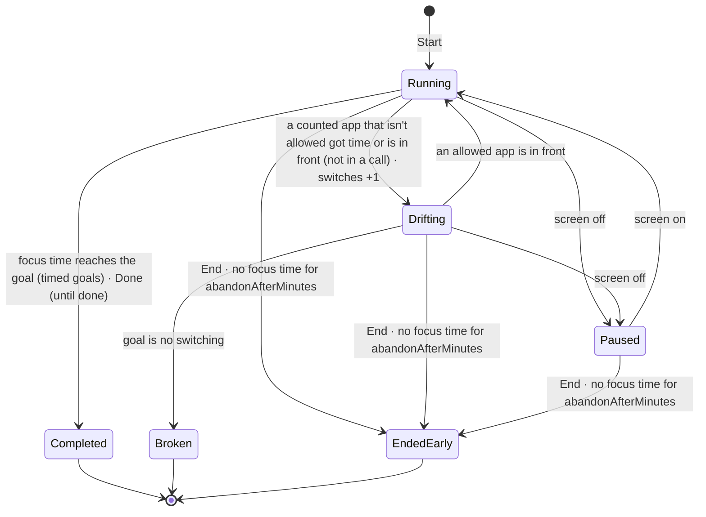

- **Focus time** (D-110) = the time the tracker credits to the session's allowed apps from the session's first tick on. So it is exact to the usage event, like Home's totals, and pauses on its own: nothing is credited while the screen is off, at the lock screen, on the launcher, in the shade or in another app. Timed goals complete when focus time reaches the goal's minutes (fast ticks: within 5 s).
  - The first tick that sees a session only sets it up: its credits are from before the start (or, after a restart, from while the service was dead) and don't count.
  - Needs two new `TrackerSnapshot` fields: `creditedMs: Map<String, Long>` (this tick's credits per package, counted apps only) and `screenOn` (the tracker's view, so debug scenarios pause sessions too).
- **Drift** (US-13, A-02, D-111): at a tick, a counted app that isn't allowed is in front, or got credited time since the last tick (a 3 s peek between ticks counts), and the phone isn't in a call (D-99's `CallState`, read every tick while a session runs).
  - Not a switch, with no extra code: the shade (System UI), the ring and bubbles (overlay windows, not apps), the launcher and Recents, and Nyx itself are never counted apps (D-69). A call isn't a switch through `CallState`, so the dialer and VoIP apps don't drift.
  - Running → Drifting adds one switch and saves it. Drifting stays until an allowed app is in front; the launcher or the shade on the way back doesn't end it.
  - No switching: the first switch breaks the session (`focus_broken`). If the timer is reached in the same tick, completion wins.
- **Paused** = screen off (the tracker's screen state). Paused time isn't focus time anyway; the phase only matters for the badge, the card and the tick interval.
- **Abandoned** (D-114): no focus time for `focus.abandonAfterMinutes` (default 30) → ended early, no line. Without it, a forgotten until-done session would hold every nag and break reminder for the rest of the day. Measured from `last_focus_at_ms` (stored), so it survives restarts. With the screen off nothing ticks, so it's noticed at the next screen-on.
- **Live state in memory** (`focus/FocusSessions.kt`, one per engine run like `Reactions`): the known session ID, its phase and the last check-in index. After a restart the phase starts as Running and is re-derived at the next tick; a drift in progress across a restart can count as a second switch (rare, accepted).

**Goals and pet modes** (US-12, D-04, D-112, D-113)

| Goal | Completes when | Done button | A switch |
|---|---|---|---|
| For a set time | Focus time reaches N min (`focus.durationMinutes`, 25, 5–180) | — | Recorded, pet reacts |
| Until I'm done | Done is tapped (A-01) | Once focus time ≥ `focus.minDoneMinutes` (5) | Recorded, pet reacts |
| No switching for N min | Focus time reaches N min | — | Breaks the session |

| Pet mode | Start | Drift | During the session | End |
|---|---|---|---|---|
| Quiet presence | `focus_started` | Badge only, no line | Nothing | `focus_completed` / `focus_broken` |
| Reward at the end | `focus_started` | `focus_drift` (`{app}`) | Nothing | same |
| Check-in every X min | `focus_started` | `focus_drift` (`{app}`) | `focus_checkin` every X min of focus time (`{minutes}` = focus minutes so far); X from `focus.checkinMinutes` (10, 5–30) | same |

- **Every mode** gets +15 (`FOCUS_COMPLETED`) and the `focus_completed` line when a session completes (US-14); ended early → no line, no mood change; broken → `focus_broken` line, no mood change.
- **D-112:** D-04 names the three modes but not how they differ; they are three levels of chattiness. "Reward at the end" differs from quiet only by speaking up when you drift (confirmed by the developer).
- **D-113:** Done exists only for until-done, and only after 5 min of focus time; timed goals finish by their timer; End is always there. Without the minimum, Start → Done would be +15 per tap and mood would mean nothing.
- Check-ins are counted in focus time, so a paused or drifting stretch doesn't trigger one. After a restart the index is rebuilt from `focus_ms`, so it doesn't check in at once.

**Holding and releasing** (US-13, US-27, D-25, D-26, D-89, D-115)
- **Which ticks count as focus:** every tick that starts with a session active, **including the one that ends it**, so the end line comes before anything that was held.
- **Bubbles:** the arbiter's `focusActive` (D-82) is now real: only the focus tier shows; nags, rewards and `pet_returned` wait; idle is dropped. **`focus_completed` moves from the reward tier to the focus tier**, otherwise a held nag (higher tier) would speak before the reward at the end. When the pet comes back from 🐾 because of the +15, only `focus_completed` is said (one line for one moment, as with `break_taken`).
- **Nags:** SM-02 keeps running and `LIMIT_EXCEEDED` (−10) is still logged when a limit is crossed; only the line, the glow and N-04 wait. At the end the waiting nag request shows after the bubble gap if its limit is still Nagging, otherwise it was already withdrawn (§14.7). The glow comes back at the first tick after the end.
- **Break reminders:** SM-03 keeps counting and a break during a session still counts (`BREAK_TAKEN`). Reminders that fall due are neither offered nor posted (no bubble, no N-02, no break screen). When the session ends, the reminder schedule restarts (`nextDueMs = null`). If continuous use is still past the limit, the next tick fires one reminder in the user's mode: gentle bubble + N-02, or the break screen (D-89's "held until it ends").
- **Mood and hidden:** mood events are logged as usual. Hidden + focus: focus-tier lines are skipped (D-24) and held ones stay held (D-82).

**Day reset during a session** (A-25, D-116)
- The session doesn't stop and keeps its start day in `focus_sessions.day`, which Trends (M13) and stats (M14) count by.
- `FOCUS_COMPLETED` is logged on the day the session ends, because mood belongs to the current day: +15 on a day that has already reset would show nowhere.
- Nags reset at the reset as before (§9); the session keeps holding the new day's nags.

**Storage** — `focus_sessions`, Room version 5, `AutoMigration(from = 4, to = 5)` (a new table, as D-85)

| Column | Type | Notes |
|---|---|---|
| `id` | INTEGER | Primary key, auto-increment |
| `day` | TEXT | Day key at the start (A-25); indexed |
| `started_at_ms` | INTEGER | App clock (fast in debug scenarios) |
| `goal` | TEXT | `FIXED_TIME`, `UNTIL_DONE`, `NO_SWITCHING` |
| `goal_minutes` | INTEGER NULL | `null` for until done |
| `allowed_apps` | TEXT | Package names joined by `,` through a `TypeConverter` (package names can't contain commas). At least one |
| `pet_mode` | TEXT | `QUIET`, `CHECK_IN`, `REWARD_AT_END` |
| `checkin_minutes` | INTEGER NULL | Only for check-in mode |
| `focus_ms` | INTEGER | Focus time so far (D-110) |
| `switches` | INTEGER | Running → Drifting count ("the switch is recorded", US-13) |
| `last_focus_at_ms` | INTEGER | Last tick that added focus time; the start at first (D-114) |
| `outcome` | TEXT NULL | `null` = active; `COMPLETED`, `BROKEN`, `ENDED_EARLY` |
| `ended_at_ms` | INTEGER NULL | |

- `FocusSessionDao` (abstract class, like `DailyUsageDao`):
  - `observeActive()`, `active()`, `byId(id)`, `latest()` (S-09's defaults), `deleteBefore(day)` (31 days, active sessions kept), `clearAll()` (debug).
  - `start(session): Long?` (`@Transaction`): inserts only if no session is active, so there's only ever one (SM-04).
  - `saveProgress(id, focusMs, switches, lastFocusAtMs)`: only when something changed.
  - `finish(id, outcome, endedAtMs, eventDay): Boolean` (`@Transaction`): `UPDATE … WHERE id = :id AND outcome IS NULL`. If a row changed and the outcome is `COMPLETED`, it inserts `FOCUS_COMPLETED` (`subject` = the session ID) on `eventDay` in the same transaction. So the reward is logged exactly once, whoever finishes, and a race between the ring, Home and the engine can't give +15 twice.
- `focus/FocusRepository.kt` for screens: `observeActive()`, `latest()`, `start(…)`, `finish(id, done)`. `eventDay` comes from `DayClock` + the effective reset hour, like `TrackingSummaryRepository`.
- No new DataStore keys. S-09 remembers the last choices by reading the last session row.

**Config** — two additive fields with Kotlin defaults (`schemaVersion` stays 1, like `breaks.obstructive`)

```json
"focus": { "durationMinutes": { "…": "…" }, "checkinMinutes": { "…": "…" }, "minDoneMinutes": 5, "abandonAfterMinutes": 30 }
```

- Bounds (`schema` rule): `minDoneMinutes` 1–60, `abandonAfterMinutes` 5–240. Not required, so documents without them stay valid. Added to `shared/default-config.json` so the console shows them.
- `features.focus` off → no Start on the ring or Home. A session already running carries on until it ends, and its card keeps Done/End.

**S-09 Focus setup** (`focus/FocusSetupScreen.kt`, `focus/AllowedAppsPicker.kt`, `focus/FocusSetupViewModel.kt`; D-117)

| Section | Control | Rules |
|---|---|---|
| Goal | 3 choices: For a set time · Until I'm done · No switching | |
| Minutes | `SettingSlider` (`ui/`) in the effective `focus.durationMinutes` range | Hidden for until done; read-only "Set by Nyx" when locked |
| Allowed apps | Search + checkbox list of launcher apps (`InstalledApps.list()`, as S-05) | At least one; selected ones listed first |
| Pet mode | 3 choices, each with a one-line description | |
| Check in every | `SettingSlider` in the `focus.checkinMinutes` range | Only in check-in mode |
| **Start** | Button | Disabled with no app selected |

- **Defaults:** the last session's goal, minutes, apps, mode and check-in interval, clamped into today's ranges; otherwise the config defaults and no app. Opened from the ring, the app that was in front is the selected app instead. The ring passes it as an intent extra; `RingStatus` gets `frontPackage`.
- The sliders don't write the user's config values: the choice belongs to the session and is remembered through the last row. `userEditable = false` still locks the slider to the admin's default.
- **After Start:** opened from the ring (a fresh task over Home, §14.5), the activity finishes, so the user is back in the app they came from with the `focus_started` line beside the pet. Opened from Home, it goes back to Home, which shows the session card.
- **While a session runs**, S-09 shows the session card instead of the form (a stale ring tap or a back-stack entry can still reach it).

**Showing the session**

| Where | What | Actions |
|---|---|---|
| Pet badge (O-01) | A small pill over the bottom of the pet's circle, inside its 56 dp, so the window's size doesn't change: minutes left (set time, no switching) or so far (until done); `!` while drifting | — |
| Ring timer slot (CR-09, D-101) | ⏱ in the Start focus slot: `12m` left or `34m` so far; caption "Focus: 12 min left · switched away 2×", "Away from your focus apps" | Tap → focus card |
| Ring focus card (`pet/RingFocusCard.kt`) | In the ring's place, like the Limits list: goal, time, switches | Done (until done, after the minimum) · End · Back |
| Home card (`focus/FocusSessionCard.kt`) | Replaces the Start focus button while a session runs; same text | Done · End |

- The pet's TalkBack description adds "Focus session, 12 minutes left" (or "away from your focus apps"). Drifting is shown by `!` and the text, not by colour alone (§9).
- `RingStatus` gets `focus: FocusStatus?` (goal, goal minutes, focus time, phase, switches, Done allowed), updated every tick. Opening the ring forces a tick (D-77), so the timer is current.
- The ring's End and Done send `EngineRequest.EndFocus(done)` (new). Home's write through `FocusRepository`.
- `HomeScreen` takes one `focus: HomeFocus` (start, or the running session with its callbacks) instead of `onFocus`, so it stays at five parameters (§4).

**Tick interval** (H-01): fast while a session is active and the screen is on (`tickDelaySeconds(…, focusRunning)`), so drift and the timer are seen within 5 s. Paused → the screen is off, so nothing ticks.

**Debug tools** (D-67, D-119)
- `ScenarioReceiver` gets focus extras that start a session through `FocusRepository.start` right after the scenario clears its data: `--es focus no_switching --ei focus_minutes 25 --es focus_apps com.google.android.youtube --es focus_mode check_in`. Starting a scenario or `--ez stop true` also clears `focus_sessions`.
- New scenarios:
  - `youtube-30min`: YouTube 30 min. Set time 25 completes at 25 with +15.
  - `youtube-instagram`: YouTube 10 min → Instagram 1 min → YouTube 20 min. No switching breaks at 10 min. Set time 25 drifts once, says `focus_drift`, and completes at 26 min (Instagram time doesn't count).
  - `youtube-screen-off`: YouTube 10 min → screen off 3 min → YouTube 16 min. Set time 25 pauses and completes at 28 min of scenario time.

**Files** (`android/app/src/main/java/com/companionstudio/nyx/` unless stated)

| File | Responsibility |
|---|---|
| `focus/FocusSession.kt` · `FocusSessionDao.kt` | Entity, `FocusGoal`, `PetMode`, `FocusOutcome`, apps converter; DAO with `start` and `finish` transactions |
| `focus/Focus.kt` | Pure: SM-04 step: focus time, drift, switches, check-ins, completion, broken, abandoned |
| `focus/FocusSessions.kt` | Per engine run: sees starts and ends, runs the step, saves progress, finishes, end requests, `FocusStatus` |
| `focus/FocusRepository.kt` | Start, finish and observe for screens |
| `focus/FocusSetupScreen.kt` · `AllowedAppsPicker.kt` · `FocusSetupViewModel.kt` | S-09 |
| `focus/FocusSessionCard.kt` | The running session on Home and S-09 |
| `rules/Reactions.kt` · `rules/Reaction.kt` (new) | Focus step before reading the log; hold and release; `Reaction`, `RingStatus`, `ShownBubble` and `BreakScreenChange` move out to `Reaction.kt`, so `Reactions.kt` stays near 250 lines |
| `rules/BubbleArbiter.kt` | `focus_completed` in the focus tier |
| `tracking/Tracker.kt` · `TickDelay.kt` | Snapshot `creditedMs` and `screenOn`; fast while focusing |
| `config/NyxConfig.kt` · `ConfigValidator.kt` | `minDoneMinutes`, `abandonAfterMinutes` with defaults; bounds |
| `service/Engine.kt` · `PetService.kt` | `EndFocus` request; `Tick` on an active-session change |
| `pet/ActionsRing.kt` · `RingFocusCard.kt` · `PetWindow.kt` · `PetOverlay.kt` | Timer slot, focus card, badge, the front app passed to S-09 |
| `home/HomeScreen.kt` · `HomeViewModel.kt` | Session card instead of Start focus while running |
| `MainActivity.kt` · `AppNavigation.kt` · `AppContainer.kt` | The ring's app extra, S-09 replaces the placeholder and finishes after Start from the ring; wiring |
| `data/AppDatabase.kt` | Version 5 |
| `shared/config.schema.json` · `shared/default-config.json` | The two fields |
| `src/debug/…/ScenarioReceiver.kt` · `src/debug/assets/scenarios/` | Focus extras, clearing sessions, three scenarios |

- `pet/PetOverlay.kt` is already ~330 lines (parking lot: split placement from content). M8 adds a few lines to it. Doing that split first as its own `refactor:` commit is an option, but it's not part of this plan unless you say so.

**Tests**

| Test | Where | Checks |
|---|---|---|
| `US13_FocusTest` | `src/test/` | Every SM-04 transition · focus time only from allowed apps' credits, not on the first tick · a peek between ticks is a switch · launcher, shade, Nyx and no front app never drift (A-02) · in a call → no drift · one switch per drift · Drifting stays through the launcher, ends on an allowed app · no switching breaks at once, completion wins in the same tick · screen off → Paused · timed goals complete at N min · Done only for until done and after the minimum · abandoned after 30 min without focus time · check-ins every X min of focus time, `{minutes}` filled, none in quiet or reward mode, rebuilt index doesn't fire at once |
| `US12_FocusSessionsTest` | `src/test/` (fake DAOs) | `focus_started` for a new session, not after a restart · an end from Home is noticed and gets its line · ended early → no line · drift lines per pet mode, `{app}` filled · progress saved only on change · `FocusStatus` values |
| `US13_FocusHoldTest` | `src/test/` (Reactions, fake DAOs) | During focus: no nag bubble, no glow, no N-04, `LIMIT_EXCEEDED` still logged; no break bubble, N-02 or break screen; idle dropped · at the end: the end line first, the held nag after the gap if still nagging, withdrawn if not; a still-due reminder fires once (gentle and obstructive); a break taken during the session → no reminder · +15 brings the pet back with only `focus_completed` · day reset during a session (A-25): it carries on, the row keeps the start day, `FOCUS_COMPLETED` on the new day, nags reset |
| `BubbleArbiterTest` (+) · `TickDelayTest` (+) · `ConfigValidatorTest` (+) · `US21_DefaultConfigTest` (+) | `src/test/` | `focus_completed` in the focus tier · fast while focusing · bounds, defaults when the fields are missing |
| `US12_FocusSetupViewModelTest` | `src/test/` | Defaults from the last session, clamped · from the ring the front app is selected · locked sliders · Start disabled with no app · start writes one row; a second start while one runs writes nothing |
| `ScenarioTest` (+) | `src/testDebug/` | The three new files parse |
| `FocusSessionDaoTest` | `src/androidTest/` | `start` refuses a second active session · `finish` only once, the second returns false · completed inserts `FOCUS_COMPLETED` in the same transaction, other outcomes don't · `observeActive` emits on start and end · `deleteBefore` keeps the active one · apps converter round trip |
| `US12_FocusSetupScreenTest` | `src/androidTest/` | Sections per goal and mode · search · Start enabled after picking an app and calls back |
| `US07_ActionsRingTest` (+) · `US28_HomeScreenTest` (+) · `PetWindowBubbleTest` (+) | `src/androidTest/` | Timer slot instead of Start focus, focus card with Done only when allowed, End, Back · the Home card instead of Start focus · badge text and TalkBack description |

- Coverage: ≥ 90% lines on `focus/Focus.kt`, `focus/FocusSessions.kt` and `rules/` (ROADMAP §2).
- **By hand** (adb, fast clock, then real use): the three scenarios with each goal and mode; S-09 from the ring over YouTube (YouTube preselected, back in YouTube after Start, start line beside the pet) and from Home (card); Done and End from the ring and from Home; badge and ring slot counting down; a nag due during a session shows only after the end line; the break screen held in obstructive mode; a call during a session (emulator's fake call) isn't a switch; install over the M7 build keeps data (v4 → v5); the done-when session on the Pixel 7a with real YouTube and Instagram.

**Decisions** (approved 2026-10-22)
- **D-109:** sessions live in `focus_sessions` (Room v5). One active row (`outcome` null), started in a transaction that refuses a second. Focus time, switches and the last focus time are saved each tick; the live phase is memory. Every end goes through one conditional `finish` that also logs `FOCUS_COMPLETED` in the same transaction. Screens write through `FocusRepository`; the ring's buttons are engine requests.
- **D-110:** focus time = tracker credits to the allowed apps from the session's first tick on (not that tick); timed goals complete on it. Paused = the tracker's screen-off.
- **D-111:** a switch = a counted, not-allowed app in front or credited since the last tick, outside a call; one per Running → Drifting; Drifting ends only on an allowed app; no switching breaks on the first one; completion wins a same-tick tie.
- **D-112:** pet modes as three levels of chattiness (table above).
- **D-113:** Done only for until-done sessions and only after `focus.minDoneMinutes` (5) of focus time; End always.
- **D-114:** a session with no focus time for `focus.abandonAfterMinutes` (30) ends early by itself.
- **D-115:** the ticks of a session, including the ending one, show focus-tier bubbles only; `focus_completed` joins the focus tier; nags keep logging but their line, glow and N-04 wait; break reminders aren't offered, and the reminder schedule restarts at the end; with the +15 return, only `focus_completed` is said.
- **D-116:** a session keeps its start day (A-25); `FOCUS_COMPLETED` goes on the day it ends.
- **D-117:** S-09's defaults come from the last session (clamped), the ring's front app overrides the app choice; the sliders don't write user config values; after Start from the ring the activity finishes, from Home it returns to Home.
- **D-118:** the timer shows as a pet badge (minutes, `!` when drifting), a ring slot in Start focus's place with a focus card (Done/End/Back), and a Home card. The ring sends `EndFocus(done)`.
- **D-119:** debug: focus extras on `ScenarioReceiver`, sessions cleared with the scenario data, three focus scenarios.
- **D-120:** two additive config fields, `focus.minDoneMinutes` and `focus.abandonAfterMinutes`, with Kotlin defaults; `features.focus` off hides Start but doesn't stop a running session.

**Not in M8:** focus stats in Trends (→ M13) and opt-in stats (→ M14); a repeat of the drift line while you stay away (the badge shows it); "phone face down" sessions (locking pauses, as US-13 says); notifications for focus events while the pet is hidden; ring animations (parking lot).
