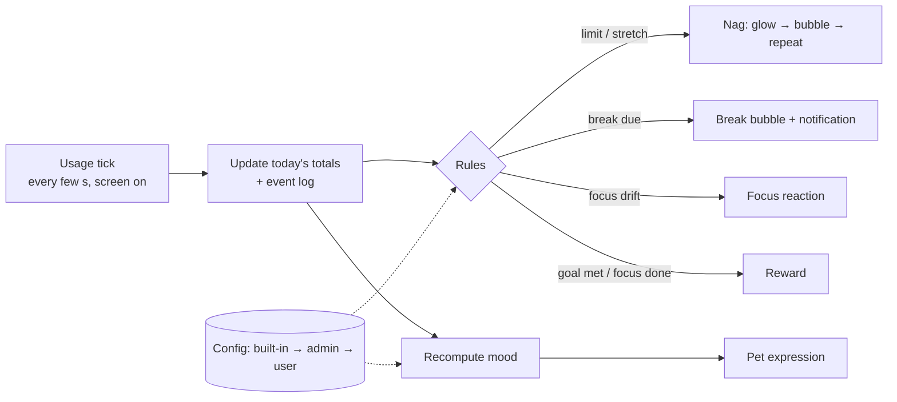
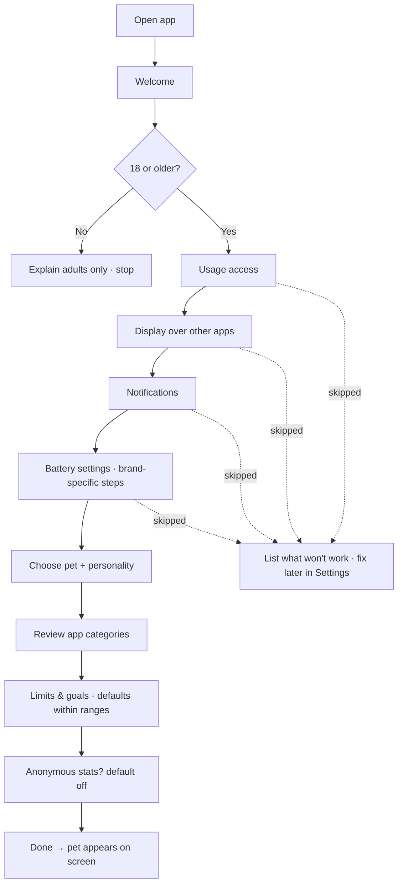
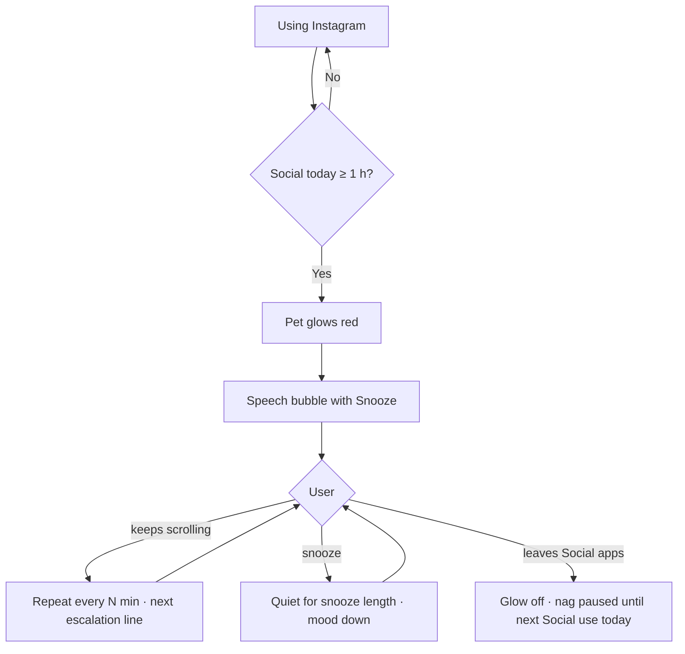
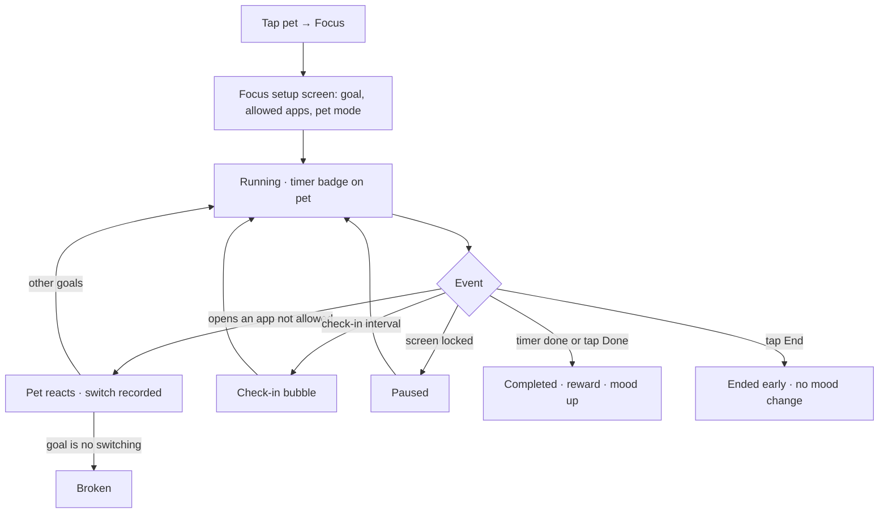
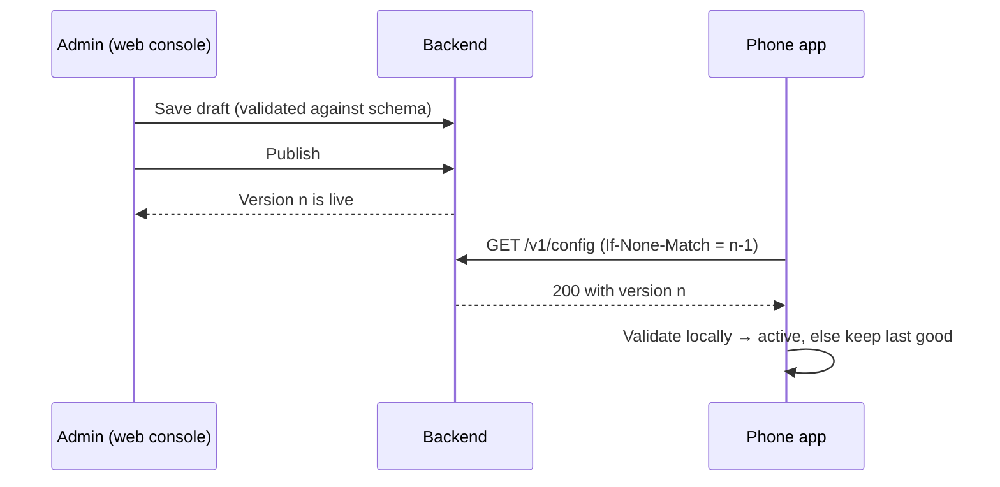
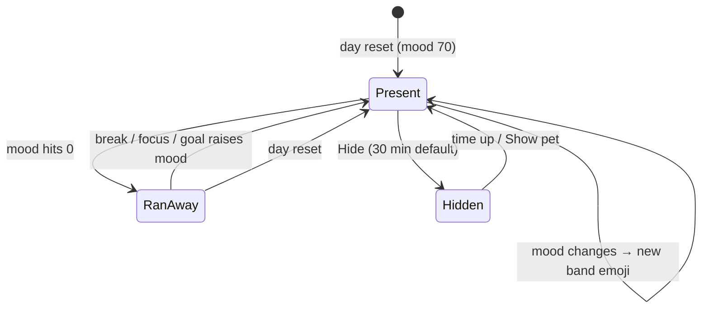
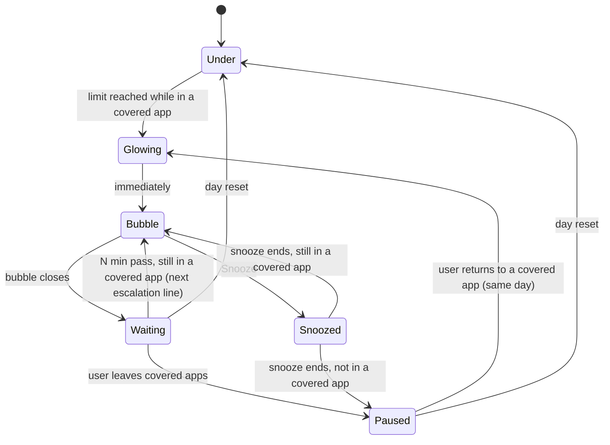
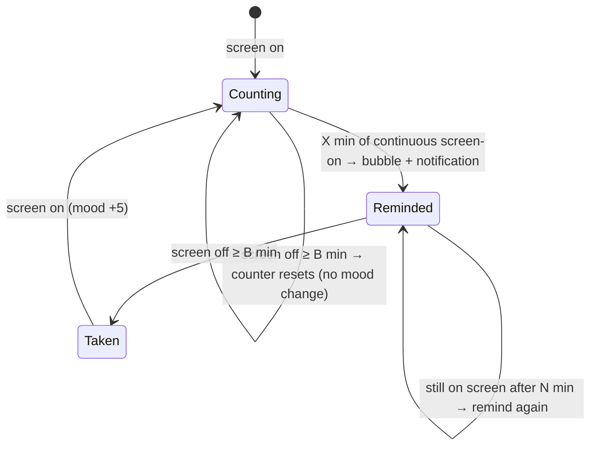
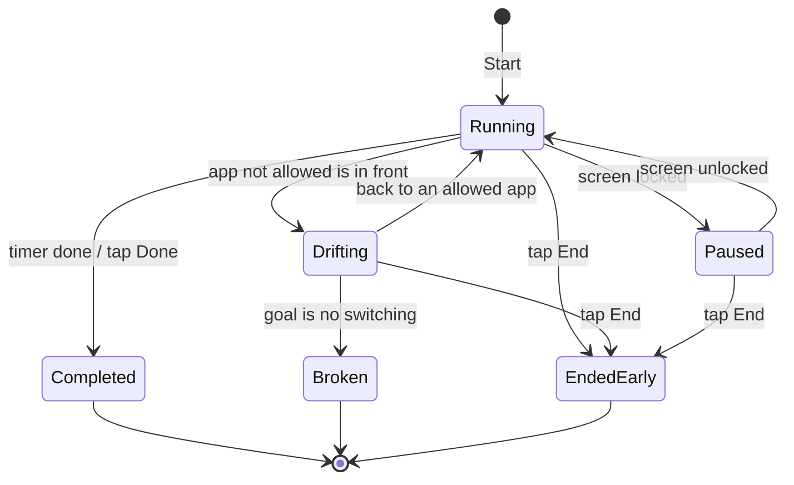
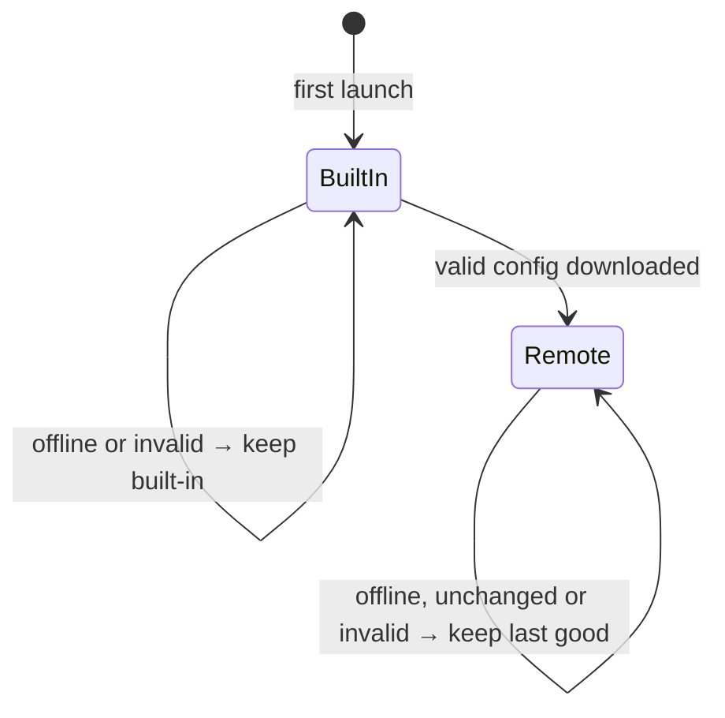

# Discussion

> Phases 1–4 complete — 2026-10-18. Phase 5 (build) started with M0. Decisions from all phases are in the logs further down.
> Last updated: 2026-10-18

---

## Phase 2 — Flows, screens & behaviour

### The app in one picture

- **Always-on service** (foreground service + persistent notification) runs everything in the background.
- **Usage tick:** every few seconds while the screen is on, it reads which app is in front, adds the time to today's totals, and runs the rules.
- **Rules → reactions:** a fixed set of triggers (limit reached, stretch reached, break due, focus drift, goal met…) decides what the pet does. Every number and line comes from config.
- **Pet overlay:** emoji face, red glow, speech bubbles and the summary panel, drawn over other apps.
- **App screens:** setup, home, focus setup, trends and settings are normal screens inside the app.
- **Config:** built-in defaults → admin config (downloaded) → user preferences.

### Flows

**FL-01 First run (setup)**

**FL-02 Daily limit → nag → snooze**

**FL-03 Focus session**

**FL-04 Admin publishes config → phones pick it up**

**FL-05 Permission revoked later**
- The service notices it can't read usage or can't draw the pet → posts a notification ("Your pet can't see your apps — tap to fix") → opens the matching permission step (S-03).
- This is new behaviour → CR-01.

### Screen inventory

**App screens**

| ID | Screen | Shows | Actions | Notes |
|---|---|---|---|---|
| S-01 | Welcome | What the pet does | Start | First run only |
| S-02 | Age check | "Are you 18 or older?" | Yes / No | First run only |
| S-03 | Permissions | One step per permission, reason, status tick | Open system setting, Skip | Reused to fix revoked permissions |
| S-04 | Choose pet | Pets + personalities from config, preview line | Pick | Also reachable from Settings |
| S-05 | App categories | Installed apps with suggested category; search | Change category | Also reachable from Settings |
| S-06 | Limits & goals | Defaults; sliders within admin ranges; locked items read-only | Adjust, add goal | Also reachable from Settings |
| S-07 | Stats opt-in | What is shared and what isn't | On / Off (default off) | Also reachable from Settings |
| S-08 | Home | Today: total, productive vs doomscrolling, goals, pet mood | Start focus, Trends, Settings | Launcher icon opens it after setup (CR-03) |
| S-09 | Focus setup | Goal type, duration or N, allowed apps, pet mode | Start | From the pet panel or Home |
| S-10 | Trends | 7 / 30 days per category; goals met per day | Switch range | Week 2 (F-13) |
| S-11 | Settings | Pet, categories, limits & goals, breaks, nag interval & snooze, day reset hour, stats, permissions, privacy policy | Edit within ranges | Locked items read-only |

**Overlay (drawn over other apps)**

| ID | Surface | Shows | Actions |
|---|---|---|---|
| O-01 | Pet | Emoji for current mood; red glow while a nag is active; timer badge during focus | Tap → panel; drag → snaps to the nearest edge |
| O-02 | Speech bubble | One line in the pet's personality | Snooze (on nags), Dismiss |
| O-03 | Summary panel | Today: total, productive vs doomscrolling, goal progress | Start focus, Open app, Hide pet (30 min default, D-24) |

**Notifications**

| ID | Notification | When |
|---|---|---|
| N-01 | Pet is running (persistent) | Always, while the service runs — Android requires it. Has a "Show pet" action while the pet is hidden |
| N-02 | Break reminder | Break due |
| N-03 | Permission lost | A required permission was revoked (CR-01) |
| N-04 | Nag | A limit nag fires while the pet is hidden (D-24) |

**Admin console (web)**

| ID | Screen | Shows | Actions | When |
|---|---|---|---|---|
| W-01 | Login | — | Log in | Week 2 |
| W-02 | Config editor | Draft vs published values, ranges, locks, feature switches | Edit, validate, publish | Week 2 |
| W-03 | Pets & lines | Pets, personalities, line pools per trigger, mood → emoji mapping, category defaults | Add, edit, disable | Week 2 |
| W-04 | Stats | Success metrics over time (aggregates only) | Pick date range | Week 2–3 |

### State machines

**SM-01 Mood** — a number 0–100; the band decides the emoji. All ranges, emojis and weights are admin config; the numbers here are placeholders (A-24).

| Band | Range | Cat | Blob |
|---|---|---|---|
| Great | 85–100 | 😻 | 🤩 |
| Happy | 70–84 | 😸 | 😄 |
| OK | 50–69 | 😺 | 🙂 |
| Meh | 35–49 | 😼 | 😐 |
| Grumpy | 20–34 | 😾 | 😠 |
| Sad | 10–19 | 😿 | 😢 |
| Sick (low point) | 1–9 | 🙀 | 🤒 |
| Ran away | 0 | 🐾 | 💨 |

- Day reset → mood starts at 70.
- Up: focus session completed +15, goal met +10, break taken +5.
- Down: every 10 min of doomscrolling −3, limit exceeded −10 (once per limit per day), snooze −5.
- Ran away → comes back as soon as mood > 0 (only a break, focus session or goal can raise it), or at the day reset.

**SM-02 Limit nag** — one instance per limit (daily per category, daily total, continuous stretch).

- The pet glows red in Glowing, Bubble and Waiting; no glow in Paused or Snoozed.
- Stretch limits also go back to Under after a break — screen off ≥ 5 min (D-27). Time spent in other apps doesn't reset a stretch.
- While the pet is hidden, a bubble is delivered as a notification instead (D-24).
- During a focus session, nags are held and fire when the session ends if they still apply (D-25).
- Snooze affects only the nag it was pressed on (D-28).

**SM-03 Break reminder**

- A break only raises mood when it follows a reminder (A-26), so leaving the phone overnight doesn't farm mood.

**SM-04 Focus session**

- One session at a time; a session belongs to the day it started (A-25).

**SM-05 Config on the phone**

### Bubble rules (so the pet doesn't spam)

- One speech bubble at a time.
- When several fire together: focus drift > stretch nag > daily-limit nag > break reminder > reward / goal met > idle line.
- At least G seconds between bubbles (placeholder 60 s), except focus drift.
- Lines are picked at random from the pool for (personality, trigger, mood band), never repeating the last 3. Placeholders such as `{app}`, `{minutes}`, `{limit}` are filled in.
- During a focus session only focus reactions show; held nags and break reminders fire when it ends (D-25).
- Idle lines: about every 30 min of screen time when nothing else has shown; admin-configurable; the user can turn them off; never during focus (D-26).

### API surface sketch (backend)

> Superseded by `ARCHITECTURE.md` §7, which adds `GET /health`, `GET /admin/config/published` and the `?schema=` parameter on `/v1/config`. Kept here as the Phase 2 record.

| Method | Path | Who | Purpose |
|---|---|---|---|
| GET | `/v1/config` | Any app, no auth | Latest published config; ETag → 304 when unchanged |
| POST | `/v1/stats` | Opted-in apps | One day's aggregates; anonymous install ID; rate-limited |
| POST | `/admin/login`, `/admin/logout` | Admin | Session |
| GET, PUT | `/admin/config/draft` | Admin | Read / save the draft (validated on save) |
| POST | `/admin/config/publish` | Admin | Make the draft the live version |
| GET | `/admin/stats?from&to` | Admin | Aggregated metrics |
| GET, POST | `/admin/config/versions`, `/admin/config/rollback/:v` | Admin | History + rollback (Could, F-16) |

- One config document holds everything: limits & ranges, nag/break/mood rules, pets, personalities, line pools, category defaults, feature switches.
- It carries `schemaVersion` (its shape) and `configVersion` (its content). The app ignores a document whose `schemaVersion` it doesn't understand.
- The schema lives in `shared/` and validates on the console and the backend. The phone checks the same rules with typed parsing + a Kotlin validator, kept in sync by shared test fixtures (D-39).

### Hard parts — approaches

**H-01 Knowing which app is in front**
- **(a) Read Android's usage event stream every few seconds from the always-on service** ← recommended. Adaptive: ~5 s when a limit is near, a nag is active or focus is running; ~30 s otherwise; nothing while the screen is off.
- (b) Accessibility Service — ruled out (D-03).
- (c) Daily totals only — too coarse for 60-second reactions.
- Trade-off: faster polling means quicker reactions but more battery (R-07).

**H-02 The rule engine**
- **(a) A fixed list of triggers in code; every number, threshold, switch and line comes from config** ← recommended. The admin tunes everything without an app update; only a brand-new kind of trigger needs code.
- (b) Generic rules as JSON conditions — more flexible, harder to test, easy to break from the console.
- (c) Embedded scripts — too risky for v1.

**H-03 Mood**
- **(a) Keep today's event log; mood = start + sum of weights, clamped to 0–100, recomputed when needed** ← recommended. Deterministic, easy to test, survives crashes, and reacts instantly when the admin changes weights.
- (b) A running counter updated on each event — simpler at first, but drifts and is hard to debug.

**H-04 Config delivery**
- **(a) One versioned JSON document, fetched with ETag, validated by a shared schema** ← recommended.
- (b) Separate keys or endpoints per setting — more requests; a phone can end up with a mix of versions.
- (c) Push messages — unnecessary for a 6-hour refresh.

**H-05 Overlay vs app screens**
- **(a) Overlay = pet, bubble, and a read-only panel with buttons. Anything with forms or typing (focus setup, settings) opens an app screen** ← recommended. Overlay windows that take keyboard input are fiddly and can steal input from the app underneath.
- (b) Everything in the overlay — feels seamless, but many more edge cases.

**H-06 Staying alive**
- Foreground service with the "special use" type + persistent notification (R-03); restart after reboot; brand-specific battery steps (R-04).
- The reboot-restart path on Android 15+ has to be verified in Phase 3 (R-09).

### Edge cases noticed

- Battery cost of polling (H-01, R-07).
- Several triggers firing at once → bubble rules.
- Day reset during a focus session (A-25) or an active nag (nags reset).
- Changing time zones mid-day — time stays on the local day it happened.
- Apps uninstalled after being categorised — removed from the list, history kept.
- Launcher, system UI and this app — not counted (A-20).
- Work-profile apps — not visible to usage access; not tracked (A-23).
- Pet over full-screen games and videos — Q-05.

---

## Decision log

| ID | Decision | Reason | Alternatives considered | Date |
|---|---|---|---|---|
| D-01 | Android only for v1 | iOS doesn't allow drawing over other apps and keeps Screen Time data inside a sandboxed view the app can't read | iOS "lite" alongside; identical features on both | 2026-10-17 |
| D-02 | Free Google Play app for adults 18+. No ADHD or health positioning; "ADHD" is internal only | Keep it simple; avoid health-app rules | ADHD-focused positioning | 2026-10-17 |
| D-03 | Focus sessions start manually; no content detection | Works without an Accessibility Service and its Play review | Tag study apps; auto-detect with Accessibility Service | 2026-10-17 |
| D-04 | Engagement goals and the pet's focus behaviour are configurable: finish the task / no switching for N min; quiet / check-ins / reward at end | Different users need different help | One fixed behaviour | 2026-10-17 |
| D-05 | v1 = rule engine + line pools written per personality. Chat comes after v1, through a cloud LLM | Personality without LLM cost in v1; cloud gives the best chat quality later | On-device Gemini Nano; bundled open model | 2026-10-17 |
| D-06 | Usage data stays on the device; no user login. Exception: opt-in anonymous stats (D-19) | Privacy, simplicity | Accounts + cloud backup | 2026-10-17, revised 2026-10-18 |
| D-07 | When limits are exceeded the pet only warns (glow, nag). No blocking | Keep it friendly and simple | Blocking or delaying apps | 2026-10-17 |
| D-08 | Several pets to choose from; personality from presets; the pet has a mood | Engagement and ownership | Single pet; personality sliders | 2026-10-17 |
| D-09 | Fixed categories: Productive / Social & scrolling / Games / Entertainment / Neutral. Auto-suggested; the user confirms or edits during setup | Predictable rules, little setup effort | Free-form categories | 2026-10-17 |
| D-10 | Limits cover daily totals and continuous stretches; the day resets at midnight | Both binge patterns matter | Daily totals only | 2026-10-17 |
| D-11 | Nags escalate (glow → speech bubble → repeat every N min); the user can snooze | Gentle first, firmer if ignored | Single warning | 2026-10-17 |
| D-12 | Break reminders: configurable trigger; shown as pet speech bubble + notification | Visible even when the overlay is hidden | One channel only | 2026-10-17 |
| D-13 | Summary shows today + 7/30-day trends; goals can be limits and positive targets | See progress over time | Today only | 2026-10-17 |
| D-14 | Web admin console + own Node.js backend serving a hosted config; every app downloads it | Change behaviour without a Play update; the backend is reused for chat later | Hidden in-app developer screen; hosted remote-config service | 2026-10-18 |
| D-15 | Config layering: built-in defaults → admin config → user preferences (only user-editable settings, within admin ranges) | Works offline; admin controls bounds; users keep their choices | Admin-only or user-only settings | 2026-10-18 |
| D-16 | Admin/user split as agreed (table below) | — | — | 2026-10-18 |
| D-17 | Mood rises with focus sessions done, goals met and breaks taken; falls with doomscrolling, limits exceeded and snoozes; resets at the day reset; has a low point (sick, runs away) | Visible consequence of habits | Mood without a low point | 2026-10-18 |
| D-18 | The pet is an emoji face that changes with mood (e.g. 🐱 → 😺 😿 😾) | Well-defined expressions, no art needed for v1 | Pet drawing + emoji badge | 2026-10-18 |
| D-19 | Success is measured with opt-in anonymous stats shown in the admin console | Play Console alone can't show behaviour change | Play Console numbers only | 2026-10-18 |
| D-20 | Collaboration mode: delivery (fix directly, explain briefly) | — | Learning mode | 2026-10-18 |
| D-21 | Minimum Android: cover phones from the last 3–5 years | Reach most phones in use | Newer-only | 2026-10-18 |
| D-22 | v1 pets: Cat (cat-face emojis 😺 😸 😹 😻 😼 😽 🙀 😿 😾) and Blob (yellow smiley emojis). More animals once custom art exists | Only these two emoji families have a full range of expressions | Animal emoji + mood badge; cat only | 2026-10-18 |
| D-23 | 2026-10-25 target = a working build (week-1 cut) on the developer's phone and emulator. Backend, console, trends and stats in week 2; Play submission after that | Realistic for a solo build; Play review adds days on top | Live on Play by 2026-10-25 with a much smaller v1 | 2026-10-18 |
| D-24 | The user can hide the pet temporarily; default 30 min, admin-configurable. While hidden, nags and break reminders arrive as notifications (Q-05) | Games and calls need a clear screen without losing protection | No hide option | 2026-10-18 |
| D-25 | During a focus session, limit nags and break reminders are held and fire when the session ends if they still apply (Q-06) | Interruptions defeat the point of focus | Let them through | 2026-10-18 |
| D-26 | Idle lines: about every 30 min of screen time, admin-configurable, user can turn off (Q-07) | Makes the pet feel alive | Pet only speaks on triggers | 2026-10-18 |
| D-27 | A break = screen off ≥ 5 min, for both break reminders and stretch limits; time in other apps doesn't count (Q-08) | One simple rule | Also count time outside the limited categories | 2026-10-18 |
| D-28 | Snooze silences only the nag it was pressed on (Q-09) | Other limits stay protective | Snooze everything | 2026-10-18 |
| D-29 | Skip the mock-data UI demo; real screens are built in M1 (Q-10) | Deadline | Build the demo first | 2026-10-18 |
| D-30 | Phase 2 design accepted: flows, screen inventory, state machines, bubble rules, API sketch; approaches H-01 (a) to H-05 (a) | — | Alternatives listed under "Hard parts" | 2026-10-18 |
| D-31 | Android app in native Kotlin + Jetpack Compose | Core features are Android system features (overlay, service, usage events) | React Native, Flutter | 2026-10-18 |
| D-32 | Backend in Node.js + Fastify | Developer's skill set; built-in JSON Schema validation | Express | 2026-10-18 |
| D-33 | Admin console in React + Vite with forms generated from the config schema | New setting = schema change only | Hand-built forms; raw JSON editor | 2026-10-18 |
| D-34 | PostgreSQL as the server database | Managed with backups on any host | SQLite | 2026-10-18 |
| D-35 | Hosting: one Docker container (API + console) + managed Postgres; provider chosen in week 2 | Least operations work; same origin, no CORS | Self-managed VPS | 2026-10-18 |
| D-36 | Standard size tier; repo layout `android/`, `backend/`, `admin/`, `shared/` (TECH_STACK §3) | Two front ends + shared contract, one backend | Simple tier; complex tier | 2026-10-18 |
| D-37 | Backend and admin console in plain JavaScript (ES modules), not TypeScript | Matches the developer's skills; no build step; data is validated at runtime by Fastify and the schema | TypeScript 7 | 2026-10-18 |
| D-38 | Admin password hashed with scrypt from Node's built-in `crypto` | Slow, memory-hard hash with no native add-on; deliberate exception to AGENTS.md's "bcrypt / argon2" | bcrypt, argon2 | 2026-10-18 |
| D-39 | The phone validates config with typed parsing (kotlinx.serialization) + a Kotlin validator; `shared/fixtures/` keeps it in sync with the JSON Schema | JSON-Schema libraries on Android are heavy | JSON-Schema library on Android | 2026-10-18 |
| D-40 | Consistent emoji via emoji2 + Google Play services' downloadable font, replacing all emoji | Same look across brands without adding > 10 MB | Bundled emoji font; system emoji only | 2026-10-18 |
| D-41 | Phase 3 approved: `TECH_STACK.md` v1.0 | — | — | 2026-10-18 |
| D-42 | The production image is built by `backend/Dockerfile` (context = repo root) and includes the console's static files; `admin/` has no Dockerfile | The console is static files, not a server; one container (D-35). Deliberate exception to AGENTS.md §4 | Separate console container | 2026-10-18 |
| D-43 | Built-in defaults live in `shared/default-config.json` — copied into the app's assets at build time and seeded as the server's first published config | One source of truth for defaults | Separate copies in the app and the backend | 2026-10-18 |
| D-44 | App screens never call `PetService`; they write to storage and the service observes. One engine coroutine owns engine state | Works whether the service is running, restarting or freshly booted; no race conditions | Bound service / direct calls | 2026-10-18 |
| D-45 | The admin document replaces the built-in one as a whole (no deep merge); user values are layered per setting and clamped; the app fetches the document for the schema version it was built with | Predictable layering; old app versions keep working during a schema change | Per-key merge of admin over built-in | 2026-10-18 |
| D-46 | Phase 4 approved: `ARCHITECTURE.md` v1.0 (HLD) and `ROADMAP.md` v1.0, including D-42 to D-45 and the week-1 cut line | — | — | 2026-10-18 |
| D-47 | ~~App name Tommy; application ID `com.rahul12arora.tommy`~~ — superseded by D-49 | — | — | 2026-10-18 |
| D-48 | Real test phone: Pixel 7a (Q-12). Code lives in `github.com/Rahul12Arora/Tommy` (Q-13) | — | — | 2026-10-18 |
| D-49 | App name **Nyx**; application ID `com.companionstudio.nyx` — no personal name in the ID; can't change once on Google Play (replaces D-47) | Developer's choice | `com.rahul12arora.tommy` | 2026-10-18 |
| D-50 | Room `AppDatabase` and the DataStore are created in M3, together with their first real table (`app_categories`) and keys (setup progress, age check), not empty in M1. M1 writes the Room and DataStore policies (ARCHITECTURE §14.1) | Room refuses a database with no entities (probe 2026-10-19: `@Database annotation must specify list of entities`); an unused DataStore is dead code | Placeholder entity in M1; pulling `app_categories` into M1 | 2026-10-19 |

### D-16 — Admin / user settings split

| Setting | Admin controls | User can change? |
|---|---|---|
| Limits (per category, total, continuous stretch) | Defaults + allowed range | Yes, within range |
| Nag timing, snooze length, max snoozes | All of it | Interval and snooze only |
| Break reminder trigger | Default + range | Yes |
| Mood rules (what moves mood, by how much) | All of it | No |
| Pet catalogue and personality presets | Add / remove | Picks one |
| Line pools (what the pet says) | All of it | No |
| App → category defaults | Defaults | Yes, per app |
| Day reset hour | Default | Yes |
| Feature switches (focus mode, breaks, trends) | On / off | — |

---

## Assumptions

| ID | Assumption | Status |
|---|---|---|
| A-01 | "Finished the video" = the user sets a session goal and confirms at the end; the app can't see playback inside other apps | Active |
| A-02 | "No app switch" = the foreground app stays within the session's allowed apps. Notification shade, pet panel and phone calls don't count; locking the screen pauses the session | Active |
| A-03 | ~~Setup never asks for or stores a diagnosis~~ | Retired — no ADHD positioning anywhere (D-02) |
| A-04 | No cloud backup; uninstalling deletes all history | Active |
| A-05 | English-only UI for v1 | Active |
| A-06 | The user self-declares 18+ during setup; under-18 can't continue | Active |
| A-07 | minSdk 30 (Android 11, ≈ phones from the last 5 years); targetSdk 36 as Play requires. Coverage confirmed in Phase 3 | Accepted |
| A-08 | Day reset hour defaults to 00:00 device time; user-changeable | Accepted |
| A-09 | Opt-in stats: off by default; daily aggregates only — minutes per category, focus sessions started/completed, nags, snoozes, breaks, pet-running flag, app and Android version — plus a random install ID. No app names, no advertising ID, no personal data | Accepted |
| A-10 | Config flows one way, server → phone; it is public-read and contains no secrets | Accepted |
| A-11 | Low point: sick expression at the low band; at zero the pet runs away (🐾 / 💨 shown); it returns as soon as mood > 0 (a break, focus session or goal raises it), or at the day reset. See SM-01 | Accepted |
| A-12 | Phones, portrait-first; tablets not optimised | Accepted |
| A-13 | On-device daily totals kept ≥ 31 days; server stats kept 12 months | Accepted |
| A-14 | Placeholder defaults: Social & scrolling 1 h/day, Games 2 h/day, Entertainment 2 h/day; continuous stretch 30 min on Social or Games; no limits on Productive or Neutral. Tuned from the console | Accepted |
| A-15 | "Doomscrolling" in the summary = Social & scrolling time | Accepted |
| A-16 | One admin account (the developer) | Accepted |
| A-17 | Apps refresh config on start and every 6 hours | Accepted |
| A-18 | Backend sized for up to 10,000 installs in v1 | Accepted |
| A-19 | The app's own battery use ≤ 3% of a full charge per day | Accepted |
| A-20 | Launcher / home screen, system UI and this app don't count toward any totals | Accepted |
| A-21 | Bubble rules: one bubble at a time, fixed priority order, ≥ 60 s between bubbles except focus drift | Accepted |
| A-22 | Forms live in app screens; the overlay only shows the pet, bubbles and a read-only panel with buttons (H-05) | Accepted |
| A-23 | Work-profile apps aren't tracked | Accepted |
| A-24 | Mood placeholder numbers as in SM-01 (start 70; +15 / +10 / +5; −3 per 10 min doomscrolling, −10 per limit exceeded, −5 per snooze) | Accepted |
| A-25 | A focus session belongs to the day it started; the day reset doesn't interrupt it | Accepted |
| A-26 | A break raises mood only when it follows a break reminder | Accepted |
| A-27 | No staging environment in v1: config changes are protected by draft → publish and validation on all three sides; code is tested locally with the same Docker image that ships | Accepted |

---

## Open questions

| ID | Question | Blocking? | Status |
|---|---|---|---|
| Q-01 | What must exist on 2026-10-25? (A) a working build installed from Android Studio on your phone and emulator, or (B) the app live on the Play Store for anyone to download | Yes | Answered — (A) → D-23 |
| Q-02 | Do you have a Google Play developer account? Personal or organisation? Created before or after 13 Nov 2023? | Yes, for the launch date | Answered — personal, created before 2023, so the 14-day closed-test rule doesn't apply |
| Q-03 | Which pets in v1? Only the cat has a full set of expression emojis; other animals have a single emoji | Yes | Answered — option (a) → D-22 |
| Q-04 | Are the success-metric targets in REQUIREMENTS §2 right? | No | Open |
| Q-05 | Can the user hide the pet temporarily (e.g. during a game or video call)? If yes: for how long, and do nags still show as notifications? | Yes — affects O-03 | Answered → D-24, CR-04 |
| Q-06 | During a focus session, what happens to limit nags and break reminders? | Yes | Answered → D-25 |
| Q-07 | Should the pet talk when nothing is wrong (idle lines)? | Yes — scope (CR-02) | Answered → D-26 |
| Q-08 | What counts as a break? | Yes | Answered → D-27 |
| Q-09 | Does Snooze silence only the nag it was pressed on, or all nags? | No | Answered → D-28 |
| Q-10 | Skip Phase 2's optional mock-data UI demo? | Yes — decides the next step | Answered → D-29 |
| Q-11 | App name and Android application ID? The ID can't change once the app is on Google Play | Yes — M0 | Answered → D-49 (D-47 superseded) |
| Q-12 | Which real phone will you test on? | Yes — M4 | Answered → D-48 (Pixel 7a) |
| Q-13 | Is there a GitHub repo for this? | Yes — M0 | Answered → D-48 |
| Q-14 | Limit goals (e.g. Social ≤ 1 h) can only be judged at day end, when mood resets. (a) Limit goals show progress and count as "kept" in trends, with no mood bonus — exceeding already costs −10 (recommended); (b) the bonus goes to the next day's starting mood; (c) judge them at a fixed evening hour | Yes — M7 | Answered — (a) → CR-05 |

---

## Risks

| ID | Risk | Impact | Mitigation |
|---|---|---|---|
| R-01 | Full v1 scope doesn't fit in one week solo | Missed date or rushed quality | Week-1 cut in REQUIREMENTS §4; backend, console, trends and stats in week 2–3 |
| R-02 | ~~New personal Play accounts need a 14-day closed test with 12 testers~~ | — | Retired — the account predates the rule (Q-02) |
| R-03 | Play reviews the always-on foreground service type ("special use") case by case | Rejection delays launch | Clear justification + demo video prepared in Phase 3 |
| R-04 | Xiaomi, Samsung, Vivo, Oppo etc. kill background apps | The pet silently disappears | Brand-specific battery steps in setup; "pet running" metric in stats. The test phone is a Pixel 7a (stock Android), which won't show these brands' behaviour: borrow at least one Xiaomi or Samsung phone before Play submission (M15) |
| R-05 | Emojis look different on each phone brand | The pet looks inconsistent | emoji2 with Google Play services' downloadable emoji font, replacing all emoji (TECH_STACK §5); bundling the font rejected (> 10 MB) |
| R-06 | A bad admin config reaches every phone | Broken behaviour for all users | Validation in the console and on the phone; last-good fallback; rollback (F-16) |
| R-07 | Usage polling drains the battery | Uninstalls | Battery budget (A-19); tune polling interval; measure during hardening |
| R-08 | Review of a brand-new app usually takes a few days and can stretch past a week | Launch date slips | Submit at least a week before any public launch date; have the always-on service justification and demo video ready at submission |
| R-09 | Restarting an overlay + "special use" service may be restricted on Android 15+ | Pet doesn't return until the app is opened | Boot path confirmed: Android 15's `BOOT_COMPLETED` restriction doesn't cover `specialUse`. Restart after an app update and after process death are verified in M4; fallback: a notification that brings the pet back on tap |
| R-10 | Listing installed apps via a `<queries>` entry for launcher apps couldn't be confirmed from the docs today | Category setup (S-05) can't show app names | Verify in M3. Fallbacks: list only apps seen in usage events, or `QUERY_ALL_PACKAGES` with a Play declaration (rejection risk) |

---

## Change requests

| ID | Change | Impact | Status |
|---|---|---|---|
| CR-01 | Notify the user when a required permission is revoked (N-03) and open the fix screen (S-03) | Small: one notification + reuse of S-03 | Approved — REQUIREMENTS v1.1 (F-21, US-26) |
| CR-02 | Idle lines: the pet occasionally speaks when nothing is wrong | Small: one new trigger + line pools + switch in config | Approved — REQUIREMENTS v1.1 (F-20, US-27) |
| CR-03 | Home screen (S-08) opens from the launcher icon after setup | Small: one screen reusing the summary data | Approved — REQUIREMENTS v1.1 (F-18, US-28) |
| CR-04 | Hide the pet temporarily (default 30 min, admin-configurable); nags and break reminders arrive as notifications while hidden | Small: one overlay state + notification (N-04) + config value | Approved — REQUIREMENTS v1.1 (F-19, US-29) |
| CR-05 | US-17: only positive goals raise mood when met; limit goals are judged at the day reset and shown as kept/missed in trends, with no mood effect (Q-14) | Small: `goal_met` fires for positive goals only; a daily "limit goal kept" flag for trends (M7, M13). No API or schema change | Approved — REQUIREMENTS v1.2 |
| CR-06 | AGP 9.4.0 → 9.4.1 (patch release on Google Maven; Android Studio's wizard picks it by default) | None: build-only, same Gradle 9.6.0 / SDK range. TECH_STACK §1, §4, §6 updated | Approved 2026-10-19 |
| CR-07 | Add `androidx.test.espresso:espresso-core` 3.7.0 as a device-test-only dependency | None for the app: test APK only. Compose UI tests pull in Espresso 3.5.0, which fails on API 35+ (`NoSuchMethodException: InputManager.getInstance`); 3.7.0 fixes it. TECH_STACK §6 updated | Approved 2026-10-19 |

---

## Parking lot

- Chat with the pet through a cloud LLM — needs a backend proxy, cost controls, abuse protection without logins, and an in-app way to report offensive replies (Play rule for generative AI)
- Custom pet art (2D/3D sprites) beyond emoji
- iOS version
- Local export of the user's own history
- Config version history, staged rollout and rollback in the console (F-16)
- Optional app blocking
- More languages
