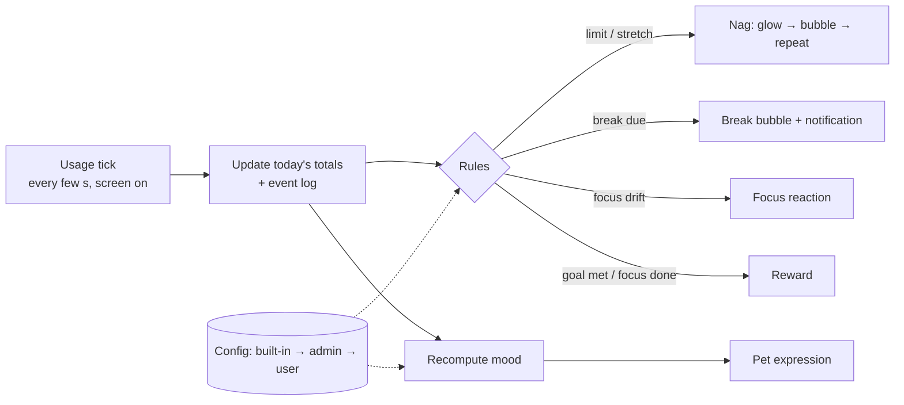
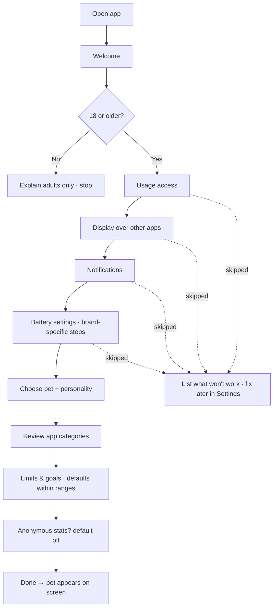
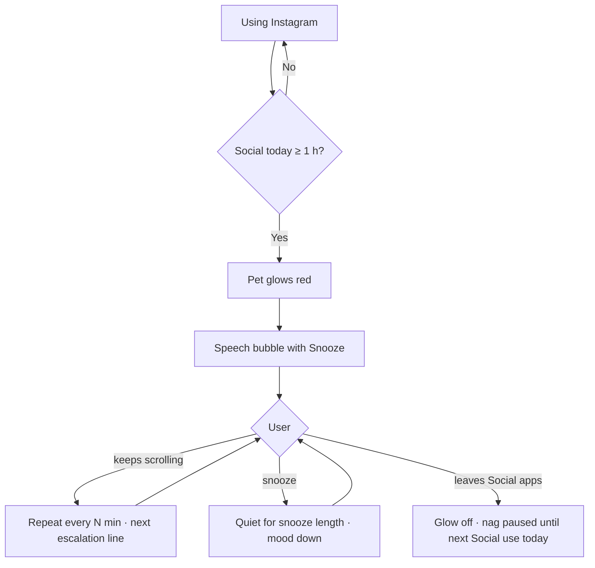
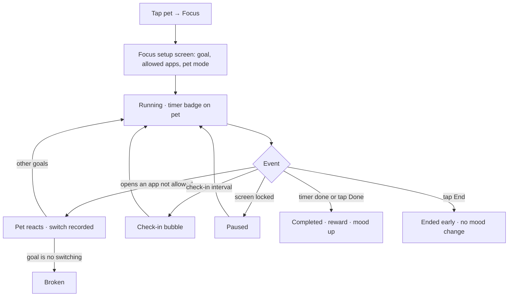
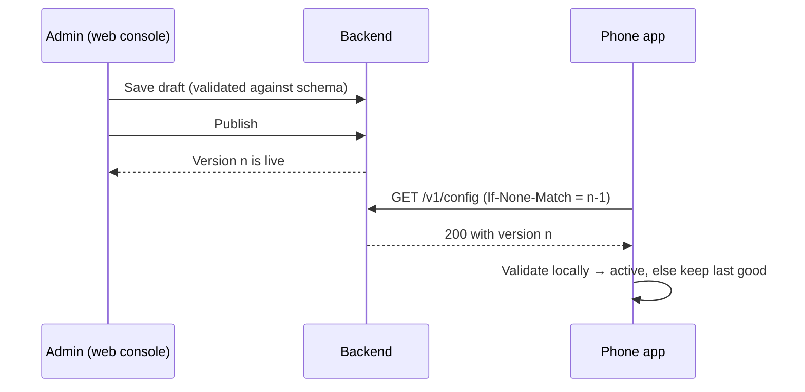
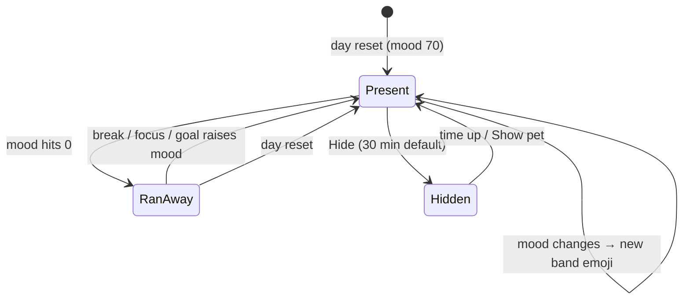
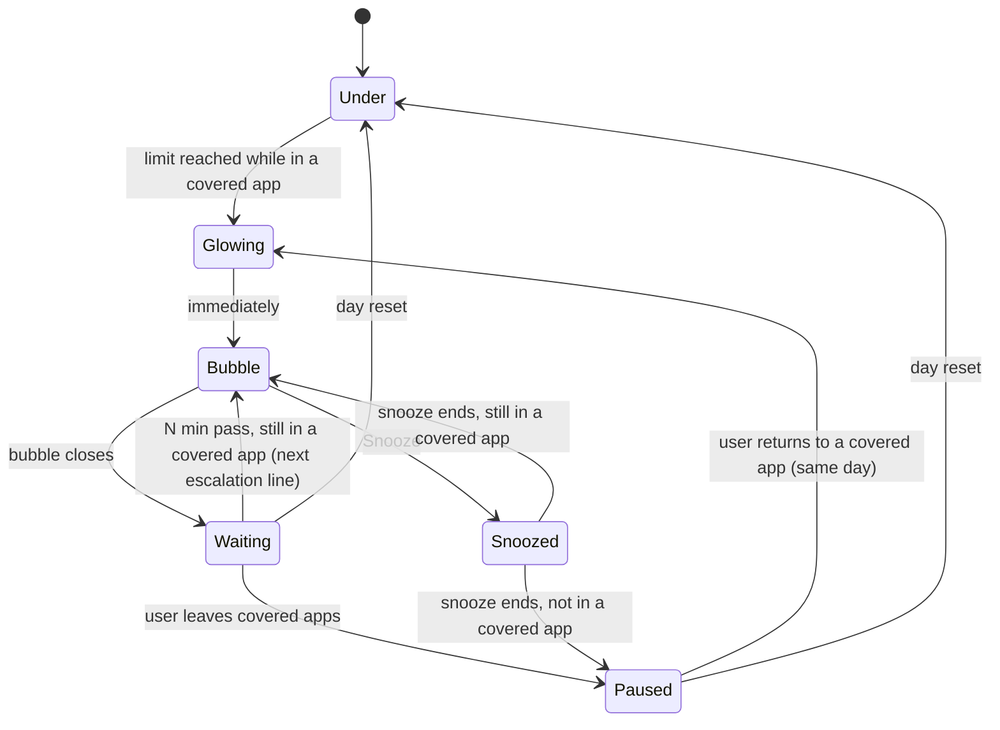
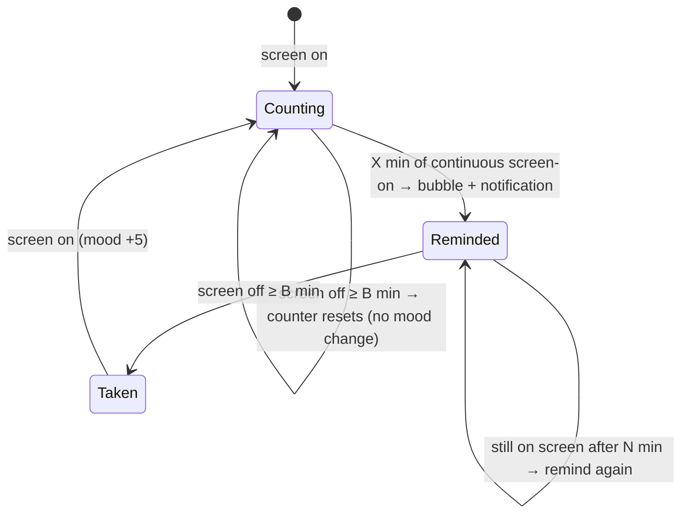
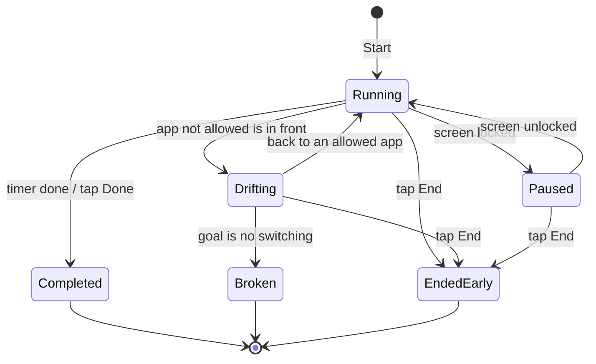
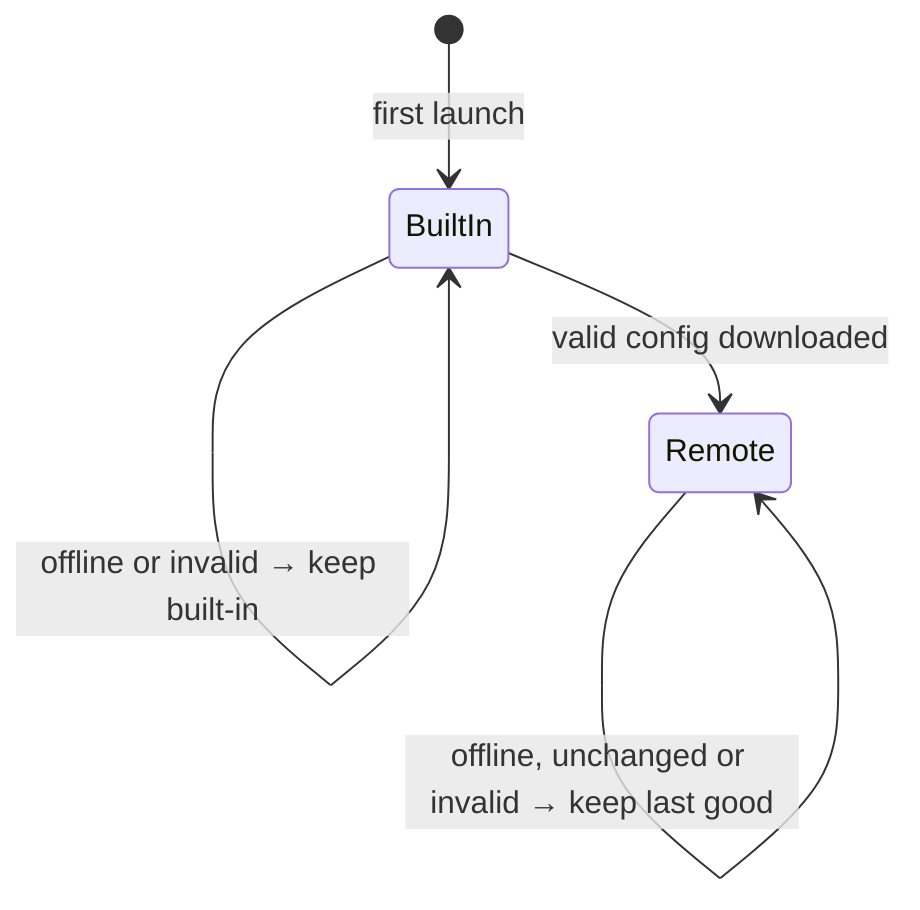

# Discussion

> Phases 1–4 complete — 2026-10-18. Phase 5 (build) started with M0. Decisions from all phases are in the logs further down.
> Last updated: 2026-10-21

---

## Phase 2 — Flows, screens & behaviour

### The app in one picture

- **Always-on service** (foreground service + persistent notification) runs everything in the background.
- **Usage tick:** every few seconds while the screen is on, it reads which app is in front, adds the time to today's totals, and runs the rules.
- **Rules → reactions:** a fixed set of triggers (limit reached, stretch reached, break due, focus drift, goal met…) decides what the pet does. Every number and line comes from config.
- **Pet overlay:** emoji face, red glow, speech bubbles and the summary panel, drawn over other apps.
- **App screens:** setup, home, focus setup, trends and settings are normal screens inside the app.
- **Config:** built-in defaults → admin config (downloaded) → user preferences.

### Flows

**FL-01 First run (setup)**

**FL-02 Daily limit → nag → snooze**

**FL-03 Focus session**

**FL-04 Admin publishes config → phones pick it up**

**FL-05 Permission revoked later**
- The service notices it can't read usage or can't draw the pet → posts a notification ("Your pet can't see your apps — tap to fix") → opens the matching permission step (S-03).
- This is new behaviour → CR-01.

### Screen inventory

**App screens**

| ID | Screen | Shows | Actions | Notes |
|---|---|---|---|---|
| S-01 | Welcome | What the pet does | Start | First run only |
| S-02 | Age check | "Are you 18 or older?" | Yes / No | First run only |
| S-03 | Permissions | One step per permission, reason, status tick | Open system setting, Skip | Reused to fix revoked permissions |
| S-04 | Choose pet | Pets + personalities from config, preview line | Pick | Also reachable from Settings |
| S-05 | App categories | Installed apps with suggested category; search | Change category | Also reachable from Settings |
| S-06 | Limits & goals | Defaults; sliders within admin ranges; locked items read-only | Adjust, add goal | Also reachable from Settings |
| S-07 | Stats opt-in | What is shared and what isn't | On / Off (default off) | Also reachable from Settings |
| S-08 | Home | Today: total, productive vs doomscrolling, goals, pet mood | Start focus, Trends, Settings | Launcher icon opens it after setup (CR-03) |
| S-09 | Focus setup | Goal type, duration or N, allowed apps, pet mode | Start | From the pet panel or Home |
| S-10 | Trends | 7 / 30 days per category; goals met per day | Switch range | Week 2 (F-13) |
| S-11 | Settings | Pet, categories, limits & goals, breaks, nag interval & snooze, day reset hour, stats, permissions, privacy policy | Edit within ranges | Locked items read-only |

**Overlay (drawn over other apps)**

| ID | Surface | Shows | Actions |
|---|---|---|---|
| O-01 | Pet | Emoji for current mood; red glow while a nag is active; timer badge during focus | Tap → panel; drag → snaps to the nearest edge |
| O-02 | Speech bubble | One line in the pet's personality | Snooze (on nags), Dismiss |
| O-03 | Summary panel → **actions ring** from M7 (CR-09, D-87, D-90 to D-92) | Today: total, productive vs doomscrolling, goal progress; from M7 as a half ring of icons with short values — one Limits icon for all category limits (D-90) — plus continuous screen use (US-30); focus timer from M8 | Start focus, Open app, Hide pet (30 min default, D-24) |
| O-04 | Break screen (only if the user picks the obstructive mode, CR-10, D-88) | Full screen over the current app, dimmed; the pet in the middle with a line about continuous screen use | Take a break, 5 more minutes (both unlock after a short delay; 5 more minutes hides after the last snooze) |

**Notifications**

| ID | Notification | When |
|---|---|---|
| N-01 | Pet is running (persistent) | Always, while the service runs — Android requires it. Has a "Show pet" action while the pet is hidden |
| N-02 | Break reminder | Break due |
| N-03 | Permission lost | A required permission was revoked (CR-01) |
| N-04 | Nag | A limit nag fires while the pet is hidden (D-24) |

**Admin console (web)**

| ID | Screen | Shows | Actions | When |
|---|---|---|---|---|
| W-01 | Login | — | Log in | Week 2 |
| W-02 | Config editor | Draft vs published values, ranges, locks, feature switches | Edit, validate, publish | Week 2 |
| W-03 | Pets & lines | Pets, personalities, line pools per trigger, mood → emoji mapping, category defaults | Add, edit, disable | Week 2 |
| W-04 | Stats | Success metrics over time (aggregates only) | Pick date range | Week 2–3 |

### State machines

**SM-01 Mood** — a number 0–100; the band decides the emoji. All ranges, emojis and weights are admin config; the numbers here are placeholders (A-24).

| Band | Range | Cat | Blob |
|---|---|---|---|
| Great | 85–100 | 😻 | 🤩 |
| Happy | 70–84 | 😸 | 😄 |
| OK | 50–69 | 😺 | 🙂 |
| Meh | 35–49 | 😼 | 😐 |
| Grumpy | 20–34 | 😾 | 😠 |
| Sad | 10–19 | 😿 | 😢 |
| Sick (low point) | 1–9 | 🙀 | 🤒 |
| Ran away | 0 | 🐾 | 💨 |

- Day reset → mood starts at 70.
- Up: focus session completed +15, goal met +10, break taken +5.
- Down: every 10 min of doomscrolling −3, limit exceeded −10 (once per limit per day), snooze −5.
- Ran away → comes back as soon as mood > 0 (only a break, focus session or goal can raise it), or at the day reset.

**SM-02 Limit nag** — one instance per limit (daily per category, daily total, continuous stretch).

- The pet glows red in Glowing, Bubble and Waiting; no glow in Paused or Snoozed.
- Stretch limits also go back to Under after a break — screen off ≥ 5 min (D-27). Time spent in other apps doesn't reset a stretch.
- While the pet is hidden, a bubble is delivered as a notification instead (D-24).
- During a focus session, nags are held and fire when the session ends if they still apply (D-25).
- Snooze affects only the nag it was pressed on (D-28).
- From M7 (D-94): coming back to a covered app brings the glow back at once, but the next line waits until N min have passed since that limit's last line.

**SM-03 Break reminder**

- A break only raises mood when it follows a reminder (A-26), so leaving the phone overnight doesn't farm mood.

**SM-04 Focus session**

- One session at a time; a session belongs to the day it started (A-25).

**SM-05 Config on the phone**

### Bubble rules (so the pet doesn't spam)

- One speech bubble at a time.
- When several fire together: focus drift > stretch nag > daily-limit nag > break reminder > reward / goal met > idle line.
- At least G seconds between bubbles (placeholder 60 s), except focus drift.
- Lines are picked at random from the pool for (personality, trigger, mood band), never repeating the last 3. Placeholders such as `{app}`, `{minutes}`, `{limit}` are filled in.
- During a focus session only focus reactions show; held nags and break reminders fire when it ends (D-25).
- Idle lines: about every 30 min of screen time when nothing else has shown; admin-configurable; the user can turn them off; never during focus (D-26).

### API surface sketch (backend)

> Superseded by `ARCHITECTURE.md` §7, which adds `GET /health`, `GET /admin/config/published` and the `?schema=` parameter on `/v1/config`. Kept here as the Phase 2 record.

| Method | Path | Who | Purpose |
|---|---|---|---|
| GET | `/v1/config` | Any app, no auth | Latest published config; ETag → 304 when unchanged |
| POST | `/v1/stats` | Opted-in apps | One day's aggregates; anonymous install ID; rate-limited |
| POST | `/admin/login`, `/admin/logout` | Admin | Session |
| GET, PUT | `/admin/config/draft` | Admin | Read / save the draft (validated on save) |
| POST | `/admin/config/publish` | Admin | Make the draft the live version |
| GET | `/admin/stats?from&to` | Admin | Aggregated metrics |
| GET, POST | `/admin/config/versions`, `/admin/config/rollback/:v` | Admin | History + rollback (Could, F-16) |

- One config document holds everything: limits & ranges, nag/break/mood rules, pets, personalities, line pools, category defaults, feature switches.
- It carries `schemaVersion` (its shape) and `configVersion` (its content). The app ignores a document whose `schemaVersion` it doesn't understand.
- The schema lives in `shared/` and validates on the console and the backend. The phone checks the same rules with typed parsing + a Kotlin validator, kept in sync by shared test fixtures (D-39).

### Hard parts — approaches

**H-01 Knowing which app is in front**
- **(a) Read Android's usage event stream every few seconds from the always-on service** ← recommended. Adaptive: ~5 s when a limit is near, a nag is active or focus is running; ~30 s otherwise; nothing while the screen is off.
- (b) Accessibility Service — ruled out (D-03).
- (c) Daily totals only — too coarse for 60-second reactions.
- Trade-off: faster polling means quicker reactions but more battery (R-07).

**H-02 The rule engine**
- **(a) A fixed list of triggers in code; every number, threshold, switch and line comes from config** ← recommended. The admin tunes everything without an app update; only a brand-new kind of trigger needs code.
- (b) Generic rules as JSON conditions — more flexible, harder to test, easy to break from the console.
- (c) Embedded scripts — too risky for v1.

**H-03 Mood**
- **(a) Keep today's event log; mood = start + sum of weights, clamped to 0–100, recomputed when needed** ← recommended. Deterministic, easy to test, survives crashes, and reacts instantly when the admin changes weights.
- (b) A running counter updated on each event — simpler at first, but drifts and is hard to debug.

**H-04 Config delivery**
- **(a) One versioned JSON document, fetched with ETag, validated by a shared schema** ← recommended.
- (b) Separate keys or endpoints per setting — more requests; a phone can end up with a mix of versions.
- (c) Push messages — unnecessary for a 6-hour refresh.

**H-05 Overlay vs app screens**
- **(a) Overlay = pet, bubble, and a read-only panel with buttons. Anything with forms or typing (focus setup, settings) opens an app screen** ← recommended. Overlay windows that take keyboard input are fiddly and can steal input from the app underneath.
- (b) Everything in the overlay — feels seamless, but many more edge cases.

**H-06 Staying alive**
- Foreground service with the "special use" type + persistent notification (R-03); restart after reboot; brand-specific battery steps (R-04).
- The reboot-restart path on Android 15+ has to be verified in Phase 3 (R-09).

### Edge cases noticed

- Battery cost of polling (H-01, R-07).
- Several triggers firing at once → bubble rules.
- Day reset during a focus session (A-25) or an active nag (nags reset).
- Changing time zones mid-day — time stays on the local day it happened.
- Apps uninstalled after being categorised — removed from the list, history kept.
- Launcher, system UI and this app — not counted (A-20).
- Work-profile apps — not visible to usage access; not tracked (A-23).
- Pet over full-screen games and videos — Q-05.

---

## Decision log

| ID | Decision | Reason | Alternatives considered | Date |
|---|---|---|---|---|
| D-01 | Android only for v1 | iOS doesn't allow drawing over other apps and keeps Screen Time data inside a sandboxed view the app can't read | iOS "lite" alongside; identical features on both | 2026-10-17 |
| D-02 | Free Google Play app for adults 18+. No ADHD or health positioning; "ADHD" is internal only | Keep it simple; avoid health-app rules | ADHD-focused positioning | 2026-10-17 |
| D-03 | Focus sessions start manually; no content detection | Works without an Accessibility Service and its Play review | Tag study apps; auto-detect with Accessibility Service | 2026-10-17 |
| D-04 | Engagement goals and the pet's focus behaviour are configurable: finish the task / no switching for N min; quiet / check-ins / reward at end | Different users need different help | One fixed behaviour | 2026-10-17 |
| D-05 | v1 = rule engine + line pools written per personality. Chat comes after v1, through a cloud LLM | Personality without LLM cost in v1; cloud gives the best chat quality later | On-device Gemini Nano; bundled open model | 2026-10-17 |
| D-06 | Usage data stays on the device; no user login. Exception: opt-in anonymous stats (D-19) | Privacy, simplicity | Accounts + cloud backup | 2026-10-17, revised 2026-10-18 |
| D-07 | When limits are exceeded the pet only warns (glow, nag). No blocking | Keep it friendly and simple | Blocking or delaying apps | 2026-10-17 |
| D-08 | Several pets to choose from; personality from presets; the pet has a mood | Engagement and ownership | Single pet; personality sliders | 2026-10-17 |
| D-09 | Fixed categories: Productive / Social & scrolling / Games / Entertainment / Neutral. Auto-suggested; the user confirms or edits during setup | Predictable rules, little setup effort | Free-form categories | 2026-10-17 |
| D-10 | Limits cover daily totals and continuous stretches; the day resets at midnight | Both binge patterns matter | Daily totals only | 2026-10-17 |
| D-11 | Nags escalate (glow → speech bubble → repeat every N min); the user can snooze | Gentle first, firmer if ignored | Single warning | 2026-10-17 |
| D-12 | Break reminders: configurable trigger; shown as pet speech bubble + notification | Visible even when the overlay is hidden | One channel only | 2026-10-17 |
| D-13 | Summary shows today + 7/30-day trends; goals can be limits and positive targets | See progress over time | Today only | 2026-10-17 |
| D-14 | Web admin console + own Node.js backend serving a hosted config; every app downloads it | Change behaviour without a Play update; the backend is reused for chat later | Hidden in-app developer screen; hosted remote-config service | 2026-10-18 |
| D-15 | Config layering: built-in defaults → admin config → user preferences (only user-editable settings, within admin ranges) | Works offline; admin controls bounds; users keep their choices | Admin-only or user-only settings | 2026-10-18 |
| D-16 | Admin/user split as agreed (table below) | — | — | 2026-10-18 |
| D-17 | Mood rises with focus sessions done, goals met and breaks taken; falls with doomscrolling, limits exceeded and snoozes; resets at the day reset; has a low point (sick, runs away) | Visible consequence of habits | Mood without a low point | 2026-10-18 |
| D-18 | The pet is an emoji face that changes with mood (e.g. 🐱 → 😺 😿 😾) | Well-defined expressions, no art needed for v1 | Pet drawing + emoji badge | 2026-10-18 |
| D-19 | Success is measured with opt-in anonymous stats shown in the admin console | Play Console alone can't show behaviour change | Play Console numbers only | 2026-10-18 |
| D-20 | Collaboration mode: delivery (fix directly, explain briefly) | — | Learning mode | 2026-10-18 |
| D-21 | Minimum Android: cover phones from the last 3–5 years | Reach most phones in use | Newer-only | 2026-10-18 |
| D-22 | v1 pets: Cat (cat-face emojis 😺 😸 😹 😻 😼 😽 🙀 😿 😾) and Blob (yellow smiley emojis). More animals once custom art exists | Only these two emoji families have a full range of expressions | Animal emoji + mood badge; cat only | 2026-10-18 |
| D-23 | 2026-10-25 target = a working build (week-1 cut) on the developer's phone and emulator. Backend, console, trends and stats in week 2; Play submission after that | Realistic for a solo build; Play review adds days on top | Live on Play by 2026-10-25 with a much smaller v1 | 2026-10-18 |
| D-24 | The user can hide the pet temporarily; default 30 min, admin-configurable. While hidden, nags and break reminders arrive as notifications (Q-05) | Games and calls need a clear screen without losing protection | No hide option | 2026-10-18 |
| D-25 | During a focus session, limit nags and break reminders are held and fire when the session ends if they still apply (Q-06) | Interruptions defeat the point of focus | Let them through | 2026-10-18 |
| D-26 | Idle lines: about every 30 min of screen time, admin-configurable, user can turn off (Q-07) | Makes the pet feel alive | Pet only speaks on triggers | 2026-10-18 |
| D-27 | A break = screen off ≥ 5 min, for both break reminders and stretch limits; time in other apps doesn't count (Q-08) | One simple rule | Also count time outside the limited categories | 2026-10-18 |
| D-28 | Snooze silences only the nag it was pressed on (Q-09) | Other limits stay protective | Snooze everything | 2026-10-18 |
| D-29 | Skip the mock-data UI demo; real screens are built in M1 (Q-10) | Deadline | Build the demo first | 2026-10-18 |
| D-30 | Phase 2 design accepted: flows, screen inventory, state machines, bubble rules, API sketch; approaches H-01 (a) to H-05 (a) | — | Alternatives listed under "Hard parts" | 2026-10-18 |
| D-31 | Android app in native Kotlin + Jetpack Compose | Core features are Android system features (overlay, service, usage events) | React Native, Flutter | 2026-10-18 |
| D-32 | Backend in Node.js + Fastify | Developer's skill set; built-in JSON Schema validation | Express | 2026-10-18 |
| D-33 | Admin console in React + Vite with forms generated from the config schema | New setting = schema change only | Hand-built forms; raw JSON editor | 2026-10-18 |
| D-34 | PostgreSQL as the server database | Managed with backups on any host | SQLite | 2026-10-18 |
| D-35 | Hosting: one Docker container (API + console) + managed Postgres; provider chosen in week 2 | Least operations work; same origin, no CORS | Self-managed VPS | 2026-10-18 |
| D-36 | Standard size tier; repo layout `android/`, `backend/`, `admin/`, `shared/` (TECH_STACK §3) | Two front ends + shared contract, one backend | Simple tier; complex tier | 2026-10-18 |
| D-37 | Backend and admin console in plain JavaScript (ES modules), not TypeScript | Matches the developer's skills; no build step; data is validated at runtime by Fastify and the schema | TypeScript 7 | 2026-10-18 |
| D-38 | Admin password hashed with scrypt from Node's built-in `crypto` | Slow, memory-hard hash with no native add-on; deliberate exception to AGENTS.md's "bcrypt / argon2" | bcrypt, argon2 | 2026-10-18 |
| D-39 | The phone validates config with typed parsing (kotlinx.serialization) + a Kotlin validator; `shared/fixtures/` keeps it in sync with the JSON Schema | JSON-Schema libraries on Android are heavy | JSON-Schema library on Android | 2026-10-18 |
| D-40 | Consistent emoji via emoji2 + Google Play services' downloadable font, replacing all emoji | Same look across brands without adding > 10 MB | Bundled emoji font; system emoji only | 2026-10-18 |
| D-41 | Phase 3 approved: `TECH_STACK.md` v1.0 | — | — | 2026-10-18 |
| D-42 | The production image is built by `backend/Dockerfile` (context = repo root) and includes the console's static files; `admin/` has no Dockerfile | The console is static files, not a server; one container (D-35). Deliberate exception to AGENTS.md §4 | Separate console container | 2026-10-18 |
| D-43 | Built-in defaults live in `shared/default-config.json` — copied into the app's assets at build time and seeded as the server's first published config | One source of truth for defaults | Separate copies in the app and the backend | 2026-10-18 |
| D-44 | App screens never call `PetService`; they write to storage and the service observes. One engine coroutine owns engine state | Works whether the service is running, restarting or freshly booted; no race conditions | Bound service / direct calls | 2026-10-18 |
| D-45 | The admin document replaces the built-in one as a whole (no deep merge); user values are layered per setting and clamped; the app fetches the document for the schema version it was built with | Predictable layering; old app versions keep working during a schema change | Per-key merge of admin over built-in | 2026-10-18 |
| D-46 | Phase 4 approved: `ARCHITECTURE.md` v1.0 (HLD) and `ROADMAP.md` v1.0, including D-42 to D-45 and the week-1 cut line | — | — | 2026-10-18 |
| D-47 | ~~App name Tommy; application ID `com.rahul12arora.tommy`~~ — superseded by D-49 | — | — | 2026-10-18 |
| D-48 | Real test phone: Pixel 7a (Q-12). Code lives in `github.com/Rahul12Arora/Tommy` (Q-13) | — | — | 2026-10-18 |
| D-49 | App name **Nyx**; application ID `com.companionstudio.nyx` — no personal name in the ID; can't change once on Google Play (replaces D-47) | Developer's choice | `com.rahul12arora.tommy` | 2026-10-18 |
| D-50 | Room `AppDatabase` and the DataStore are created in M3, together with their first real table (`app_categories`) and keys (setup progress, age check), not empty in M1. M1 writes the Room and DataStore policies (ARCHITECTURE §14.1) | Room refuses a database with no entities (probe 2026-10-19: `@Database annotation must specify list of entities`); an unused DataStore is dead code | Placeholder entity in M1; pulling `app_categories` into M1 | 2026-10-19 |
| D-51 | Five fixed categories — `social`, `games`, `entertainment`, `productive`, `neutral` — as an enum in the schema and in Kotlin. Adding one bumps `schemaVersion` | Home's productive vs doomscrolling split and the limits depend on what each category means | Admin-defined categories in config | 2026-10-19 |
| D-52 | Unknown keys are accepted on every side: the schema doesn't forbid extra properties, and the phone parses with `ignoreUnknownKeys`. This includes unknown trigger names in `lines` | Additive changes keep `schemaVersion` the same, and an older app can read a newer document; fixtures stay identical on both sides (D-39) | `additionalProperties: false` (the backend would reject what the phone accepts) | 2026-10-19 |
| D-53 | Every validation error carries a rule ID. Each invalid fixture is named `<rule-id>--<what>.json`, and both the phone and the backend must reject it with that rule ID | The two sides then agree on why a file is rejected as well as whether | Only checking accept/reject | 2026-10-19 |
| D-54 | Accept two known differences between the phone's parser and JSON Schema: kotlinx.serialization 1.11.0 accepts `"3"` / `"true"` for numbers and yes/no fields (the schema rejects them) and rejects `3.0` (the schema accepts it). Documented, pinned by a phone unit test; the server serves the re-serialised document (M10) | Neither can reach a phone: the console sends JSON numbers, the backend rejects quoted values on save, re-serialising turns `3.0` into `3`. Even if one did, the outcome is harmless ("3" reads as 3; `3.0` → last good config) | Strict Int/Boolean serializers on every field (full parity, ~30 lines plus a custom type everywhere); strict on quotes only | 2026-10-19 |
| D-55 | Add `lifecycle-viewmodel-navigation3` 2.11.0 so each screen's ViewModel lives as long as its back-stack entry (CR-08) | Activity-scoped ViewModels would keep S-05's app icons in memory after setup and show stale state when Settings reopens a step | Activity-scoped ViewModels; ~40 lines copying the library | 2026-10-19 |
| D-56 | Setup progress is one flag, `setup.completed`; each step saves its own choices as it goes | Nothing to keep in sync; the saved back stack already covers rotation and process death | Storing the current step | 2026-10-19 |
| D-57 | An under-18 answer isn't stored; the next launch asks again | Age is self-declared (A-06); storing "no" only locks out a mis-tap | Store it and block until data is cleared | 2026-10-19 |
| D-58 | `app_categories` stores only the user's choices; suggestions are computed when needed (ARCHITECTURE §6, §14.3) | A better admin default reaches every app the user never touched; no stale snapshots | Store every listed app with a "user chose it" flag (the HLD) | 2026-10-19 |
| D-59 | The "what won't work" list shows on S-03 when the user continues with permissions not granted | Feedback at the moment of skipping; setup can still finish | A summary at the end of setup | 2026-10-19 |
| D-60 | Brand battery steps are written instructions plus the app-details settings screen; no brand-private Settings intents, and the extra steps have no tick | Brand component names aren't documented and change between OS versions | Brand-specific intents | 2026-10-19 |
| D-61 | A user value is stored only when the user moves a slider, clamped to the range first | Untouched settings keep following the admin default, including later changes | Store every value shown on S-06 | 2026-10-19 |
| D-62 | Usage time is credited from Android's usage event log with a cursor stored in Room; after any restart the tracker replays the log and credits the gap (≤ 7 days); the first start credits from the start of today (ARCHITECTURE §14.4) | Time used while the service was dead is still counted, nothing twice; Home matches Digital Wellbeing from day one | Count only while the service runs; daily totals from `queryUsageStats` | 2026-10-20 |
| D-63 | `daily_app_usage` stores milliseconds (`duration_ms`) | Segments are often a few seconds; rounding each to seconds drifts by minutes a day | Seconds, as the HLD said | 2026-10-20 |
| D-64 | The `events` table arrives with its first writer (M6/M7), not in M4 | Same rule as D-50: a table comes with its first real use | An empty table in M4 | 2026-10-20 |
| D-65 | The stretch counts only time in the stretch categories; other apps neither add nor reset it; a break (D-27) or the day reset resets it | Matches US-09 and the glossary | Count all screen time once a stretch has started | 2026-10-20 |
| D-66 | N-03 covers usage access and overlay; it fires when one goes missing since the last check (once per service start for one never granted); tracking pauses meanwhile and catches up afterwards | Without events the last front app would keep collecting time; the catch-up makes the pause lossless | Also watch notifications and battery; persist what was notified | 2026-10-20 |
| D-67 | Debug test tools: scenario files + a fast clock, run over adb through a debug-only receiver guarded by `DUMP`; main code gets an adjustable clock (real in release) and a swappable usage source | Time-based behaviour can be checked in seconds, deterministically (Track A) | A debug screen in the app; injecting real usage events (impossible without root) | 2026-10-20 |
| D-68 | Home's goals in M4 are the limit goals from the effective config; the face is the chosen pet's starting face until mood exists (M6) | Real data with no new concepts; positive goals come in M13 | Keep the fake goals until M13 | 2026-10-20 |
| D-69 | Not counted: Nyx, `com.android.systemui`, every HOME handler with priority ≥ 0 — Settings' fallback home (priority −1000) still counts (found through a second `<queries>` intent) | A-20, without a hard-coded launcher list | A fixed list of known launcher packages | 2026-10-20 |
| D-70 | The service starts on setup Finish, every app open, boot and app update, and is sticky after process death; M4's tick is fast only when a limit on the front app is less than one slow tick away | Every restart path R-09 names; fast ticks only where they change a reaction time | Start only on Finish and boot; a fixed tick | 2026-10-20 |
| D-71 | one overlay window holds the pet and, when open, the summary panel; it grows away from the pet's edge and from the nearer of top/bottom so the pet stays put; outside taps are watched only while the panel is open (ARCHITECTURE §14.5) | A tap on the pet can't also count as an "outside" tap; taps beside the closed pet reach the app | Separate panel window; full-screen scrim window | 2026-10-21 |
| D-72 | taps are Compose clicks (TalkBack can open the panel); drags are a `FrameLayout` that intercepts past the touch slop and moves the window with raw screen coordinates | The window moves under the finger, so local coordinates jump; no experimental API | Compose drag detector; `pointerInteropFilter` (experimental) | 2026-10-21 |
| D-73 | the pet's position is stored as side + fraction of the usable height; default right edge, 30% down | Survives rotation and other screen sizes | Raw pixels | 2026-10-21 |
| D-74 | Hide stores `pet.hiddenUntil`; the pet returns when it passes, re-checked at every screen-on; Show pet (N-01 action, Home button) clears it through storage; a passed value is removed | Timers can stall in deep sleep; screens write storage and the service follows (D-44) | An in-memory timer in the service | 2026-10-21 |
| D-75 | the speech bubble's window arrives in M6 with the bubble arbiter; M5 ships the composable and its test | Same rule as D-50/D-64: a piece arrives with its first real use | A window with nothing to show yet | 2026-10-21 |
| D-76 | the app initialises emoji2 itself with replace-all and removes the library's startup initializer | The default initializer waits for an Activity, so after a reboot the overlay would draw system emoji | The default initializer; `EmojiSupportMatch.All` per text style | 2026-10-21 |
| D-77 | opening the panel forces a tick through a conflated channel the engine loop waits on; the panel shows stored numbers at once and updates after that tick | Numbers ≤ 1 min old within 1 s, still one engine coroutine (§3) | Wait for the tick before showing the panel | 2026-10-21 |
| D-78 | overlay windows use a window context; Compose's lifecycle and saved state come from a small `OverlayOwner` (no new dependency: `androidx.savedstate` is part of `activity`'s API) | What Compose needs outside an Activity, with the context Android expects for UI | Service context + `LifecycleService` as the owner (its lifecycle is already past the point a saved-state registry can attach) | 2026-10-21 |
| D-79 | Mood is today's events folded from `mood.start` in log order with the weights in force, clamped to 0–100 after every event; no mood number is stored (ARCHITECTURE §14.6) | With one clamp at the end, a pet far below 0 couldn't come back after a break (US-16); recomputing keeps H-03's "admin changes apply at once" | Clamp once at the end; a stored running counter (H-03 b) | 2026-10-21 |
| D-80 | Running away and coming back are logged events (`RAN_AWAY`, `PET_RETURNED`, weight 0); logging `PET_RETURNED` offers the `pet_returned` bubble; the day reset brings the pet back without a line | A restart can't announce a return twice; the log says what happened | Compare with the previous tick's mood in memory | 2026-10-21 |
| D-81 | `doomscroll_10min` events are derived from today's doomscroll total: one per full 10 minutes, minus those already logged | A restart, catch-up or missed tick neither loses nor repeats one | A timer in the engine | 2026-10-21 |
| D-82 | Bubble arbiter: six tiers (focus > stretch nag > limit nag > break > reward > idle); requests wait, one per key; the gap runs from the previous bubble's appearance and `focus_drift` ignores it; pet not on screen → nags and breaks become notifications (from M7), others dropped; during focus only focus bubbles, others wait, idle dropped | Pure and testable; no message back from the window is needed | Gap from when a bubble closes; dropping requests the gap blocks | 2026-10-21 |
| D-83 | Lines come from the band pool, else `any`, never one of the last 3 lines of that trigger (kept in memory); placeholders per trigger are fixed in code and enforced by a new validator rule `line-placeholders` (backend in M10) | A typo such as `{App}` is caught in the console, not shown to users | Storing shown lines in the log; leaving placeholders unchecked | 2026-10-21 |
| D-84 | The bubble shows in the pet's window, in the panel's place; the panel wins; it lasts `showSeconds` real seconds; Dismiss or a drag removes it; the window's transparent corner may catch taps for those seconds | Reuses D-71's anchoring, no second window to keep beside the pet | A separate bubble window | 2026-10-21 |
| D-85 | Room version 3 adds `events` through an auto-migration from version 2, so debug installs keep their data; still no migration tests before v1.0.0 (`room-testing` not added) | The developer's phone keeps its categories and today's totals; no new dependency | The destructive fallback (§14.1), which would wipe them again | 2026-10-21 |
| D-87 | The actions ring (CR-09) is a half ring that opens towards the middle of the screen; the pet stays on its edge | The developer's choice; the pet doesn't move under the finger, and the ring never runs off screen | A full ring with the pet sliding inward to its centre | 2026-10-21 (amended by D-91) |
| D-86 | M6's "done when" uses a 4 h scenario (2 h only reaches 34 😾 with the default weights) and checks the return with a debug-logged `break_taken` (a real break raises mood only after a reminder, A-26, M7); M7's "done when" adds the real path | Keeps the default weights and A-26 as approved | Steeper default weights; letting any break raise mood | 2026-10-21 |
| D-88 | Obstructive mode (Q-15 option a+): when continuous screen use reaches the limit, a full-screen dimmed break screen (O-04) covers the current app, with the pet in the middle and two buttons, **Take a break** and **5 more minutes**, which unlock after an admin-set delay (default 10 s, 0 turns it off). Take a break closes it with a line; the break counts only by SM-03 (screen off ≥ `breaks.breakMinutes`) — Nyx never turns the screen off. 5 more minutes brings it back after 5 min if no break was taken, at most 3 times; after that only Take a break shows. Snoozing doesn't change mood; a break after it gives +5 as any reminder (A-26). It can always be dismissed, so D-07 and §8 stand. Delay, snooze minutes and max snoozes are admin config (names in M7's LLD) | Friction you can't tap away without thinking, without locking the phone, needing device-admin or accessibility powers, or a Play-policy fight | (a) no delay; (b) can't be dismissed until a break; (c) the pet grows over the app | 2026-10-21 |
| D-89 | The break screen never shows during a focus session (held, as D-25), while the pet is hidden (the gentle N-02 notification instead, as D-24), or during a phone call if Android reports one without a new permission (checked in M7's LLD; if it needs one, the developer is asked). Navigation isn't detected | A full-screen overlay mid-call or mid-game is the one place it would do harm | Per-app exclusions (parking lot) | 2026-10-21 |
| D-90 | The actions ring has one **Limits** icon for all category limits: it shows the category nearest to (or furthest over) its limit, e.g. `! 52/45m`, and tapping it opens a short list of every limit | Keeps the ring to a fixed ~7 icons, so a ~100 dp radius fits on any phone however many categories have limits | A bigger radius (~160 dp); only the top 2–3 categories | 2026-10-21 |
| D-91 | Amends D-87: the pet may move. When the half ring wouldn't fit above or below the pet, the pet slides along its edge until it fits | The ring keeps one shape and never runs off screen; the developer's choice | A quarter ring near the corners | 2026-10-21 |
| D-92 | The ring has no × button; tapping the pet again or anywhere outside the ring closes it (D-71's outside-tap watch) | One less icon on a crowded ring; the reference's centre × sits where our pet is | A centre × as in the reference | 2026-10-21 |
| D-93 | One nag state machine per limit key (`limit:<category>`, `limit:total`, `stretch`), in memory; rebuilt at engine start and each day from today's `LIMIT_EXCEEDED` events (over + logged → Paused, no line); `LIMIT_EXCEEDED` once per key per day, the stretch included; `events` gets a nullable `subject` (Room v4, auto-migration). | See ARCHITECTURE §14.7 | See §14.7 | 2026-10-21 |
| D-94 | Returning to a covered app brings the glow back at once, but the next line waits until `nags.repeatMinutes` since that limit's last line (refines SM-02's "immediately"). | See ARCHITECTURE §14.7 | See §14.7 | 2026-10-21 |
| D-95 | Snooze only from the bubble; `maxSnoozesPerDay` counts all nags together; the snooze end is in memory; N-04 has no Snooze action in v1. | See ARCHITECTURE §14.7 | See §14.7 | 2026-10-21 |
| D-96 | Continuous screen use is all screen-on time, any app, launcher and lock screen included; reset only by a break, not by the day reset; kept by the tracker and rebuilt by its replay. | See ARCHITECTURE §14.7 | See §14.7 | 2026-10-21 |
| D-97 | A break counts (`BREAK_TAKEN`, +5, `break_taken` bubble, N-02 cancelled) when the continuous use before it had reached the break limit, i.e. a reminder was due; reminders come at the limit and every `breaks.repeatMinutes`, each as bubble + N-02. | See ARCHITECTURE §14.7 | See §14.7 | 2026-10-21 |
| D-98 | Obstructive timing: the break screen replaces each reminder; 5 more minutes → back after `snoozeMinutes`, at most `maxSnoozes` per sitting; Take a break → back after `returnAfterTakeBreakSeconds` (60 s) if the screen stays on; config block `breaks.obstructive` with Kotlin defaults; the user's mode in DataStore, effective only when allowed, stored choice kept. | See ARCHITECTURE §14.7 | See §14.7 | 2026-10-21 |
| D-99 | "in a call" = `AudioManager.getMode()` in a ringing, call, communication, screening or redirect mode; no permission needed, VoIP calls included. | See ARCHITECTURE §14.7 | See §14.7 | 2026-10-21 |
| D-100 | Idle lines come after `idle.everyMinutes` of counted screen time since the last bubble; baseline in memory, starting at the current total; switched off by `features.idleLines` or the user's `idle.enabled`. | See ARCHITECTURE §14.7 | See §14.7 | 2026-10-21 |
| D-101 | The ring has 6–7 slots over the half circle (radius 120 dp, 56 dp circles, emoji glyphs + short values), a caption with the full label of the pressed slot, and the Limits slot opens a list card with Back. | See ARCHITECTURE §14.7 | See §14.7 | 2026-10-21 |
| D-102 | While open, the pet's window is the fixed bounding box of the ring; the pet moves along its edge to fit and back on close, without animation; taps on the box's empty space close it. | See ARCHITECTURE §14.7 | See §14.7 | 2026-10-21 |
| D-103 | One unlimited engine request channel (`Tick`, `Snooze`, `BreakScreenAnswer`) replaces the conflated tick channel; the loop moves to `service/Engine.kt`. | See ARCHITECTURE §14.7 | See §14.7 | 2026-10-21 |
| D-104 | N-02 and N-04 use the `alerts` channel with fixed IDs (one of each at a time), the line as text, tap → Home; N-02 is cancelled when the break is taken. | See ARCHITECTURE §14.7 | See §14.7 | 2026-10-21 |
| D-105 | Limit goals are judged from the log (a `LIMIT_EXCEEDED` for the key that day = missed); M7 writes nothing at the day reset; which goals were on each day is M13's. | See ARCHITECTURE §14.7 | See §14.7 | 2026-10-21 |
| D-106 | S-11 as in the table; `breaks.mode` and `idle.enabled` in `ReactionSettings`; the S-06 slider row shared through `ui/SettingSlider.kt`. | See ARCHITECTURE §14.7 | See §14.7 | 2026-10-21 |
| D-107 | Fast ticks also while the pet glows and when continuous use is within one slow tick of the break limit. | See ARCHITECTURE §14.7 | See §14.7 | 2026-10-21 |
| D-108 | Four new debug scenarios (above). | See ARCHITECTURE §14.7 | See §14.7 | 2026-10-21 |
| D-109 | Focus sessions live in `focus_sessions` (Room v5): one active row, started in a transaction that refuses a second; focus time, switches and last focus time saved each tick, the live phase in memory; every end goes through one conditional `finish` that logs `FOCUS_COMPLETED` in the same transaction; screens write through `FocusRepository`, the ring's buttons are engine requests. | See ARCHITECTURE §14.8 | See §14.8 | 2026-10-22 |
| D-110 | Focus time = tracker credits to the allowed apps from the session's first tick on (not that tick); timed goals complete on it; Paused = the tracker's screen-off. | See ARCHITECTURE §14.8 | See §14.8 | 2026-10-22 |
| D-111 | A switch = a counted, not-allowed app in front or credited since the last tick, outside a call; one per Running → Drifting; Drifting ends only on an allowed app; no switching breaks on the first; completion wins a same-tick tie. | See ARCHITECTURE §14.8 | See §14.8 | 2026-10-22 |
| D-112 | Pet modes are three levels of chattiness: quiet (no lines during the session, drift on the badge), reward at the end (drift lines), check-in (drift lines + check-ins every X min of focus time); all get start and end lines and +15 on completion. | See ARCHITECTURE §14.8 | See §14.8 | 2026-10-22 |
| D-113 | Done only for until-done sessions, after `focus.minDoneMinutes` (5) of focus time; End always. | See ARCHITECTURE §14.8 | See §14.8 | 2026-10-22 |
| D-114 | A session with no focus time for `focus.abandonAfterMinutes` (30) ends early by itself. | See ARCHITECTURE §14.8 | See §14.8 | 2026-10-22 |
| D-115 | Session ticks, including the ending one, show focus-tier bubbles only; `focus_completed` joins the focus tier; nags keep logging but their line, glow and N-04 wait; break reminders aren't offered and their schedule restarts at the end; a +15 return says only `focus_completed`. | See ARCHITECTURE §14.8 | See §14.8 | 2026-10-22 |
| D-116 | A session keeps its start day (A-25); `FOCUS_COMPLETED` goes on the day it ends. | See ARCHITECTURE §14.8 | See §14.8 | 2026-10-22 |
| D-117 | S-09 defaults come from the last session (clamped); the ring's front app overrides the app choice; sliders don't write user config; after Start from the ring the activity finishes, from Home it returns to Home. | See ARCHITECTURE §14.8 | See §14.8 | 2026-10-22 |
| D-118 | The timer shows as a pet badge (minutes, `!` when drifting), a ring slot in Start focus's place with a focus card (Done/End/Back), and a Home card; the ring sends `EndFocus(done)`. | See ARCHITECTURE §14.8 | See §14.8 | 2026-10-22 |
| D-119 | Debug: focus extras on `ScenarioReceiver`, sessions cleared with scenario data, three focus scenarios. | See ARCHITECTURE §14.8 | See §14.8 | 2026-10-22 |
| D-120 | Two additive config fields, `focus.minDoneMinutes` and `focus.abandonAfterMinutes`, with Kotlin defaults; `features.focus` off hides Start but doesn't stop a running session. | See ARCHITECTURE §14.8 | See §14.8 | 2026-10-22 |
| D-121 | Backend validates config documents with its own `ajv` 8.20.0 instance (CR-11): `allErrors: true`, otherwise Ajv's defaults (no coercion, no defaults, nothing removed). The config route has no response schema. | Fastify already ships Ajv 8, so no extra install weight; Fastify's route-level Ajv coerces types (would let `"3"` through, D-54); a response schema would drop unknown keys (D-52) | Import Fastify's Ajv undeclared; hand-written schema checker | 2026-10-22 |
| D-122 | Backend runs the JSON Schema first and the cross-field rules only on a schema-valid document. | Cross-field code can trust types; accept/reject and fixture rule IDs stay identical to the phone | Port the phone's mixed order (needs defensive type checks everywhere) | 2026-10-22 |
| D-123 | Backend error paths are JSON Pointers (`/nags/snoozeMinutes`); the phone keeps dotted paths; fixtures compare rule IDs only. | What Ajv produces and what §7's error shape shows | Convert to the phone's dotted form | 2026-10-22 |
| D-124 | `GET /v1/config`: strong ETag `"<configVersion>"`, weak comparison of `If-None-Match` (lists, `W/`, `*`), `Cache-Control: no-cache`, a DB read per request, no in-memory cache. | ~0.5 req/s at 10k installs; caching only where measured | In-memory cache invalidated on publish | 2026-10-22 |
| D-125 | `daily_stats` moves from M10's `001_init.sql` to M14's `002_stats.sql`. | Its columns depend on M14's payload design (YAGNI) | Create it now and alter it in M14 | 2026-10-22 |
| D-126 | Migrations (`src/lib/migrate.js`, advisory lock, one transaction per file, forward only) and the initial config (version 1 from `default-config.json`, only into an empty table) run at server start-up, before listening; no `scripts/migrate.js`. | No manual step to forget in production; safe if two containers start together | A separate migrate command run by the deploy | 2026-10-22 |
| D-127 | Two error codes added to §7: `BAD_REQUEST` (Fastify's other 4xx: bad body, content type, size) and `UNAVAILABLE` (503, `/health` with the DB down). | Every response keeps the standard shape with an honest status | Squeeze them into `VALIDATION_FAILED` / `INTERNAL` | 2026-10-22 |
| D-128 | Node 26.12.1 (security release 2026-10-21) in `engines`, CI and `node:26.12.1-alpine3.24`; `postgres:18.6-alpine3.24`; `actions/setup-node` v7.1.0 by SHA. Move to the first Node 26 LTS patch when it's promoted. | Closes TECH_STACK §8's open item; exact pins | Floating `26-alpine` tags | 2026-10-22 |
| D-129 | Backend DB tests use a separate `nyx_test` database (created by an init script in Compose, a service container in CI), run one file at a time, and truncate tables before each test. | Dev data survives `npm test`; no cross-file interference | Per-test Postgres schemas; mocking `pg` | 2026-10-22 |
| D-130 | Env vars arrive with the milestone that reads them: M10 has `PORT`, `DATABASE_URL`, `TRUST_PROXY`, `LOG_LEVEL` (+ `TEST_DATABASE_URL`); `NODE_ENV` and the admin variables come in M11. Start-up lists every bad variable at once. | `.env.example` never lists unused settings | All of §12 now | 2026-10-22 |
| D-131 | Admin session is stateless: a signed cookie holding its expiry time, checked on every admin request; logout clears the cookie; rotating `SESSION_SECRET` ends every session (ARCHITECTURE §14.11) | One admin; no table, cleanup or query per request | A sessions table with server-side revoke | 2026-10-22 |
| D-132 | Cookie `nyx_session`, `Path=/admin`, `HttpOnly`, `SameSite=Strict`, `Max-Age` 12 h, `Secure` only when `NODE_ENV=production` | Never sent to `/v1`, `/health` or the console files; dev runs on plain `http://localhost` | `Path=/`; always `Secure` | 2026-10-22 |
| D-133 | CSRF: `SameSite=Strict` + every non-GET request under `/admin` must be `Content-Type: application/json` (else `415`); bodyless actions send `{}` | Forms can't send JSON and cross-origin `fetch` needs a preflight that fails (no CORS) | A CSRF token | 2026-10-22 |
| D-134 | Login limit counts every attempt (5/min/IP), in-memory store per container | Stricter than US-23's "failed attempts" and simpler; one container (D-35) | Count failures only; a shared store | 2026-10-22 |
| D-135 | `POST /admin/logout` needs no session and always answers `204` | Clearing a cookie can't hurt anyone; an expired admin still gets a clean logout | Logout behind `requireAdmin` | 2026-10-22 |
| D-136 | Draft lifecycle: `GET draft` → `404` when none; `PUT` replaces the whole document; the server sets `configVersion` (`MAX(id)+1` when new) and `schemaVersion` (the schema's `const`); publish re-validates; saves and publishes take a transaction-level advisory lock; last save wins | Version numbers can't be chosen or reused; a deploy that tightens rules can't publish a stale draft | Draft created on first GET; client-chosen versions; optimistic locking | 2026-10-22 |
| D-137 | `NODE_ENV` is required; `.env.example` ships `ADMIN_PASSWORD_HASH` and `SESSION_SECRET` empty, with the commands that make them; the README explains how to create a dev login (Track A) | No secret in the repo, so no deploy can go out with a known password; a forgotten `NODE_ENV` can't drop `Secure` | A committed dev login | 2026-10-22 |
| D-138 | scrypt N=2^15, r=8, p=3, 64-byte key, 16-byte salt, `maxmem` 64 MiB; stored as `scrypt:N:r:p:salt:key` in base64url | An OWASP-listed setting at ~32 MiB per check; parameters travel with the hash; no `$` to quote | Node's defaults (N=2^14); PHC `$` strings | 2026-10-22 |
| D-139 | Console: one draft document, two tabs (Settings = W-02, Pets & lines = W-03), each an RJSF form over a subset of the top-level keys; draft vs published as a Changes list | No custom RJSF templates; small forms | Published value beside every field; one giant form | 2026-10-22 |
| D-140 | The console's schema validator is precompiled at `dev`/`build` time (`scripts/compile-validator.js`, RJSF's `compileSchemaValidatorsCode`); the form uses the full schema and hides the other tab's sections (ARCHITECTURE §14.11) | Ajv builds validators with `new Function`, which the console's CSP blocks; the precompiled validator only accepts the schema it was compiled from. Keeps the strict CSP with no new dependency; both tabs are validated in the browser | `'unsafe-eval'` in the console's CSP; no browser validation; a sub-schema per tab with two compiled validators | 2026-10-22 |
| D-141 | `If-None-Match` is sent only when a server document is cached; on the built-in document the first check always downloads (ARCHITECTURE §14.12) | The built-in `configVersion` 1 and the server's version 1 can differ (the server's is `default-config.json` as it was on first deploy); one ~9 KB download per install | ETag from whatever base is in use | 2026-10-22 |
| D-142 | Debug builds use `http://127.0.0.1:3000` with `adb reverse tcp:3000 tcp:3000` on the emulator and a USB phone alike; plain HTTP allowed to `127.0.0.1` only, debug only (replaces `10.0.2.2`) | One URL and one command for both devices; nothing on the laptop is exposed to the Wi-Fi | `10.0.2.2` + a Gradle property with the laptop's LAN address for the phone | 2026-10-22 |
| D-143 | Config checks run in `PetService`: on service start, then every 6 h of wall-clock time, looked at every 15 min while the screen is on; never while it's off; a failure waits for the next 6-hour check; last check kept in memory | No new dependency, no wake-ups with the screen off; the service always runs | WorkManager (new dependency); `delay(6 h)` (stops while the phone sleeps); persisting the last check | 2026-10-22 |
| D-144 | A fetched document is applied while the app runs (from the next tick); any valid document whose version differs from the current one is applied, lower ones included | US-19 says "within 6 hours"; the server's published document is the truth (rollback, F-16) | Apply only at next start; refuse lower versions | 2026-10-22 |
| D-145 | Config fetch sends `User-Agent: Nyx/<versionName>`; 10 s connect + read timeouts; body capped at 1 MiB | The default user agent names the phone model (§9 Privacy); a hung or broken server can't stall the check or exhaust memory | Library defaults | 2026-10-22 |
| D-146 | Release `CONFIG_BASE_URL` stays blank until M15; blank = no refresher | No guessed production address in code | A placeholder URL that fails at runtime | 2026-10-22 |

### D-16 — Admin / user settings split

| Setting | Admin controls | User can change? |
|---|---|---|
| Limits (per category, total, continuous stretch) | Defaults + allowed range | Yes, within range |
| Nag timing, snooze length, max snoozes | All of it | Interval and snooze only |
| Break reminder trigger | Default + range | Yes |
| Mood rules (what moves mood, by how much) | All of it | No |
| Pet catalogue and personality presets | Add / remove | Picks one |
| Line pools (what the pet says) | All of it | No |
| App → category defaults | Defaults | Yes, per app |
| Day reset hour | Default | Yes |
| Feature switches (focus mode, breaks, trends) | On / off | — |

---

## Assumptions

| ID | Assumption | Status |
|---|---|---|
| A-01 | "Finished the video" = the user sets a session goal and confirms at the end; the app can't see playback inside other apps | Active |
| A-02 | "No app switch" = the foreground app stays within the session's allowed apps. Notification shade, pet panel and phone calls don't count; locking the screen pauses the session | Active |
| A-03 | ~~Setup never asks for or stores a diagnosis~~ | Retired — no ADHD positioning anywhere (D-02) |
| A-04 | No cloud backup; uninstalling deletes all history | Active |
| A-05 | English-only UI for v1 | Active |
| A-06 | The user self-declares 18+ during setup; under-18 can't continue | Active |
| A-07 | minSdk 30 (Android 11, ≈ phones from the last 5 years); targetSdk 36 as Play requires. Coverage confirmed in Phase 3 | Accepted |
| A-08 | Day reset hour defaults to 00:00 device time; user-changeable | Accepted |
| A-09 | Opt-in stats: off by default; daily aggregates only — minutes per category, focus sessions started/completed, nags, snoozes, breaks, pet-running flag, app and Android version — plus a random install ID. No app names, no advertising ID, no personal data | Accepted |
| A-10 | Config flows one way, server → phone; it is public-read and contains no secrets | Accepted |
| A-11 | Low point: sick expression at the low band; at zero the pet runs away (🐾 / 💨 shown); it returns as soon as mood > 0 (a break, focus session or goal raises it), or at the day reset. See SM-01 | Accepted |
| A-12 | Phones, portrait-first; tablets not optimised | Accepted |
| A-13 | On-device daily totals kept ≥ 31 days; server stats kept 12 months | Accepted |
| A-14 | Placeholder defaults: Social & scrolling 1 h/day, Games 2 h/day, Entertainment 2 h/day; continuous stretch 30 min on Social or Games; no limits on Productive or Neutral. Tuned from the console | Accepted |
| A-15 | "Doomscrolling" in the summary = Social & scrolling time | Accepted |
| A-16 | One admin account (the developer) | Accepted |
| A-17 | Apps refresh config on start and every 6 hours | Accepted |
| A-18 | Backend sized for up to 10,000 installs in v1 | Accepted |
| A-19 | The app's own battery use ≤ 3% of a full charge per day | Accepted |
| A-20 | Launcher / home screen, system UI and this app don't count toward any totals | Accepted |
| A-21 | Bubble rules: one bubble at a time, fixed priority order, ≥ 60 s between bubbles except focus drift | Accepted |
| A-22 | Forms live in app screens; the overlay only shows the pet, bubbles and a read-only panel with buttons (H-05) | Accepted |
| A-23 | Work-profile apps aren't tracked | Accepted |
| A-24 | Mood placeholder numbers as in SM-01 (start 70; +15 / +10 / +5; −3 per 10 min doomscrolling, −10 per limit exceeded, −5 per snooze) | Accepted |
| A-25 | A focus session belongs to the day it started; the day reset doesn't interrupt it | Accepted |
| A-26 | A break raises mood only when it follows a break reminder | Accepted |
| A-27 | No staging environment in v1: config changes are protected by draft → publish and validation on all three sides; code is tested locally with the same Docker image that ships | Accepted |
| A-28 | Default content: two personalities, `cheerful` "Cheerful coach" and `calm` "Calm friend", with at least 4 English lines per bubble trigger; the placeholder ranges in ARCHITECTURE §14.2. Tuned from the console later | Accepted |
| A-29 | The brand battery steps (Xiaomi, Samsung, Vivo, Oppo) are our own words from the brands' help pages and dontkillmyapp.com, not checked on those phones until one is borrowed (R-04) | Accepted |
| A-30 | S-05 lists every app with a launcher icon, system apps included, except Nyx | Accepted |
| A-31 | "Continuous screen use" (US-30) = screen-on time since the last break (screen off ≥ `breaks.breakMinutes`), in any app — SM-03's counter, not the Social/Games stretch. "Configurable on the user's end" = its limit (the existing break trigger) and the reaction mode (gentle / obstructive) in S-11 | Active — confirm in M7's LLD review |
| A-32 | When the pet slid along its edge to fit the ring (D-91), it slides back to where it was when the ring closes | Confirmed by the developer 2026-10-21 |

---

## Open questions

| ID | Question | Blocking? | Status |
|---|---|---|---|
| Q-01 | What must exist on 2026-10-25? (A) a working build installed from Android Studio on your phone and emulator, or (B) the app live on the Play Store for anyone to download | Yes | Answered — (A) → D-23 |
| Q-02 | Do you have a Google Play developer account? Personal or organisation? Created before or after 13 Nov 2023? | Yes, for the launch date | Answered — personal, created before 2023, so the 14-day closed-test rule doesn't apply |
| Q-03 | Which pets in v1? Only the cat has a full set of expression emojis; other animals have a single emoji | Yes | Answered — option (a) → D-22 |
| Q-04 | Are the success-metric targets in REQUIREMENTS §2 right? | No | Open |
| Q-05 | Can the user hide the pet temporarily (e.g. during a game or video call)? If yes: for how long, and do nags still show as notifications? | Yes — affects O-03 | Answered → D-24, CR-04 |
| Q-06 | During a focus session, what happens to limit nags and break reminders? | Yes | Answered → D-25 |
| Q-07 | Should the pet talk when nothing is wrong (idle lines)? | Yes — scope (CR-02) | Answered → D-26 |
| Q-08 | What counts as a break? | Yes | Answered → D-27 |
| Q-09 | Does Snooze silence only the nag it was pressed on, or all nags? | No | Answered → D-28 |
| Q-10 | Skip Phase 2's optional mock-data UI demo? | Yes — decides the next step | Answered → D-29 |
| Q-11 | App name and Android application ID? The ID can't change once the app is on Google Play | Yes — M0 | Answered → D-49 (D-47 superseded) |
| Q-12 | Which real phone will you test on? | Yes — M4 | Answered → D-48 (Pixel 7a) |
| Q-13 | Is there a GitHub repo for this? | Yes — M0 | Answered → D-48 |
| Q-15 | What should the obstructive mode (CR-10) do when continuous screen use reaches the limit? (a) A full-screen break screen over the current app (pet in the middle, dimmed background) with "Take a break" and "5 more minutes" — it gets in the way but never locks the phone (recommended; keeps D-07's "no blocking"); (b) the same, but it can't be dismissed until the screen has been off ≥ 5 min — a real block, which reverses D-07, needs §8 changed and carries Play-review risk and an emergency-call problem; (c) the pet grows and moves to the middle of the screen, covering part of the app until dragged away. Also: does it repeat after "5 more minutes" (how often, how many times), and is it skipped during calls, navigation and focus sessions (D-25)? | Yes — the obstructive part of M7 | Answered 2026-10-21 — (a+) → D-88, D-89 |
| Q-14 | Limit goals (e.g. Social ≤ 1 h) can only be judged at day end, when mood resets. (a) Limit goals show progress and count as "kept" in trends, with no mood bonus — exceeding already costs −10 (recommended); (b) the bonus goes to the next day's starting mood; (c) judge them at a fixed evening hour | Yes — M7 | Answered — (a) → CR-05 |

---

## Risks

| ID | Risk | Impact | Mitigation |
|---|---|---|---|
| R-01 | Full v1 scope doesn't fit in one week solo | Missed date or rushed quality | Week-1 cut in REQUIREMENTS §4; backend, console, trends and stats in week 2–3 |
| R-02 | ~~New personal Play accounts need a 14-day closed test with 12 testers~~ | — | Retired — the account predates the rule (Q-02) |
| R-03 | Play reviews the always-on foreground service type ("special use") case by case | Rejection delays launch | Clear justification + demo video prepared in Phase 3 |
| R-04 | Xiaomi, Samsung, Vivo, Oppo etc. kill background apps | The pet silently disappears | Brand-specific battery steps in setup; "pet running" metric in stats. The test phone is a Pixel 7a (stock Android), which won't show these brands' behaviour: borrow at least one Xiaomi or Samsung phone before Play submission (M15) |
| R-05 | Emojis look different on each phone brand | The pet looks inconsistent | emoji2 with Google Play services' downloadable emoji font, replacing all emoji (TECH_STACK §5); bundling the font rejected (> 10 MB) |
| R-06 | A bad admin config reaches every phone | Broken behaviour for all users | Validation in the console and on the phone; last-good fallback; rollback (F-16) |
| R-07 | Usage polling drains the battery | Uninstalls | Battery budget (A-19); tune polling interval; measure during hardening |
| R-08 | Review of a brand-new app usually takes a few days and can stretch past a week | Launch date slips | Submit at least a week before any public launch date; have the always-on service justification and demo video ready at submission |
| R-09 | Restarting an overlay + "special use" service may be restricted on Android 15+ | Pet doesn't return until the app is opened | Boot path confirmed: Android 15's `BOOT_COMPLETED` restriction doesn't cover `specialUse`. Restart after an app update, after process death and after a reboot confirmed on the API 37 emulator in M4 (2026-10-20), without the battery exemption; restart after a reboot also confirmed on the Pixel 7a (2026-10-21, checked by the developer). Fallback if a phone differs: a notification that brings the pet back on tap |
| R-10 | Listing installed apps via a `<queries>` entry for launcher apps couldn't be confirmed from the docs today | Category setup (S-05) can't show app names | Confirmed 2026-10-20 on the API 37 emulator (device test fails without the entry) and on the Pixel 7a (device test run by the developer). Fallbacks if a phone differs: list only apps seen in usage events, or `QUERY_ALL_PACKAGES` with a Play declaration (rejection risk) |

---

## Change requests

| ID | Change | Impact | Status |
|---|---|---|---|
| CR-01 | Notify the user when a required permission is revoked (N-03) and open the fix screen (S-03) | Small: one notification + reuse of S-03 | Approved — REQUIREMENTS v1.1 (F-21, US-26) |
| CR-02 | Idle lines: the pet occasionally speaks when nothing is wrong | Small: one new trigger + line pools + switch in config | Approved — REQUIREMENTS v1.1 (F-20, US-27) |
| CR-03 | Home screen (S-08) opens from the launcher icon after setup | Small: one screen reusing the summary data | Approved — REQUIREMENTS v1.1 (F-18, US-28) |
| CR-04 | Hide the pet temporarily (default 30 min, admin-configurable); nags and break reminders arrive as notifications while hidden | Small: one overlay state + notification (N-04) + config value | Approved — REQUIREMENTS v1.1 (F-19, US-29) |
| CR-05 | US-17: only positive goals raise mood when met; limit goals are judged at the day reset and shown as kept/missed in trends, with no mood effect (Q-14) | Small: `goal_met` fires for positive goals only; a daily "limit goal kept" flag for trends (M7, M13). No API or schema change | Approved — REQUIREMENTS v1.2 |
| CR-06 | AGP 9.4.0 → 9.4.1 (patch release on Google Maven; Android Studio's wizard picks it by default) | None: build-only, same Gradle 9.6.0 / SDK range. TECH_STACK §1, §4, §6 updated | Approved 2026-10-19 |
| CR-07 | Add `androidx.test.espresso:espresso-core` 3.7.0 as a device-test-only dependency | None for the app: test APK only. Compose UI tests pull in Espresso 3.5.0, which fails on API 35+ (`NoSuchMethodException: InputManager.getInstance`); 3.7.0 fixes it. TECH_STACK §6 updated | Approved 2026-10-19 |
| CR-08 | Add `androidx.lifecycle:lifecycle-viewmodel-navigation3` 2.11.0 (Apache-2.0): each screen's ViewModel lives as long as its back-stack entry (ARCHITECTURE §14.3, D-55) | Small: one runtime library, in the lifecycle version we already use; it only pulls in artifacts that are already there. TECH_STACK §6 gets one row | Approved 2026-10-19 |
| CR-09 | Summary panel (O-03) becomes an **actions ring**: tapping the pet opens a half ring of small round icons around it, towards the middle of the screen (D-87), each with a short value — category limits as used/limit (`47/60m`), total today, productive vs doomscrolling, **continuous screen use across all apps** (whatever is in front, US-30), the focus timer (M8) — plus the panel's actions (Start focus, Open Nyx, Hide) as icons. Reference: Logitech Options' actions ring (the developer's screenshot, 2026-10-21): eight round, light icon buttons on a full circle around a small × close button in the centre; the one under the pointer turns dark and shows its label | UI only for the ring itself; no API change. Config: none for the ring. Changes O-03 (screen inventory), D-71's window growth and placement (§14.5), `PetWindow`/`SummaryPanel`, `US07_SummaryPanelTest`, US-07's wording. Needs: ≥ 48 dp icons (ring radius ~100 dp), a TalkBack label per icon, "over limit" shown by more than colour (e.g. a "!" mark), a way to read an icon's full meaning (label on press, like the reference). The continuous-use value is SM-03's screen-on counter, which M7 builds anyway; the focus timer icon arrives with M8. Designed in M7's LLD so M7's glow/snooze and M8's timer land in the ring directly. About one session on top of M7, which makes M7's cut line (D-46) tighter | Approved 2026-10-21 (half ring, D-87) |
| CR-10 | Continuous screen use (all apps, US-30) becomes a **user setting**: the limit (today's `breaks.afterMinutes`, already user-editable within the admin range) and how Nyx reacts when it's reached — gentle (bubble + N-02, the default, as US-11) or **obstructive**, only if the user selects it | Data: one new user setting (reaction mode) in DataStore; config: a switch for the admin to allow or forbid the obstructive mode (additive, `schemaVersion` stays 1). UI: S-11 row; a new overlay surface if obstructive (O-04). Requirements: touches D-07 ("only warns, no blocking") and §8 out of scope ("Blocking or delaying apps"), so what "obstructive" does must be settled first (Q-15). Play: a large overlay over other apps is allowed for a user-chosen feature, but must stay dismissable and clearly explained (R-03's review covers the overlay too). Timeline: the setting and gentle mode fit M7; the obstructive surface ~half a session once Q-15 is answered | Approved 2026-10-21 — behaviour D-88, D-89 (Q-15) |
| CR-11 | Add `ajv` 8.20.0 (MIT) to the backend register: validates config documents against `shared/config.schema.json` with our own options (D-121) | None in size: Fastify 5.12.7 already installs Ajv 8 (`@fastify/ajv-compiler` 4 → `ajv ^8.12.0`), so npm keeps one copy. TECH_STACK §6 gets one row. Without it: import an undeclared transitive package, or hand-write a JSON Schema checker | Approved 2026-10-22 |

---

## Parking lot

- Chat with the pet through a cloud LLM — needs a backend proxy, cost controls, abuse protection without logins, and an in-app way to report offensive replies (Play rule for generative AI)
- Custom pet art (2D/3D sprites) beyond emoji
- iOS version
- Local export of the user's own history
- Config version history, staged rollout and rollback in the console (F-16)
- Optional app blocking
- More languages
- Home banner when usage access is missing: today Home just shows zeros while N-03 explains it (noticed in M4's LLD)
- Pet shadow is clipped at the screen edge: the window is exactly the pet's size, so the shadow outside the circle isn't drawn. A few dp of padding inside the window would fix it, with the placement maths adjusted (noticed in M5)
- N-01 sits on the low-importance channel, so "Show pet" only shows once the notification is expanded; consider a second channel for the hidden state if users miss it (noticed in M5)
- TalkBack: the pet's description is always "Nyx, your pet"; it could add the mood band or "ran away", which today only the emoji shows (noticed in M6)
- `US02_AgeCheckTest` can race on a slow emulator: the age choice is saved before navigating, which Compose's idling doesn't wait for. Seen twice on an emulator that had been up for hours (memory swapping, System UI ANR); green 3 runs in a row after a reboot. A `waitUntilDisplayed` would make it robust (noticed in M6)
- Pin the CI runner to `ubuntu-24.04` instead of `ubuntu-latest`: GitHub moves `ubuntu-latest` to Ubuntu 26 from 2026-10-19, and a new image can break a build with no change on our side (noticed on M2's CI run)
- A Snooze action on N-04, so a nag can be snoozed while the pet is hidden (noticed in M7's LLD, D-95)
- Animate the pet moving along its edge when the ring opens and closes (noticed in M7's LLD, D-102)
- `pet/PetOverlay.kt` is ~320 lines (§4's ~250): split the window placement (pet, bubble, ring box) from the Compose content (noticed building M7)
- Per-app exclusions for the obstructive break screen (e.g. navigation apps, which Nyx can't detect) (noticed answering Q-15)
- A generous per-IP rate limit on the public `GET /v1/config` (`@fastify/rate-limit` is installed in M11 anyway); not required by an NFR today (noticed in M10's LLD)
- Move the bubble trigger list and their placeholders into `shared/` as data, so the phone and the backend can't drift (today: Kotlin enum + JS constant, kept in step by the fixtures) (noticed in M10's LLD)
- Console: a server error shown under its field appears twice in some sequences (RJSF merges `extraErrors` into the field's errors twice); the ServerErrors box at the top shows it once. Cosmetic (noticed in M11's walkthrough)
- Console field labels are the schema's property names (`dailyMinutes`); `title`/`description` in the schema would make them friendlier, additive for the phone (noticed in M11's LLD)
- Console optimistic locking between two tabs, and a `DELETE` for drafts (last save wins today, D-136) (noticed in M11's LLD)
